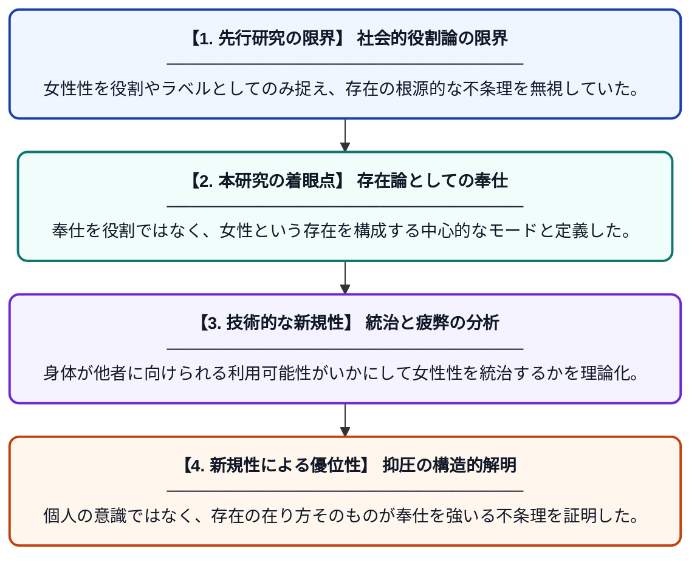

# 奉仕の存在論：疲弊、性格付け、そして女性性の統治

**Original Title**: *The Ontology of Service: Exhaustion, Characterization, and the Governance of Womanhood*

> **💡 一言要約**: 女性性とは「他者への奉仕」という存在の在り方である

| 項目 | 内容 |
|---|---|
| **著者** | A Sanchez |
| **掲載誌** | 2026 |
| **アラートキーワード** | Ontology |
| **PDF** | [https://preserve.lehigh.edu/system/files/derivatives/coverpage/509119.pdf](https://preserve.lehigh.edu/system/files/derivatives/coverpage/509119.pdf) |
| **原文リンク** | [https://preserve.lehigh.edu/system/files/derivatives/coverpage/509119.pdf](https://preserve.lehigh.edu/system/files/derivatives/coverpage/509119.pdf) |
| **PDF版要約** | [README.pdf](./README.pdf) |

---

## 📊 新規性の図解（先行研究との違いと本研究のブレークスルー）

## 📝 要約

女性性を単なる社会的アイデンティティや役割としてではなく、他者のために常に利用可能であるという「奉仕」によって構造化された存在状態（存在論）として再定義する研究です。疲弊や特定の性格付けを通じて、女性がいかにして他者へ奉仕する存在として管理・統治されているかを批判的に分析しています。

## ❓ どんな問題に取り組んだか

従来の議論では、女性性は社会的役割やアイデンティティとして捉えられがちでしたが、なぜ女性が構造的に自己を削り他者に尽くす状態に置かれ続けるのかという根本的な存在様式が十分に解明されていませんでした。特に、奉仕がどのように個人の身体や存在そのものを規定し、統治の手段となっているかが課題でした。

## ✨ 何が新しい？何がすごい？（新規性）

本論文は、女性性を「奉仕（Service）」という観点から存在論的に再構築した点が画期的です。単なる役割分担の議論を超え、女性が「常に他者のために利用可能な身体」として定義される仕組みを、疲弊や統治のプロセスと結びつけて論じています。これにより、性別の差異を社会的なラベルではなく、他者への指向性という存在の根源的なモードとして捉え直す新しい視座を提供しています。

## 🎓 大学1年生向けの解説

「女性らしさ」とは、生まれ持った性質や社会から与えられた役割だけではありません。この論文は、女性が「いつも誰かのために動ける状態でいること」自体が、女性という存在そのものを作り上げていると指摘しています。自分が疲れていても他者のために存在しなければならないという仕組みが、どのように人々の生き方を縛っているのかを哲学的に解き明かしています。簡単に言えば、「尽くすことが当たり前」とされる背景にある不平等な仕組みを考えるための研究です。
