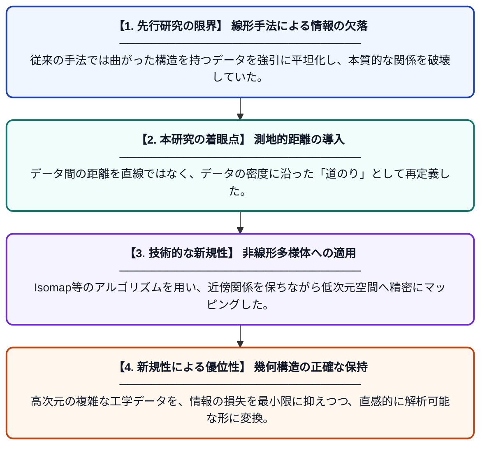

# 非線形多様体学習を用いた工学データの低次元埋め込みと解析

**Original Title**: *Results in Engineering*

> **💡 一言要約**: 高次元データの「形」を壊さずシンプルに可視化・圧縮

| 項目 | 内容 |
|---|---|
| **著者** | C Chang, S Peng, X Wang, S Zong, W Hu, H Cheng… |
| **アラートキーワード** | manifold learning |
| **PDF** | [https://pure.tudelft.nl/ws/portalfiles/portal/293153903/1-s2.0-S2590123026019341-main.pdf](https://pure.tudelft.nl/ws/portalfiles/portal/293153903/1-s2.0-S2590123026019341-main.pdf) |
| **原文リンク** | [https://pure.tudelft.nl/ws/portalfiles/portal/293153903/1-s2.0-S2590123026019341-main.pdf](https://pure.tudelft.nl/ws/portalfiles/portal/293153903/1-s2.0-S2590123026019341-main.pdf) |
| **PDF版要約** | [README.pdf](./README.pdf) |

---

## 📊 新規性の図解（先行研究との違いと本研究のブレークスルー）

## 📝 要約

複雑な高次元の工学データを解析するために、Isomapなどの非線形多様体学習手法を適用した研究です。データの測地的近傍構造を維持しながら低次元へ投影することで、本来の幾何学的特徴を保った効率的なデータ表現を実現しています。

## ❓ どんな問題に取り組んだか

従来の線形な次元削減手法（PCAなど）では、データが複雑に曲がった構造を持つ場合に、その本質的な関係性を捉えきれないという課題がありました。高次元空間におけるデータの真の近傍構造が、単純な投影によって失われてしまうことが問題視されていました。

## ✨ 何が新しい？何がすごい？（新規性）

本研究は、点と点の距離を直線距離ではなく、データ上の「道のり（測地的距離）」として捉えるIsomap等の手法を工学分野に応用しました。先行研究が抱えていた非線形データの歪みを解消し、データの幾何学的なつながりを維持したまま低次元化することに成功しています。これにより、複雑な物理現象やシステム挙動のより正確なモデル化が可能となりました。

## 🎓 大学1年生向けの解説

例えば、くしゃくしゃに丸めた紙を想像してください。紙の上の2点は、丸まった状態だと近くに見えますが、本来の紙の繋がりを辿ると遠いかもしれません。この研究は、そんな「丸まったデータ」を、破いたり歪めたりせずに綺麗に広げて、2次元や3次元の図にする技術について説明しています。これによって、人間には理解できないほど複雑な数字の羅列を、パッと見てわかる形に変えることができます。
