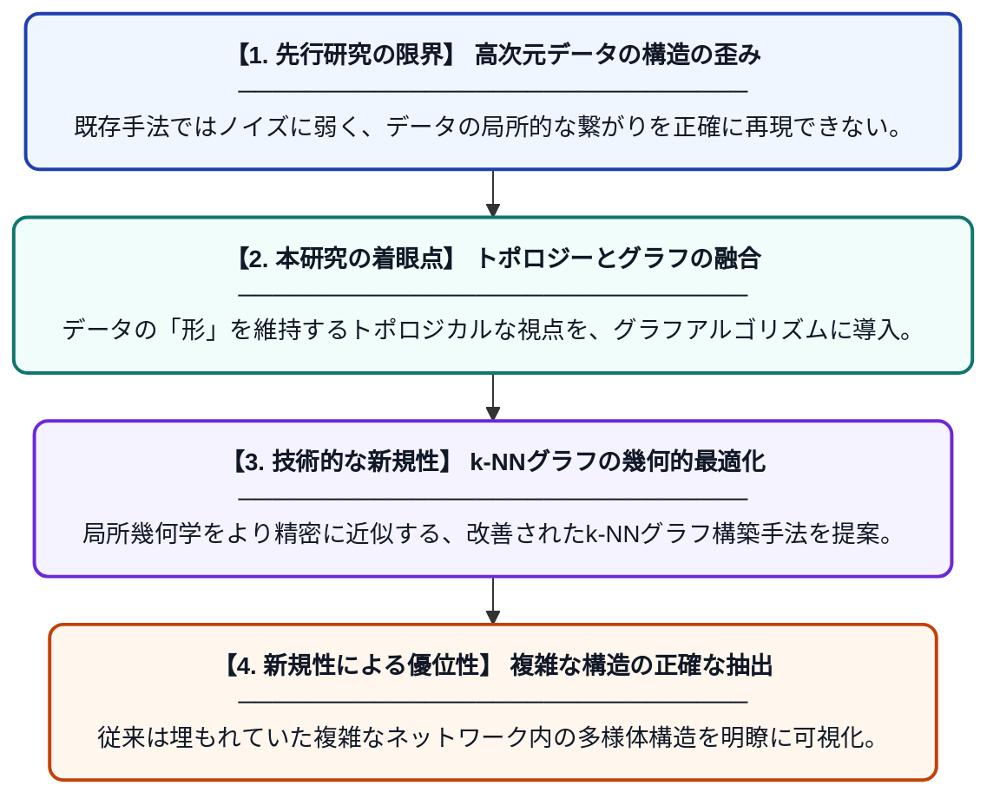

# ネットワークと高次元データにおける多様体構造の解明

**Original Title**: *Uncovering Manifold Structure in Networks and High-dimensional Data*

> **💡 一言要約**: 高次元データの背後に潜む「形」をグラフで解き明かす

| 項目 | 内容 |
|---|---|
| **著者** | H Sansford |
| **掲載誌** | 2026 |
| **アラートキーワード** | manifold learning |
| **PDF** | [https://research-information.bris.ac.uk/files/504292544/Thesis_with_corrections.pdf](https://research-information.bris.ac.uk/files/504292544/Thesis_with_corrections.pdf) |
| **原文リンク** | [https://research-information.bris.ac.uk/files/504292544/Thesis_with_corrections.pdf](https://research-information.bris.ac.uk/files/504292544/Thesis_with_corrections.pdf) |
| **PDF版要約** | [README.pdf](./README.pdf) |

---

## 📊 新規性の図解（先行研究との違いと本研究のブレークスルー）

## 📝 要約

高次元データや複雑なネットワークの背後に潜む低次元の幾何学的構造（多様体）を特定するための手法を提案しています。k-最近傍（k-NN）グラフなどのツールを活用し、トポロジカルデータ解析の視点からデータの局所的な幾何学を精密に近似するアルゴリズムを検討しています。

## ❓ どんな問題に取り組んだか

現実世界のデータは非常に高次元ですが、実際には低次元の構造（多様体）上に分布していることが多いです。しかし、既存の多様体学習アルゴリズムでは、データのノイズや複雑なネットワーク構造の影響で、局所的な幾何学を正確に捉えきれないという課題があります。

## ✨ 何が新しい？何がすごい？（新規性）

本研究は、トポロジカルデータ解析（TDA）の理論を多様体学習に深く統合することで、従来のk-NNグラフベースの手法の限界を打破しています。データの局所的なつながりをより頑健に評価する新しい計算的枠組みを導入し、従来手法では見落とされがちだった非線形な構造を高い精度で抽出できることを示しました。これにより、ネットワークデータにおける潜在的な幾何学的情報の抽出能力が大幅に向上しています。

## 🎓 大学1年生向けの解説

例えば、ぐちゃぐちゃに丸められた紙くず（高次元データ）を、破かずに元の平らな形（多様体）に戻す方法を考えています。データは一見バラバラに見えても、実は特定のルールに基づいた「形」を持っています。この研究は、数学的なグラフの仕組みを使って、その隠れた形をデジタルの世界で見つけるための新しい道具を作りました。これを使うと、複雑な情報を人間にとって理解しやすいシンプルな形に整理できるようになります。
