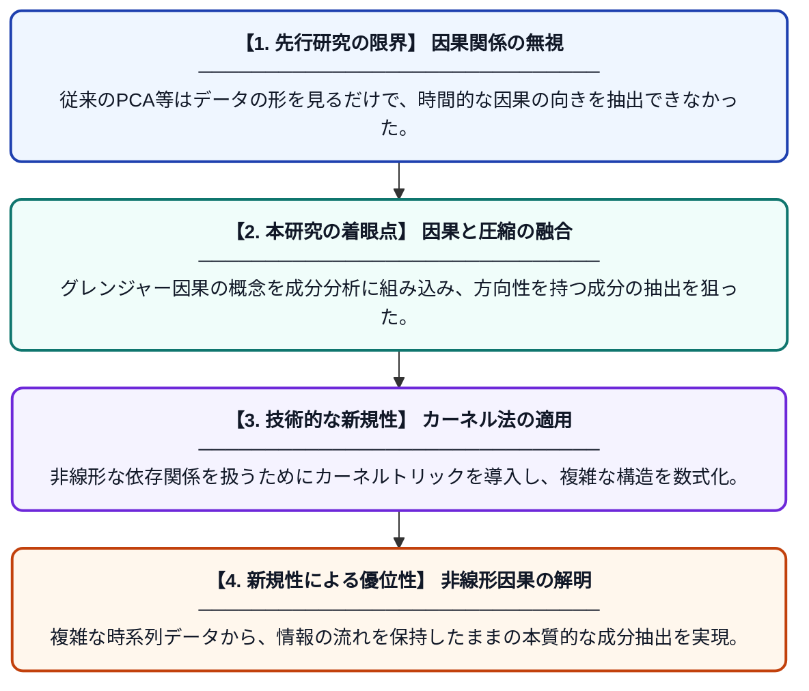

# 非線形な方向性成分発見のためのカーネル・グレンジャー成分分析

**Original Title**: *Kernel Granger Component Analysis for Nonlinear Directed Component Discovery*

> **💡 一言要約**: 因果の「向き」と「非線形性」を抽出する新しい次元圧縮法

| 項目 | 内容 |
|---|---|
| **著者** | D Francis |
| **掲載誌** | The Fortieth Annual Conference on Neural Information … |
| **アラートキーワード** | independent component ... |
| **PDF** | [https://openreview.net/pdf?id=Jx528jtKFC](https://openreview.net/pdf?id=Jx528jtKFC) |
| **原文リンク** | [https://openreview.net/pdf?id=Jx528jtKFC](https://openreview.net/pdf?id=Jx528jtKFC) |
| **PDF版要約** | [README.pdf](./README.pdf) |

---

## 📊 新規性の図解（先行研究との違いと本研究のブレークスルー）

## 📝 要約

多変量時系列データから、情報の流れ（因果関係）の向きを保持したまま低次元の成分を抽出する「カーネル・グレンジャー成分分析（KGCA）」を提案しています。従来のPCAやICAが捉えられなかった、非線形なダイナミクスと変数間の因果構造を同時に解明することが可能です。

## ❓ どんな問題に取り組んだか

従来の主成分分析（PCA）や独立成分分析（ICA）は、データの分散や独立性のみに注目しており、変数間の「時間の流れ」や「因果の方向」を考慮できませんでした。また、複雑な非線形関係を持つデータから、その背後にある因果的な構造を低次元で抽出する一般的な手法が不足していました。

## ✨ 何が新しい？何がすごい？（新規性）

統計的な因果性の指標である「グレンジャー因果」と、複雑な関係を扱える「カーネル法」を統合し、非線形なデータの背後にある方向性を持った潜在成分を抽出する理論を確立しました。これにより、単なるデータの要約に留まらず、システムの動力学的な構造を保持したまま次元を圧縮することが可能になりました。高次元かつ非線形なシステムにおいても、情報の発生源と伝達経路を特定できる点が革新的です。

## 🎓 大学1年生向けの解説

たくさんのデータから重要な情報を取り出すとき、これまでは「データの大きさ」や「バラつき」ばかりが注目されてきました。この研究はそこに「どちらが原因でどちらが結果か」という情報の順番（因果関係）を取り入れた新しい方法を開発しました。カーネル法という高度な数学を使うことで、複雑に絡み合ったデータの中からでも「情報の流れ」を正しく抜き出すことができます。これにより、脳の活動や経済の動きのような、複雑なシステムの仕組みをより深く理解できるようになります。
