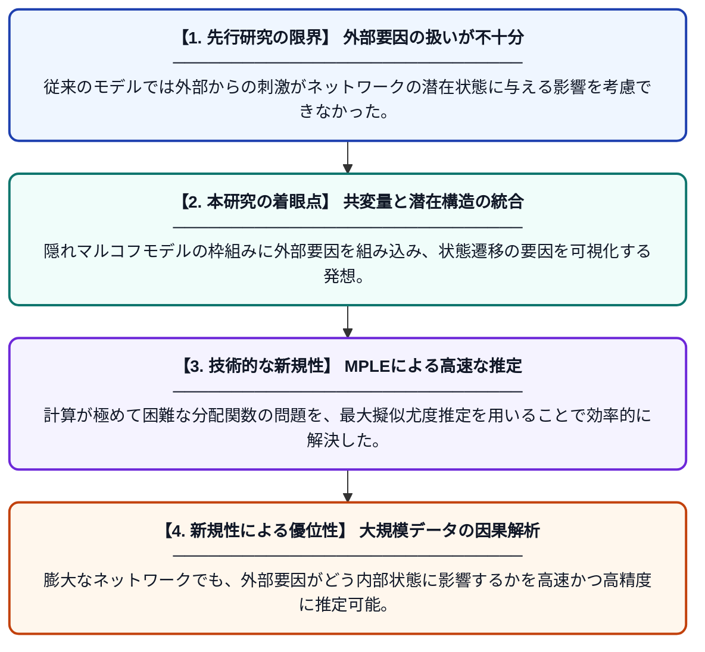

# 外生的共変量を伴う隠れマルコフ・イジングモデル

**Original Title**: *The Hidden Markov Ising Model with Exogenous Covariates*

> **💡 一言要約**: 外部要因と隠れた関係性を解き明かす新モデル

| 項目 | 内容 |
|---|---|
| **著者** | A Vinayagasothy, B Haddis, O Lopez, A Manjo… |
| **掲載誌** | arXiv preprint arXiv … 2026 |
| **アラートキーワード** | Markov random"  fields |
| **PDF** | [https://arxiv.org/pdf/2611.05213](https://arxiv.org/pdf/2611.05213) |
| **Git リポジトリ** | [https://github.com/cachelack/Hidden-Markov-Ising-Model](https://github.com/cachelack/Hidden-Markov-Ising-Model) |
| **原文リンク** | [https://arxiv.org/pdf/2611.05213](https://arxiv.org/pdf/2611.05213) |
| **PDF版要約** | [README.pdf](./README.pdf) |

---

## 📊 新規性の図解（先行研究との違いと本研究のブレークスルー）

## 📝 要約

統計物理学のイジングモデルを拡張し、外部要因（共変量）が潜在的なネットワーク構造の相互作用に与える影響を組み込んだ新しいモデルを提案しています。大規模なネットワークデータでも効率的に計算できるよう、最大擬似尤度推定法を用いることで、複雑な空間依存性の解析を可能にしました。

## ❓ どんな問題に取り組んだか

従来のイジングモデルやマルコフ確率場では、観測されない「隠れた状態」の変化や、外部からの影響（共変量）を同時に扱うことが困難でした。また、ネットワークの規模が大きくなると計算コストが爆発的に増加し、現実的な時間でパラメータを推定できないという課題がありました。

## ✨ 何が新しい？何がすごい？（新規性）

本研究は、隠れマルコフモデルとイジングモデルを統合し、さらに外部共変量を導入した「外生的HMIM」を構築した点にあります。先行研究では困難だった「外部刺激による潜在的なネットワーク状態の変化」の定式化に成功しました。さらに、計算負荷の高い正規化定数を回避する最大擬似尤度推定（MPLE）を適用し、理論的な一貫性と実用的な計算速度を両立させた点が主要な貢献です。

## 🎓 大学1年生向けの解説

この研究は、磁石の粒が隣同士で影響し合う様子を表す数式を応用して、人間関係や複雑なデータのつながりを分析する方法を開発したものです。そこに「外部からの影響（例えば気温や景気など）」を組み込むことで、直接は見えない背後の変化をより正確に予測できるようになりました。難しい計算を工夫して簡略化することで、膨大なデータでもスムーズに処理できるのが特徴です。これにより、社会の複雑な動きをデータから読み解く新しい道具が手に入ったと言えます。
