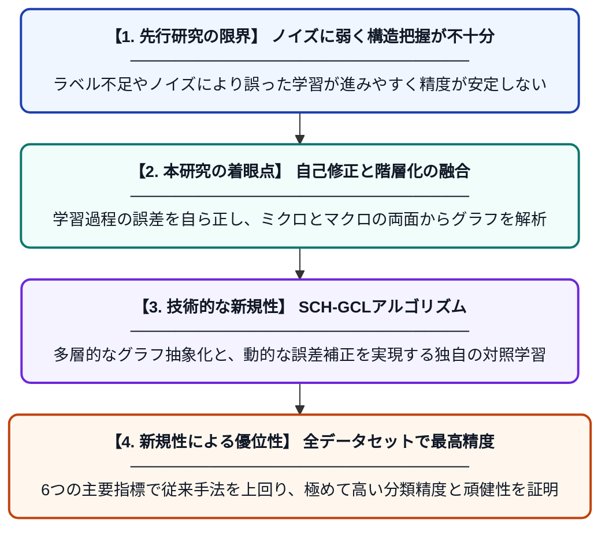

# 半教師ありノード分類のための自己修正階層型グラフ対照学習

**Original Title**: *Self-Correcting Hierarchical Graph Contrastive Learning for Semi-Supervised Node Classification*

> **💡 一言要約**: 自己修正と階層構造でグラフ分類の精度を極める

| 項目 | 内容 |
|---|---|
| **著者** | S Zhang, D Sun, J Tang, Z Ding |
| **掲載誌** | International Conference on Image and Graphics 2027 |
| **アラートキーワード** | Semi supervise |
| **原文リンク** | [https://link.springer.com/chapter/10.1007/978-981-92-7195-5_11](https://link.springer.com/chapter/10.1007/978-981-92-7195-5_11) |
| **PDF版要約** | [README.pdf](./README.pdf) |

---

## 📊 新規性の図解（先行研究との違いと本研究のブレークスルー）

## 📝 要約

本論文は、グラフデータにおけるノード分類の精度を向上させるため、自己修正機能を備えた階層型グラフ対照学習（SCH-GCL）を提案しています。ラベルが少ない環境でも、グラフの階層構造を捉えつつ学習時の誤差を自ら修正する仕組みを導入し、主要な6つのデータセットすべてで最高精度を達成しました。

## ❓ どんな問題に取り組んだか

従来のグラフ対照学習では、ラベルが不足している場合にデータのノイズや負例のサンプリングミスによる影響を受けやすく、精度が低下する課題がありました。また、グラフの局所的な情報だけでなく、広域的な階層構造を効率的に学習プロセスに取り入れる手法が求められていました。

## ✨ 何が新しい？何がすごい？（新規性）

本研究の核心は、階層的なグラフ構造の表現学習と「自己修正メカニズム」を統合した点にあります。先行研究とは異なり、学習過程で発生する誤った予測や不整合を動的に補正する仕組みを導入することで、ノイズの多いグラフデータに対しても極めて高い頑健性を獲得しました。これにより、複雑なグラフネットワークにおける特徴抽出の精度を劇的に向上させ、6つのベンチマークで従来手法を凌駕する結果を示しました。

## 🎓 大学1年生向けの解説

SNSの友人関係のような「つながり」のデータから、各ユーザーの属性を当てるAIの研究です。これまでは一部のデータに間違いがあるとAIも混乱していましたが、この研究では「自分の間違いを自分で直しながら学ぶ」という賢い仕組みを取り入れました。さらに、個人のつながりだけでなく、グループ全体のつながりも多層的に見ることで、より正確に予測できるようになっています。パズルを解くときに、一箇所の間違いを修正しながら全体像を把握するようなイメージです。
