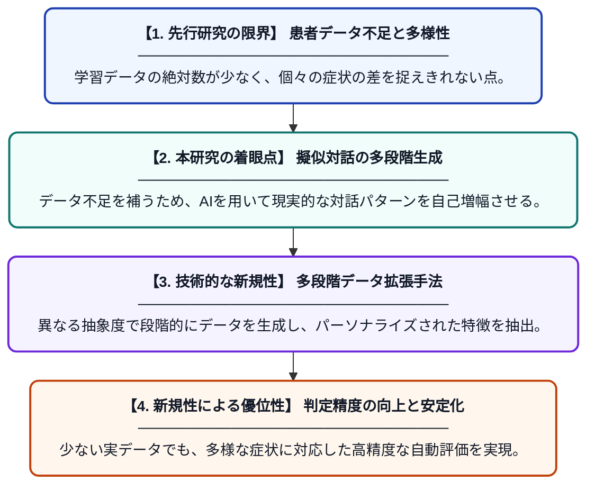

# 多段階データ拡張を用いた双極性障害評価のためのパーソナライズされた対話ベースシステム

**Original Title**: *A Personalized Dialogue-Based System for Bipolar Disorder Assessment Using Multi-Stage Data Augmentation*

> **💡 一言要約**: 多段階データ拡張で双極性障害を精度良く判定

| 項目 | 内容 |
|---|---|
| **著者** | CS Xue, CH Wu, CC Chen |
| **掲載誌** | IEEE Transactions on Affective Computing 2026 |
| **アラートキーワード** | affective computing |
| **原文リンク** | [https://www.computer.org/csdl/journal/ta/5555/01/11780588/2lc4ayznYXe](https://www.computer.org/csdl/journal/ta/5555/01/11780588/2lc4ayznYXe) |
| **PDF版要約** | [README.pdf](./README.pdf) |

---

## 📊 新規性の図解（先行研究との違いと本研究のブレークスルー）

## 📝 要約

双極性障害の診断を支援するため、患者との自然な対話を通じて状態を評価するAIシステムを提案しています。データ不足の課題を克服するために多段階のデータ拡張手法を導入し、個々の患者の特性に合わせた精度の高い評価を実現しました。

## ❓ どんな問題に取り組んだか

双極性障害の評価には継続的なモニタリングが必要ですが、専門家による対面診断は頻繁に行うことが困難です。また、機械学習モデルを構築するための高品質な患者データが慢性的に不足していることや、個々の症状の多様性に対応しきれないという課題がありました。

## ✨ 何が新しい？何がすごい？（新規性）

本研究は、不足しているデータを補うために「多段階データ拡張（Multi-Stage Data Augmentation）」を導入し、現実的な対話シナリオを生成した点が画期的です。単なるデータ増量ではなく、個人の特性（パーソナライズ）を考慮した対話生成を行うことで、先行研究よりも高い評価精度を達成しました。これにより、専門家の介入を最小限に抑えつつ、日常的な自動モニタリングを可能にしています。

## 🎓 大学1年生向けの解説

双極性障害（躁うつ病）は気分の波が激しい病気ですが、自分だけで状態を正確に把握するのは簡単ではありません。そこでこの研究では、AIがスマホなどを通じて優しく話しかけてくれる仕組みを作りました。AIはたくさんの会話データを学習しており、その人特有の話し方の変化から「今は躁状態かな？うつ状態かな？」と予測します。データが少なくても賢く学習できる工夫をしているので、精度の高いチェックが可能です。
