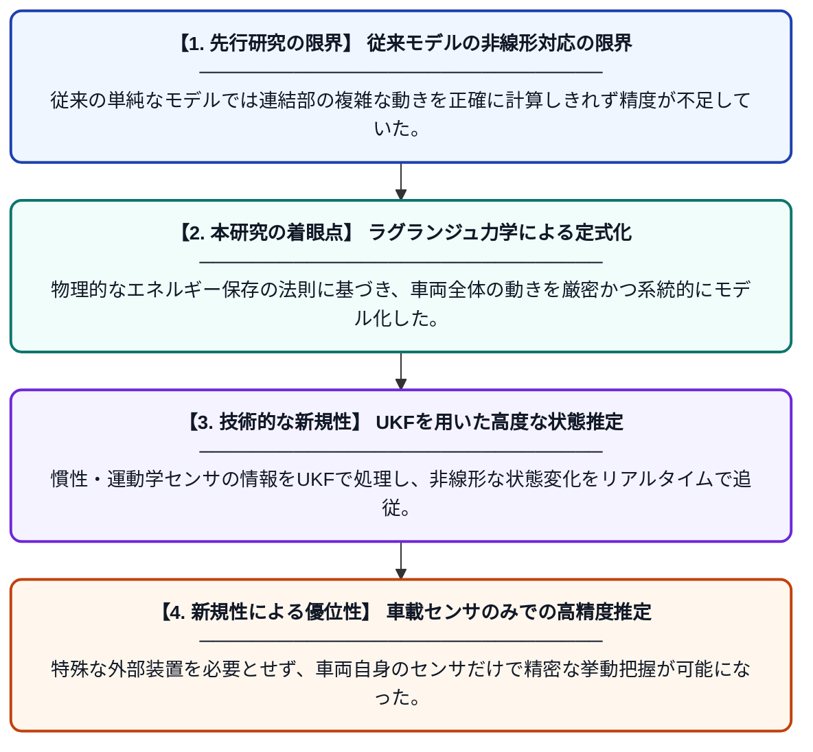

# 連結車両における乗員の挙動および車両状態の推定

**Original Title**: *State Estimation of Articulated Passenger*

> **💡 一言要約**: ラグランジュ力学で連結車両の挙動を精密に推定

| 項目 | 内容 |
|---|---|
| **著者** | R Gao, Y Jia¹, S Zhou, T Gordon |
| **掲載誌** | Advances in Dynamics of Vehicles on Roads and … 2026 |
| **アラートキーワード** | kalman filter |
| **原文リンク** | [https://books.google.com/books?hl=ja&lr=lang_ja|lang_en&id=cdQoEgAAQBAJ&oi=fnd&pg=PA381&dq="kalman+filter"&ots=_S1h4TpTSV&sig=FMv_PKbQKndAr4--dHc9VFPPX_k](https://books.google.com/books?hl=ja&lr=lang_ja|lang_en&id=cdQoEgAAQBAJ&oi=fnd&pg=PA381&dq="kalman+filter"&ots=_S1h4TpTSV&sig=FMv_PKbQKndAr4--dHc9VFPPX_k) |
| **PDF版要約** | [README.pdf](./README.pdf) |

---

## 📊 新規性の図解（先行研究との違いと本研究のブレークスルー）

## 📝 要約

ラグランジュ力学から導出されたカルマンフィルタに基づく、連結車両の状態推定アルゴリズムを提案しています。車載の慣性センサおよび運動学センサからの観測データを活用し、アンセンテッド・カルマンフィルタ（UKF）を用いることで、複雑な車両挙動の高精度な把握を実現しました。

## ❓ どんな問題に取り組んだか

連結車両は複数の車体が結合されているため構造が複雑であり、走行中の各節の相対的な動きや姿勢を正確に把握することが困難です。従来の推定手法では、非線形な挙動やセンサのノイズに対して、計算の安定性と精度の両立が大きな課題となっていました。

## ✨ 何が新しい？何がすごい？（新規性）

ラグランジュ力学に基づく動的な物理モデルを状態推定の基盤に組み込み、物理的な整合性と計算効率を高いレベルで両立させた点が画期的です。先行研究では扱いきれなかった複雑な拘束条件をモデル化し、アンセンテッド・カルマンフィルタ（UKF）を適用することで、高度な非線形性を持つ連結部の挙動を車載センサのみで特定することに成功しました。これにより、外部計測機器に頼らず実用的な環境で精密な状態把握を可能にしました。

## 🎓 大学1年生向けの解説

2つの車体が繋がったバスのような「連結車両」が、曲がったり揺れたりするときの複雑な動きを数学で解き明かす研究です。研究チームは、バスに備え付けられたセンサーの情報から、今車両がどのような状態にあるかを瞬時に計算する新しい仕組みを作りました。難しい物理の法則（ラグランジュ力学）を計算式に取り入れることで、計算のズレを抑え、より正確な予測ができるようになっています。これが進化すれば、将来の連結バスの自動運転や乗り心地の改善に役立ちます。
