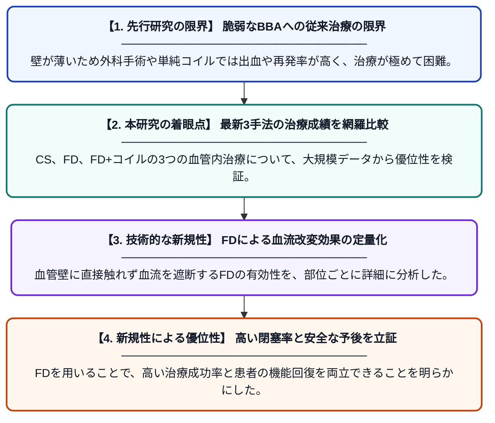

# 破裂性水疱状動脈瘤に対する治療戦略：カバードステント、フローダイバーター、コイル併用フローダイバーターのメタ解析

**Original Title**: *Treatment Strategies for Ruptured Blister-like Aneurysms: A Meta-analysis of Covered Stent, Flow Diverter, and Flow Diverter with Adjunctive Coiling*

> **💡 一言要約**: BBA治療、フローダイバーターが予後改善の鍵に

| 項目 | 内容 |
|---|---|
| **著者** | X Guo, X Meng, CH Li |
| **掲載誌** | Frontiers in Neurology |
| **アラートキーワード** | ICA |
| **原文リンク** | [https://www.frontiersin.org/journals/neurology/articles/10.3389/fneur.2026.1905048/full](https://www.frontiersin.org/journals/neurology/articles/10.3389/fneur.2026.1905048/full) |
| **PDF版要約** | [README.pdf](./README.pdf) |

---

## 📊 新規性の図解（先行研究との違いと本研究のブレークスルー）

## 📝 要約

破裂性水疱状動脈瘤（BBA）に対する3つの主要な血管内治療の有効性と安全性を347名の患者データに基づき比較しました。解析の結果、フローダイバーター（FD）を用いた治療は80%以上の高い完全閉塞率と良好な予後を示し、BBA治療における有力な選択肢であることが示唆されました。

## ❓ どんな問題に取り組んだか

水疱状動脈瘤（BBA）は血管壁が極めて脆弱で壊れやすく、従来の外科的手術や単純なコイル塞栓術では再発や出血のリスクが高い難治性の病態です。カバードステント（CS）やフローダイバーター（FD）などの新しい治療法が登場していますが、どの手法が最も治療成績に優れているか、統一した見解が得られていませんでした。

## ✨ 何が新しい？何がすごい？（新規性）

本研究は、BBAに対する複数の血管内治療（CS、FD、FD+コイル）を直接比較した最大規模のメタ解析の一つです。従来手法と比較して、フローダイバーター単独、またはコイルを併用することで、脆弱な血管壁への物理的ストレスを抑えつつ、80%を超える高い血管閉塞率と良好な臨床予後を両立できることを定量的に証明した点に大きな価値があります。内頸動脈以外の希少な部位への適用についても検討を行っています。

## 🎓 大学1年生向けの解説

脳の血管にできる「水疱」のような動脈瘤は、壁がとても薄く、手術中に破れる危険がある非常に厄介な病気です。この研究では、最新の網目状の筒（ステント）を血管に入れて血流をコントロールする治療法が、従来の治療よりも安全で治りやすいことを、多くの患者さんのデータを集めて証明しました。これにより、医師が難しい脳の病気に対して、どの道具を使うのが一番良いかを判断するための重要な基準ができました。
