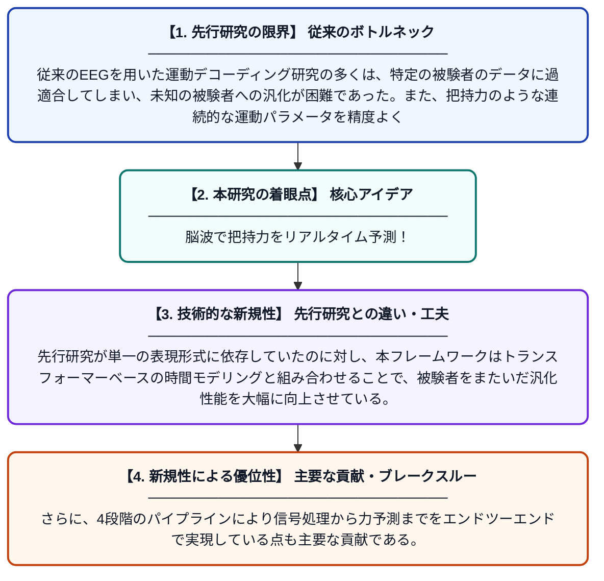

# EEGForceFusion：被験者非依存の把持力デコーディングのためのトークン化・連続表現の統合学習

**Original Title**: *EEGForceFusion: Joint Tokenised-Continuous Representation Learning for Subject-Independent Grasp Force Decoding*

> **💡 一言要約**: 脳波で把持力をリアルタイム予測！

| 項目 | 内容 |
|---|---|
| **著者** | SS Turankar, YK Meena |
| **掲載誌** | arXiv preprint arXiv:2607.24126 2026 |
| **アラートキーワード** | representation learning |
| **PDF** | [https://arxiv.org/pdf/2607.24126](https://arxiv.org/pdf/2607.24126) |
| **Git リポジトリ** | [https://github.com/HAIx-Lab/EEGForceFusion](https://github.com/HAIx-Lab/EEGForceFusion) |
| **原文リンク** | [https://arxiv.org/abs/2607.24126](https://arxiv.org/abs/2607.24126) |
| **PDF版要約** | [README.pdf](./README.pdf) |

---

## 📊 新規性の図解（先行研究との違いと本研究のブレークスルー）

## 📝 要約

本論文は、脳波（EEG）信号から手の把持力をリアルタイムで予測するためのフレームワーク「EEGForceFusion」を提案している。信号の前処理・エンコーダによる埋め込み、離散トークン化、トランスフォーマーによる時系列モデリングの4段階で構成されており、特定の被験者に依存せず汎化できる点が特徴である。表現学習とトランスフォーマーベースの時間モデリングを組み合わせることで、連続的な把持力の予測精度向上を目指している。

## ❓ どんな問題に取り組んだか

従来のEEGを用いた運動デコーディング研究の多くは、特定の被験者のデータに過適合してしまい、未知の被験者への汎化が困難であった。また、把持力のような連続的な運動パラメータを精度よく推定することは、信号のノイズや個人差により非常に難しい課題であった。

## ✨ 何が新しい？何がすごい？（新規性）

本研究の新規性は、離散トークン化表現と連続表現の両方を統合した「ジョイント表現学習」をEEGデコーディングに初めて適用した点にある。先行研究が単一の表現形式に依存していたのに対し、本フレームワークはトランスフォーマーベースの時間モデリングと組み合わせることで、被験者をまたいだ汎化性能を大幅に向上させている。さらに、4段階のパイプラインにより信号処理から力予測までをエンドツーエンドで実現している点も主要な貢献である。

## 🎓 大学1年生向けの解説

人間が物を掴むとき、脳からは微弱な電気信号（脳波）が発生します。この研究では、その脳波を頭皮上のセンサーで計測し、どのくらいの力で物を握っているかをコンピュータが予測する技術を開発しました。特に難しいのは、人によって脳波のパターンが全く異なる点で、この研究ではその個人差を乗り越えて誰にでも使える手法を提案しています。文章の翻訳技術でも使われる「トランスフォーマー」という最新のAI技術を応用することで、精度の高い予測を実現しました。この技術が進めば、義手のコントロールなど、身体に障害を持つ方を助けるリハビリ機器への応用が期待されます。
