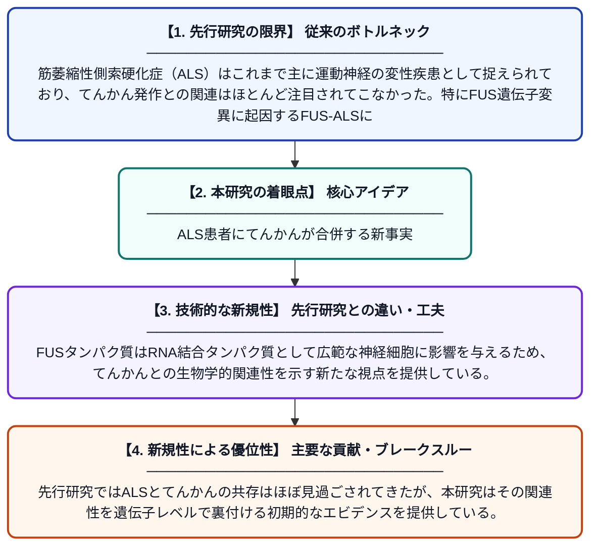

# 焦点性てんかんがFUS遺伝子変異に関連する筋萎縮性側索硬化症の表現型を拡大する

**Original Title**: *Focal epilepsy expands the phenotype of FUS‐associated amyotrophic lateral sclerosis*

> **💡 一言要約**: ALS患者にてんかんが合併する新事実

| 項目 | 内容 |
|---|---|
| **著者** | Y Jia, B Cui, Y Liang, M Zhang, S Wang, Y Wang |
| **掲載誌** | Epilepsia 2026 |
| **アラートキーワード** | ALS |
| **原文リンク** | [https://onlinelibrary.wiley.com/doi/abs/10.1002/epi.70409](https://onlinelibrary.wiley.com/doi/abs/10.1002/epi.70409) |
| **PDF版要約** | [README.pdf](./README.pdf) |

---

## 📊 新規性の図解（先行研究との違いと本研究のブレークスルー）

## 📝 要約

本研究では、遺伝子検査でFUS変異が確認された25歳の男性ALS患者が頻繁なてんかん発作を併発した症例を報告している。FUS関連ALS（FUS-ALS）においててんかんが生じる可能性とその潜在的な関連メカニズムを探索することを目的としている。この症例はFUS-ALSの臨床的な表現型が従来考えられていたよりも広い可能性を示唆している。

## ❓ どんな問題に取り組んだか

筋萎縮性側索硬化症（ALS）はこれまで主に運動神経の変性疾患として捉えられており、てんかん発作との関連はほとんど注目されてこなかった。特にFUS遺伝子変異に起因するFUS-ALSにおいて、てんかんが臨床症状として出現するケースは極めて稀であり、その機序も不明であった。

## ✨ 何が新しい？何がすごい？（新規性）

本報告は、FUS-ALSにてんかん発作が合併した症例を詳細に記述した稀少な事例であり、FUS-ALSの臨床的表現型を運動障害以外の領域にまで拡張する可能性を提示している。FUSタンパク質はRNA結合タンパク質として広範な神経細胞に影響を与えるため、てんかんとの生物学的関連性を示す新たな視点を提供している。先行研究ではALSとてんかんの共存はほぼ見過ごされてきたが、本研究はその関連性を遺伝子レベルで裏付ける初期的なエビデンスを提供している。

## 🎓 大学1年生向けの解説

ALS（筋萎縮性側索硬化症）は筋肉を動かす神経が壊れていく難病で、FUSという遺伝子の変異が原因の一つとして知られています。この研究では、FUS変異を持つ25歳のALS患者さんが、てんかん発作も繰り返したという珍しいケースを報告しています。てんかんは脳の電気信号が乱れることで起きる発作で、これまでALSとはあまり結びつけて考えられていませんでした。この症例は、ALSが単なる運動神経の病気ではなく、もっと広い脳の機能に影響しうることを示しているかもしれません。
