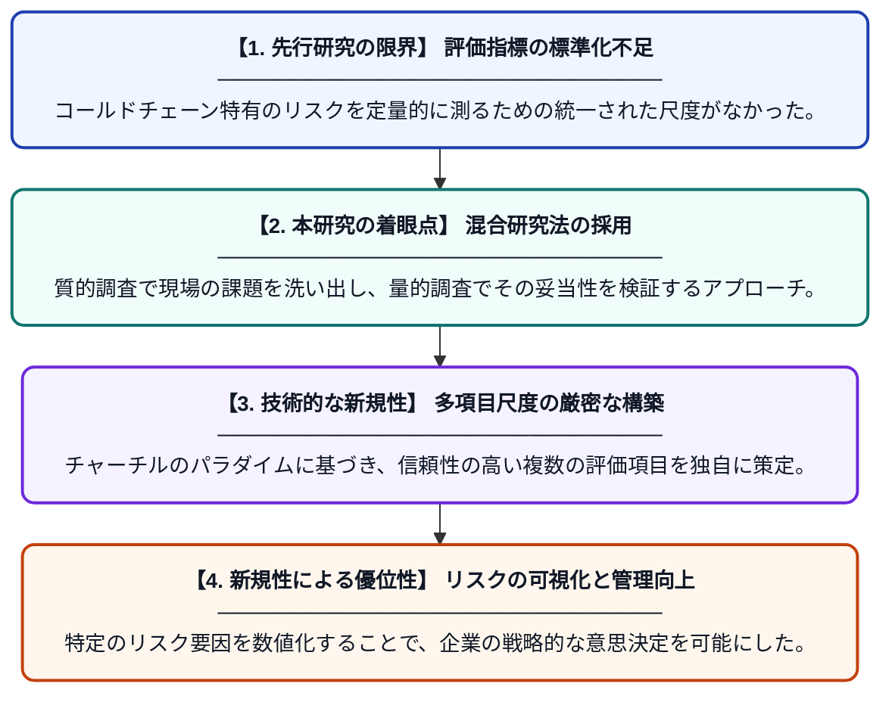

# コールドチェーン物流におけるサプライチェーン・リスク・エクスポージャー：尺度の開発と妥当性の検証

**Original Title**: *Supply Chain Risk Exposure: Scale Development and Validation in Cold Chain Logistics*

> **💡 一言要約**: 冷たい物流のリスクを数値化する新指標の開発

| 項目 | 内容 |
|---|---|
| **著者** | B Zhang |
| **掲載誌** | Sage Open 2026 |
| **アラートキーワード** | logistics |
| **PDF** | [https://journals.sagepub.com/doi/pdf/10.1177/21582440261510192](https://journals.sagepub.com/doi/pdf/10.1177/21582440261510192) |
| **原文リンク** | [https://journals.sagepub.com/doi/pdf/10.1177/21582440261510192](https://journals.sagepub.com/doi/pdf/10.1177/21582440261510192) |
| **PDF版要約** | [README.pdf](./README.pdf) |

---

## 📊 新規性の図解（先行研究との違いと本研究のブレークスルー）

## 📝 要約

本研究は、厳格な温度管理が求められるコールドチェーン物流を対象に、サプライチェーン・リスク・エクスポージャー（SCRE）を定量化するための多項目尺度を開発しました。チャーチルの尺度開発手法に基づき、質的調査と量的調査を組み合わせることで、業界特有のリスクを客観的に測定できる信頼性の高い評価ツールを構築しました。

## ❓ どんな問題に取り組んだか

コールドチェーン物流は商品の品質維持のために高い専門性が求められ、多くのリスクを抱えていますが、そのリスクへの「さらされ具合（エクスポージャー）」を測定する標準的な基準が不足していました。このため、企業は自社のリスクを客観的に把握し、適切な管理戦略を立てることが困難な状況にありました。

## ✨ 何が新しい？何がすごい？（新規性）

本研究の最大の貢献は、これまで曖昧だったコールドチェーンにおけるリスク概念を、現場の実態に即した具体的な多項目尺度として定義し、その妥当性を厳密に検証した点にあります。質的・量的な混合研究法を用いることで、先行研究では不十分だった「業界特有のリスク要因」を網羅的に捉えることに成功しました。これにより、主観に頼らない科学的なリスク評価の基盤を確立した点が極めて重要です。

## 🎓 大学1年生向けの解説

アイスやお肉などを運ぶ「コールドチェーン（冷凍・冷蔵物流）」は、温度が変わると商品がダメになるため、普通よりも高いリスクがあります。この論文は、そのリスクがどれくらいあるのかを「共通の物差し」で測れるようにする新しい方法を開発しました。これを使うことで、運送会社は自分たちがどこに弱点があるのかを数字で確認し、事故を防ぐための準備をより正しく行えるようになります。
