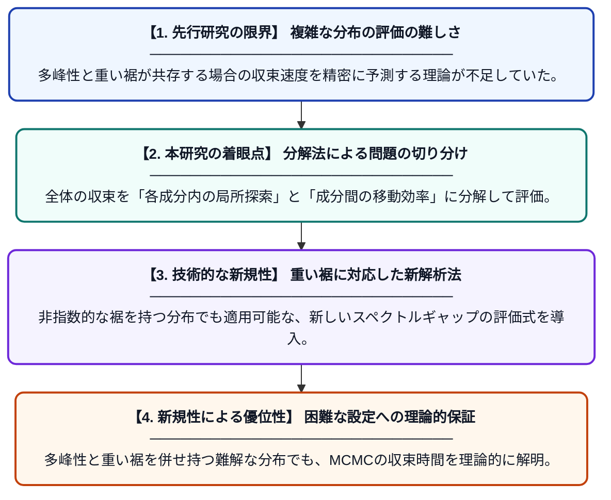

# 混合標的分布に対するMCMCの分解限界：多峰性と重い裾の性質

**Original Title**: *Decomposition Bounds for MCMC with Mixture Targets: Multimodality and Heavy-Tailedness*

> **💡 一言要約**: 多峰・重裾分布のMCMC収束を分解し理論解明

| 項目 | 内容 |
|---|---|
| **著者** | Q Qin |
| **掲載誌** | arXiv preprint arXiv:2611.20513 2026 |
| **アラートキーワード** | MCMC |
| **PDF** | [https://arxiv.org/pdf/2611.20513](https://arxiv.org/pdf/2611.20513) |
| **原文リンク** | [https://arxiv.org/pdf/2611.20513](https://arxiv.org/pdf/2611.20513) |
| **PDF版要約** | [README.pdf](./README.pdf) |

---

## 📊 新規性の図解（先行研究との違いと本研究のブレークスルー）

## 📝 要約

この論文は、混合分布を標的とするマルコフ連鎖モンテカルロ法（MCMC）の収束速度を、局所的な探索と広域的な移動の2つの要素に分解して解析する理論を提示しています。特に、分布が複数の「山（モード）」を持つ多峰性や、裾が長く極端な値が出やすい「重い裾」を持つ場合に、アルゴリズムの収束がどのように制限されるかを数学的に解明しました。

## ❓ どんな問題に取り組んだか

MCMCは複雑な統計モデルからサンプルを得るために不可欠ですが、ターゲットが複数の離れたピークを持っていたり、裾が非常に長かったりすると、探索が極めて遅くなることが知られています。これまで、これら2つの困難な性質が組み合わさった場合に、アルゴリズム全体がどの程度の速度で収束するのかを厳密に評価する一般的な枠組みが不足していました。

## ✨ 何が新しい？何がすごい？（新規性）

本研究は、混合分布の収束率を「各成分内での収束」と「成分間の移動（重み付けされた行列の第2固有値）」に分解する手法を発展させ、多峰性と重い裾の両方を同時に扱う理論的境界を導出しました。先行研究の多くは特定の条件下でのみ有効でしたが、本論文はより広範なマルコフカーネルと非指数的な裾を持つ分布に適用可能な汎用的な枠組みを提供しています。これにより、特定の標的分布に対してMCMCがいつ理論的な限界に達するかをより正確に予測可能にしました。

## 🎓 大学1年生向けの解説

統計学では、シミュレーションを使って複雑な分布からサンプルを取る「MCMC」という手法をよく使います。しかし、分布の「山」が複数に分かれていたり、非常に珍しい値が時々現れるような設定では、シミュレーションがいつ終わるか予想するのが非常に大変です。この論文は、その難しさを「山の中を調べる時間」と「山から山へ飛び移る時間」に分けて考えることで、計算が終わるまでの時間を数学的に計算する方法を発明しました。これにより、より正確で効率的なシミュレーションの設計が可能になります。
