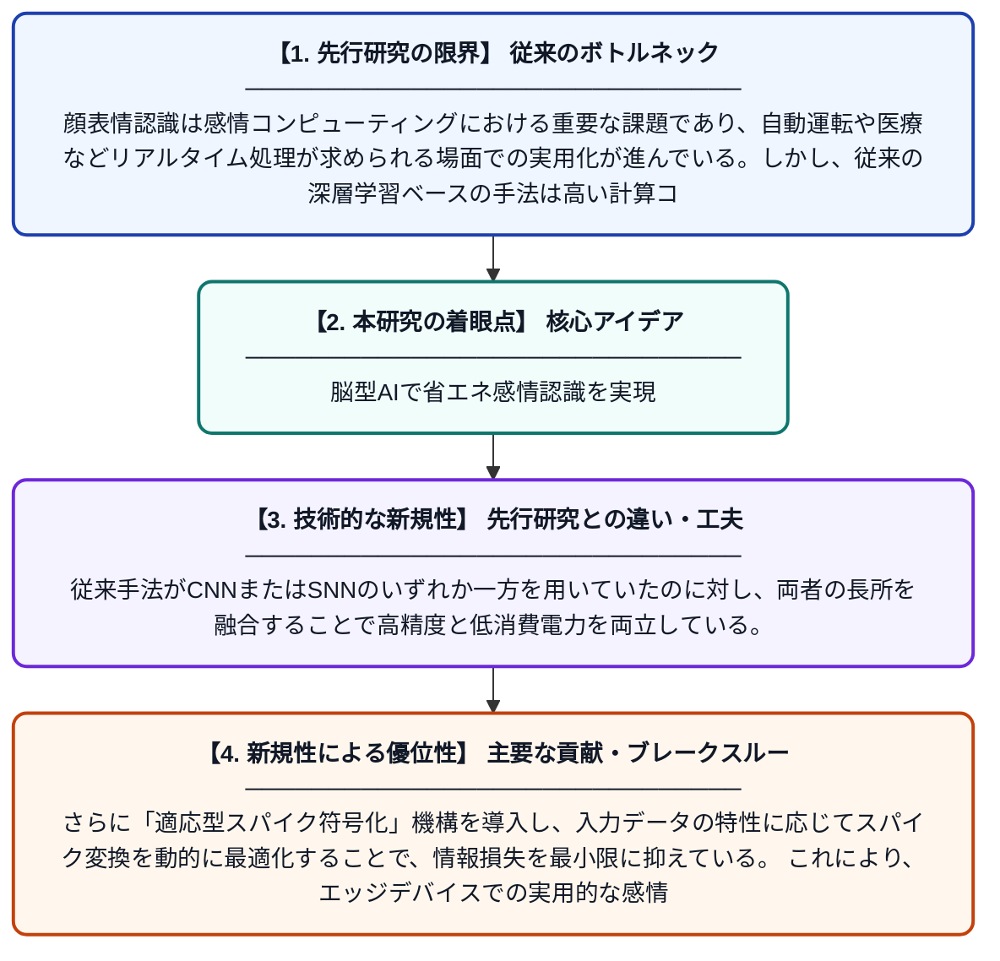

# エネルギー効率の高い顔表情認識のための適応型スパイク符号化ハイブリッドCNN–SNNフレームワーク

**Original Title**: *Adaptive Spike-Encoded Hybrid CNN–SNN Framework for Energy-Efficient Facial Emotion Recognition*

> **💡 一言要約**: 脳型AIで省エネ感情認識を実現

| 項目 | 内容 |
|---|---|
| **著者** | A Taliwal, R Gupta |
| **掲載誌** | Proceedings of the International Conference on Intelligent Computing 2026 |
| **アラートキーワード** | affective computing |
| **PDF** | [https://www.atlantis-press.com/article/126026214.pdf](https://www.atlantis-press.com/article/126026214.pdf) |
| **原文リンク** | [https://www.atlantis-press.com/article/126026214.pdf](https://www.atlantis-press.com/article/126026214.pdf) |
| **PDF版要約** | [README.pdf](./README.pdf) |

---

## 📊 新規性の図解（先行研究との違いと本研究のブレークスルー）

## 📝 要約

本論文は、顔の表情から感情を認識する「顔表情認識（FER）」において、従来の畳み込みニューラルネットワーク（CNN）と脳型のスパイキングニューラルネットワーク（SNN）を組み合わせたハイブリッドフレームワークを提案する。スパイク符号化という手法を適応的に用いることで、認識精度を維持しながら大幅な省エネルギー化を実現している。スマート監視、医療モニタリング、運転支援システムなど幅広い応用分野への展開が期待される。

## ❓ どんな問題に取り組んだか

顔表情認識は感情コンピューティングにおける重要な課題であり、自動運転や医療などリアルタイム処理が求められる場面での実用化が進んでいる。しかし、従来の深層学習ベースの手法は高い計算コストと消費電力を要するため、組み込みデバイスやエッジ環境への展開が難しいという問題がある。精度と省エネルギーを同時に達成する軽量なモデルの開発が強く求められていた。

## ✨ 何が新しい？何がすごい？（新規性）

本研究の新規性は、特徴抽出が得意なCNNと、生体脳の神経活動を模倣してスパイク（パルス）で情報を伝えるSNNを組み合わせた「ハイブリッドアーキテクチャ」を提案した点にある。従来手法がCNNまたはSNNのいずれか一方を用いていたのに対し、両者の長所を融合することで高精度と低消費電力を両立している。さらに「適応型スパイク符号化」機構を導入し、入力データの特性に応じてスパイク変換を動的に最適化することで、情報損失を最小限に抑えている。これにより、エッジデバイスでの実用的な感情認識システムの実現に向けた重要な貢献をもたらしている。

## 🎓 大学1年生向けの解説

人間の顔の表情を見て「嬉しい」「悲しい」などの感情をコンピューターに自動で判断させる技術を「顔表情認識」といいます。この研究では、画像認識が得意な従来のAI（CNN）と、人間の脳の神経細胞の働きを真似た省エネ型AI（SNN）を組み合わせた新しい仕組みを作りました。脳の神経細胞は「ビビビ」とパルス信号（スパイク）でやり取りするため、常に電気を流す従来のAIより消費電力がずっと少なくて済みます。この2つのAIをうまくつなぐ「適応型スパイク符号化」という工夫を加えることで、精度を落とさずに省エネを達成しました。将来的には、スマートフォンや車載カメラなど小型デバイスにも搭載できる感情認識システムへの応用が期待されます。
