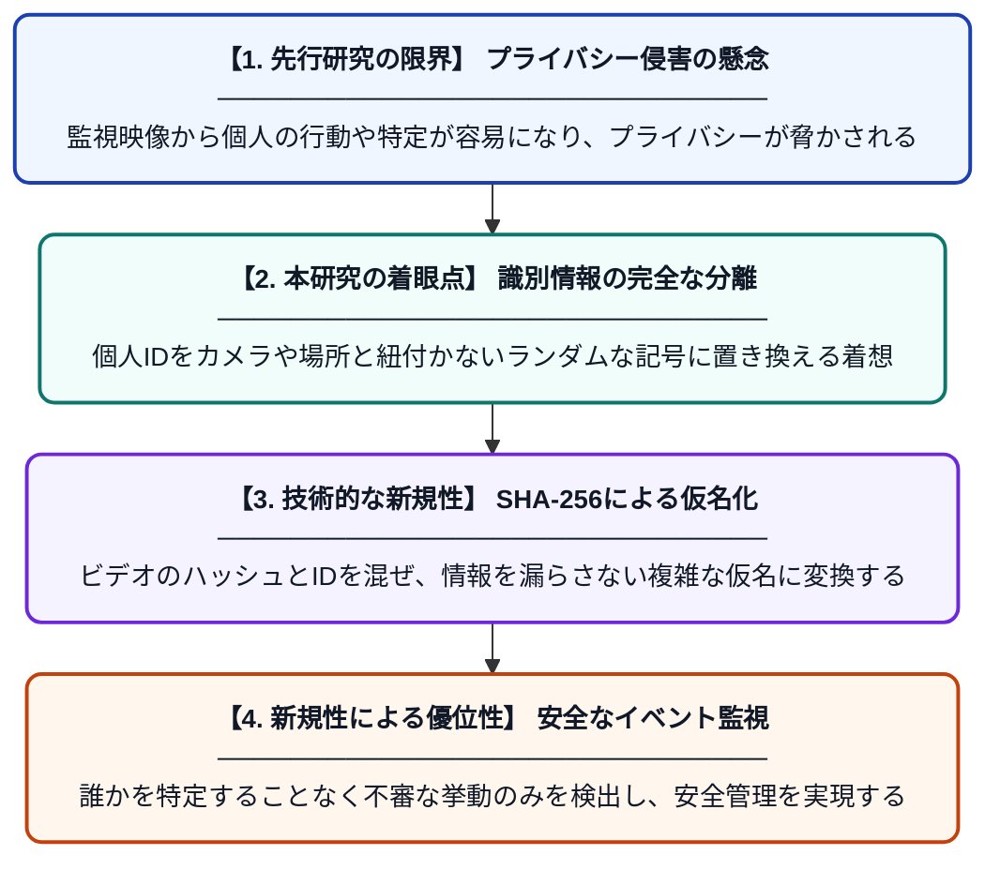

# Raqeeb：メガイベントにおける先端的セキュリティのためのプライバシー保護型AIビデオ解析

**Original Title**: *Raqeeb: Privacy-Preserving AI Video Analytics for Proactive Security at Mega-Events*

> **💡 一言要約**: 匿名化AIでイベントの安全とプライバシーを両立

| 項目 | 内容 |
|---|---|
| **著者** | Z Albalawi |
| **掲載誌** | 2026 |
| **アラートキーワード** | Multi Camera Tracking |
| **PDF** | [https://www.researchgate.net/profile/Ziad-Albalawi/publication/416882078_Raqeeb_Privacy-Preserving_AI_Video_Analytics_for_Proactive_Security_at_Mega-_Events/links/6adf40ad0fef1c1d0a0bedac/Raqeeb-Privacy-Preserving-AI-Video-Analytics-for-Proactive-Security-at-Mega-Events.pdf](https://www.researchgate.net/profile/Ziad-Albalawi/publication/416882078_Raqeeb_Privacy-Preserving_AI_Video_Analytics_for_Proactive_Security_at_Mega-_Events/links/6adf40ad0fef1c1d0a0bedac/Raqeeb-Privacy-Preserving-AI-Video-Analytics-for-Proactive-Security-at-Mega-Events.pdf) |
| **原文リンク** | [https://www.researchgate.net/profile/Ziad-Albalawi/publication/416882078_Raqeeb_Privacy-Preserving_AI_Video_Analytics_for_Proactive_Security_at_Mega-_Events/links/6adf40ad0fef1c1d0a0bedac/Raqeeb-Privacy-Preserving-AI-Video-Analytics-for-Proactive-Security-at-Mega-Events.pdf](https://www.researchgate.net/profile/Ziad-Albalawi/publication/416882078_Raqeeb_Privacy-Preserving_AI_Video_Analytics_for_Proactive_Security_at_Mega-_Events/links/6adf40ad0fef1c1d0a0bedac/Raqeeb-Privacy-Preserving-AI-Video-Analytics-for-Proactive-Security-at-Mega-Events.pdf) |
| **PDF版要約** | [README.pdf](./README.pdf) |

---

## 📊 新規性の図解（先行研究との違いと本研究のブレークスルー）

## 📝 要約

大規模イベントにおいて、個人のプライバシーを侵害することなくAIによる高度な監視を実現するシステム「Raqeeb」を提案しています。SHA-256ハッシュを活用して個人の追跡IDを匿名の仮名に変換し、場所や個人情報と紐付けない新しいデータ処理手法を導入しました。

## ❓ どんな問題に取り組んだか

大規模イベントでのセキュリティ監視は不可欠ですが、AIによるビデオ解析は個人の行動履歴やアイデンティティを暴くリスクがあり、プライバシー保護が課題でした。従来のシステムでは、カメラの設置場所や追跡データから、特定の個人が容易に割り出されてしまう危険性がありました。

## ✨ 何が新しい？何がすごい？（新規性）

ソースビデオのハッシュ値とトラッカーIDを組み合わせ、SHA-256を用いた「P-NNNN」形式の公開仮名へマッピングする独自のレジストリ手法を開発しました。この仮名はカメラ番号や位置情報を一切含まず、事後処理によって個人識別を完全に排除する構造を持っています。これにより、リアルタイムのセキュリティ監視と厳格なプライバシー保護を高い次元で両立させた点が画期的です。

## 🎓 大学1年生向けの解説

たくさんの人が集まるイベントで、怪しい動きをAIで自動的に見つけるシステムの研究です。ただし、映像をそのまま使うと誰がどこにいるかバレてしまうため、この研究では「名前」や「場所」を暗号のような記号に置き換える工夫をしました。AIには「誰か」はわからなくても「何かが起きている」ことだけが伝わるようにして、みんなのプライバシーを守りながら安全を保ちます。
