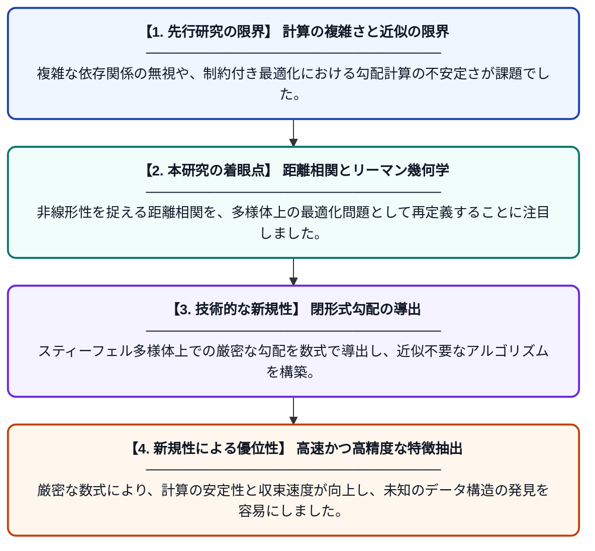

# 距離相関と距離分散を用いた射影追跡：単位球面およびスティーフェル多様体上での閉形式リーマン勾配

**Original Title**: *Projection Pursuit with Distance Correlation and Distance Variance: Closed-Form Riemannian Gradients on the Unit Sphere and the Stiefel Manifold*

> **💡 一言要約**: 多様体上の数学的工夫で高次元解析を高速・正確に

| 項目 | 内容 |
|---|---|
| **著者** | M Scheiblauer |
| **掲載誌** | 2026 |
| **アラートキーワード** | independent component ... |
| **PDF** | [https://repositum.tuwien.at/bitstream/20.500.12708/231863/1/Scheiblauer%20Maximilian%20-%202026%20-%20Projection%20Pursuit%20with%20Distance%20Correlation%20and...pdf](https://repositum.tuwien.at/bitstream/20.500.12708/231863/1/Scheiblauer%20Maximilian%20-%202026%20-%20Projection%20Pursuit%20with%20Distance%20Correlation%20and...pdf) |
| **Git リポジトリ** | [https://github.com/maxscheiblauer/Dcor-SDR-Dvar-PP](https://github.com/maxscheiblauer/Dcor-SDR-Dvar-PP) |
| **原文リンク** | [https://repositum.tuwien.at/bitstream/20.500.12708/231863/1/Scheiblauer Maximilian - 2026 - Projection Pursuit with Distance Correlation and...pdf](https://repositum.tuwien.at/bitstream/20.500.12708/231863/1/Scheiblauer Maximilian - 2026 - Projection Pursuit with Distance Correlation and...pdf) |
| **PDF版要約** | [README.pdf](./README.pdf) |

---

## 📊 新規性の図解（先行研究との違いと本研究のブレークスルー）

## 📝 要約

多次元データから特徴的な構造を見出す「射影追跡」において、非線形な依存関係を捉える距離相関と距離分散を指標に用いる手法を提案しています。幾何学的な制約（単位球面やスティーフェル多様体）がある状況下で、最適化に必要な勾配を厳密な数式（閉形式）で導出したことが最大の特徴です。

## ❓ どんな問題に取り組んだか

高次元データから重要な情報を抽出する際、従来の指標では変数間の複雑な非線形関係を十分に捉えられないという課題がありました。また、直交性などの制約を保ちながら効率的に最適な投影方向を探すための、数学的に厳密で計算負荷の低い勾配アルゴリズムが不足していました。

## ✨ 何が新しい？何がすごい？（新規性）

非線形な依存関係を評価できる「距離相関」を射影追跡に導入し、それを幾何学的な枠組みで定式化しました。最大の貢献は、単位球面やスティーフェル多様体といった多様体上での最適化に必要なリーマン勾配を、近似なしの「閉形式」で導き出した点にあります。これにより、独立成分分析（ICA）などの既存手法よりも広範なデータ構造を安定して抽出可能になりました。

## 🎓 大学1年生向けの解説

たくさんのデータが詰まった多次元の塊から、「どの方向から見れば一番面白い特徴が見えるか」を探す技術の研究です。これまでは「直線的な関係」しか探しにくかったのですが、この研究では「曲がった複雑な関係」も探せる新しい指標を使っています。さらに、その一番いい方向を計算で探すときに、数学的な「近道」となる数式を見つけたことで、より速く正確に分析できるようになりました。
