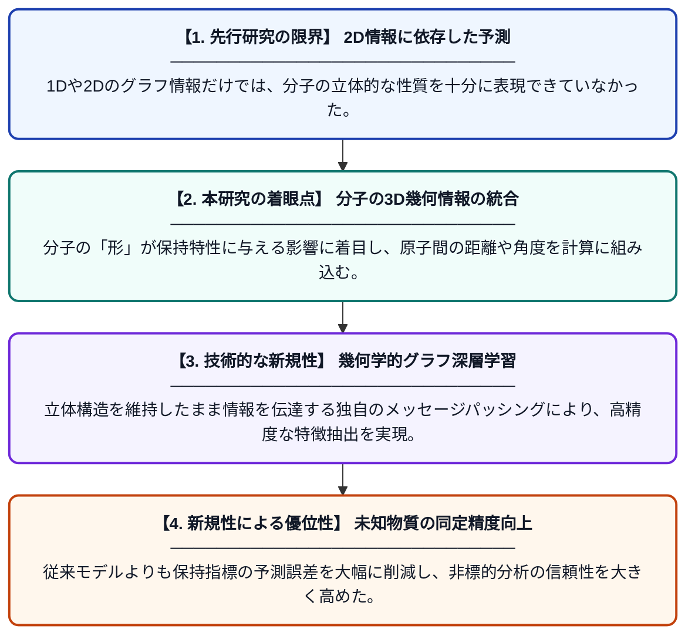

# 非標的分析におけるNORMAN予測保持指標を近似するための幾何学的情報を考慮した分子表現学習

**Original Title**: *Geometry-Aware Molecular Representation Learning for Approximating NORMAN-Predicted Retention Time Indices in Nontargeted Screening*

> **💡 一言要約**: 3D構造を読み解き、化合物の保持時間を超精密予測

| 項目 | 内容 |
|---|---|
| **著者** | H Wang, S Zhong, B Dong, Z Xu |
| **掲載誌** | Journal of Chemical Information and Modeling |
| **アラートキーワード** | representation learning |
| **原文リンク** | [https://pubs.acs.org/jcisd8/article/doi/10.1021/acs.jcim.6c02699/5459257](https://pubs.acs.org/jcisd8/article/doi/10.1021/acs.jcim.6c02699/5459257) |
| **PDF版要約** | [README.pdf](./README.pdf) |

---

## 📊 新規性の図解（先行研究との違いと本研究のブレークスルー）

## 📝 要約

LC-HRMSを用いた非標的分析（NTS）において、分子の保持指標（RTI）を精度高く予測するための新しい幾何学的深層学習モデルを提案しました。従来の1次元（SMILES）や2次元（グラフ）の情報に、分子の3次元的な幾何構造を統合することで、より信頼性の高い化学物質の同定を可能にしています。

## ❓ どんな問題に取り組んだか

非標的分析では、膨大な未知物質を特定するために保持時間の情報が重要ですが、既存モデルの多くは分子の「つながり（2D）」のみに依存しています。分子の立体的な「形状」や「距離感」といった幾何学的な特徴が無視されているため、予測精度が限定的であるという課題がありました。

## ✨ 何が新しい？何がすごい？（新規性）

本研究の最大の特徴は、原子間の距離や角度を直接考慮できる幾何学的メッセージパッシングネットワークを導入した点にあります。従来の2Dグラフ表現に3次元的な空間情報を融合させることで、物理化学的な性質をより詳細に捉えることが可能になりました。その結果、NORMANデータベースを用いたベンチマークにおいて、既存の最先端モデルを上回る予測精度を達成しました。

## 🎓 大学1年生向けの解説

化学物質を分析する際、その物質が装置を通り抜けるのにかかる時間（保持時間）は、その正体を知るための大きなヒントになります。これまでのAIは分子の「設計図（つながり）」だけで時間を予測していましたが、この研究では「分子の立体的な形」まで考慮する新しいAIを作りました。立体の形がわかれば、装置の中での動きがより正確に予想できるため、未知の物質が何であるかをより正しく突き止められるようになります。
