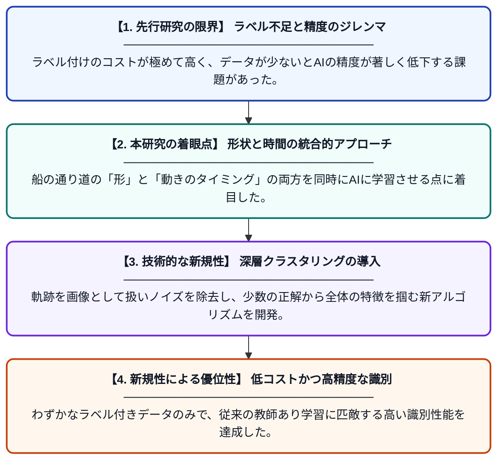

# AISデータに基づいた船舶種類識別のための半教師あり深層学習手法

**Original Title**: *A semi-supervised method for vessel type identification based on AIS data*

> **💡 一言要約**: 少ないデータで船の種類を当てる高度なAI技術

| 項目 | 内容 |
|---|---|
| **著者** | J Chen, W Zhou, M Liang, X Tang, S Hu |
| **掲載誌** | Ocean Engineering 2026 |
| **アラートキーワード** | Semi supervise |
| **原文リンク** | [https://www.sciencedirect.com/science/article/pii/S002980182604919X](https://www.sciencedirect.com/science/article/pii/S002980182604919X) |
| **PDF版要約** | [README.pdf](./README.pdf) |

---

## 📊 新規性の図解（先行研究との違いと本研究のブレークスルー）

## 📝 要約

船舶のAISデータから種類を特定するために、少ないラベル付きデータでも高精度な識別を可能にする半教師あり深層クラスタリング手法を提案しました。軌跡の幾何学的形状と時間的な表現を統合し、ノイズ除去済みのラスタデータとして処理することで、船舶の挙動パターンを効果的に抽出します。

## ❓ どんな問題に取り組んだか

船舶のAIS（自動識別装置）データは膨大ですが、その種類（貨物船や漁船など）を特定するためのラベル付け作業には多大なコストがかかります。そのため、ラベルが不完全な状態でも精度良く種類を判別できる手法が求められていました。

## ✨ 何が新しい？何がすごい？（新規性）

本研究の核心は、軌跡の幾何学的な形状と時間的な変化の特徴を同時に学習する半教師あり深層クラスタリングフレームワークにあります。AIS軌跡をラスタ画像化してノイズを除去する前処理を導入し、限られた教師データからでも船舶固有のパターンを効率的に抽出する仕組みを構築しました。これにより、純粋な教師なし学習よりも精度が高く、全データにラベルが必要な教師あり学習よりも実用的な手法を実現しています。

## 🎓 大学1年生向けの解説

海を走る船は自分の位置情報を発信していますが、そのデータだけを見ても「これが何の船か」を当てるのは専門家でも大変です。この研究では、AIを使って「船の動き方のクセ」を学習させ、少しのヒントからでも船の種類を自動で見分ける技術を開発しました。船の通り道を「絵」のように捉えたり、時間の進み方で分析したりすることで、非常に賢い判別が可能になっています。この技術を使えば、海の交通整理や怪しい船の発見がより簡単になります。
