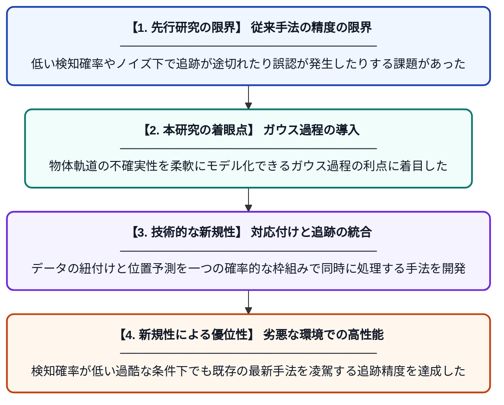

# ガウス過程を用いた監視レーダーのためのデータ対応付けと追跡の統合手法

**Original Title**: *Joint Data Association and Tracking for Surveillance Radar Using Gaussian Processes*

> **💡 一言要約**: ガウス過程が導く次世代のレーダー追跡

| 項目 | 内容 |
|---|---|
| **著者** | A Malthe Westerkam, T Pedersen |
| **掲載誌** | arXiv e-prints 2026 |
| **アラートキーワード** | kalman filter |
| **原文リンク** | [https://ui.adsabs.harvard.edu/abs/2026arXiv261103314M/abstract](https://ui.adsabs.harvard.edu/abs/2026arXiv261103314M/abstract) |
| **PDF版要約** | [README.pdf](./README.pdf) |

---

## 📊 新規性の図解（先行研究との違いと本研究のブレークスルー）

## 📝 要約

監視レーダーにおいて、観測データの対応付けと物体追跡を同時に行うガウス過程ベースのアルゴリズムを提案しています。広範囲な検知確率において、従来のカルマンフィルタや最新のベルヌーイフィルタを上回る性能を示すことが確認されました。

## ❓ どんな問題に取り組んだか

レーダー観測では、どの信号が標的由来で、どれが背景雑音かを見極める「データ対応付け」が重要ですが、検知漏れやノイズが多い環境では追跡精度が著しく低下するという課題がありました。

## ✨ 何が新しい？何がすごい？（新規性）

本研究は、物体の軌道を記述するために柔軟な表現力を持つガウス過程を採用し、これをデータ対応付けの枠組みと密接に統合しました。従来のカルマンフィルタ等と比較して統計的なモデル化がより頑健であり、検知確率が低い過酷な観測環境でも安定して動作する点が主要な貢献です。また、最先端のベルヌーイフィルタを凌駕する性能を広範な条件で実証しました。

## 🎓 大学1年生向けの解説

レーダーで空を飛ぶものを追いかけるとき、画面に映る点が本物の機体かただのゴミ（雑音）か判断するのは難しい作業です。この論文では、数学的な「予測の幅」を持たせるガウス過程という技術を使い、あやふやなデータからでも正確な軌道を割り出す仕組みを作りました。この方法を使えば、レーダーの映りが悪い日でも、対象を見失わずにしっかり追い続けることができます。
