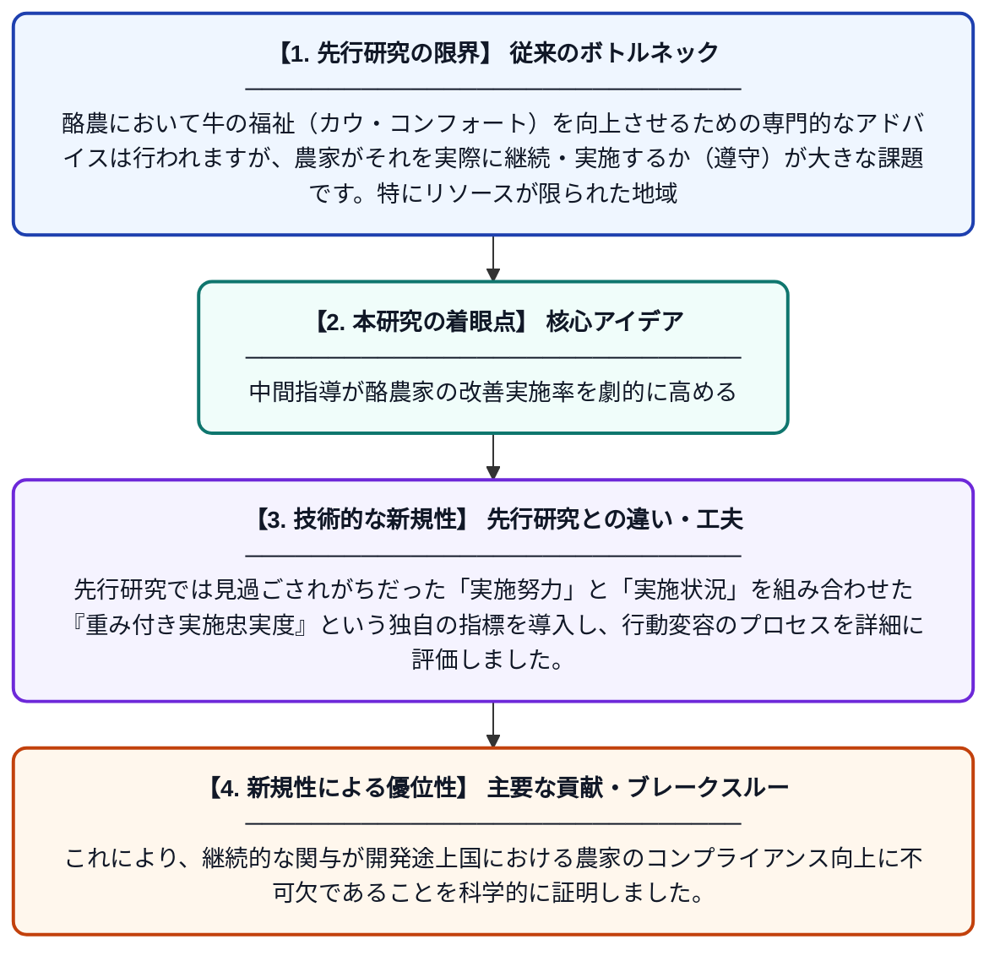

# 中間的な強化指導は農場ごとのカウ・コンフォート推奨事項の遵守を改善するか？ケニアにおけるネスト化ランダム化比較試験からの知見

**Original Title**: *Does midterm reinforcement improve compliance with farm-specific cow-comfort recommendations? Evidence from a nested randomized controlled trial in Kenyan …*

> **💡 一言要約**: 中間指導が酪農家の改善実施率を劇的に高める

| 項目 | 内容 |
|---|---|
| **著者** | E Muunda, EJO Rao, DC Hall, C Ritter, MC Ceballos… |
| **掲載誌** | Veterinary and Animal … 2026 |
| **アラートキーワード** | reinforcement |
| **原文リンク** | [https://www.sciencedirect.com/science/article/pii/S2451943X26003431](https://www.sciencedirect.com/science/article/pii/S2451943X26003431) |
| **PDF版要約** | [README.pdf](./README.pdf) |

---

## 📊 新規性の図解（先行研究との違いと本研究のブレークスルー）

## 📝 要約

ケニアの酪農場を対象に、牛の快適性を向上させるための個別推奨事項が、中間地点でのフォローアップ（強化指導）によってどの程度定着するかをランダム化比較試験で検証しました。その結果、中間指導を行ったグループは、行わなかったグループに比べて推奨事項の実施率（遵守率）が有意に向上することが明らかになりました。

## ❓ どんな問題に取り組んだか

酪農において牛の福祉（カウ・コンフォート）を向上させるための専門的なアドバイスは行われますが、農家がそれを実際に継続・実施するか（遵守）が大きな課題です。特にリソースが限られた地域では、一度の指導だけでは改善活動が立ち消えてしまうことが多く、効果的な介入方法の確立が求められていました。

## ✨ 何が新しい？何がすごい？（新規性）

本研究の新規性は、ケニアの小規模農家を対象に、ネスト化されたランダム化比較試験（RCT）という厳密な手法を用いて「中間フォローアップ」の因果効果を定量化した点にあります。先行研究では見過ごされがちだった「実施努力」と「実施状況」を組み合わせた『重み付き実施忠実度』という独自の指標を導入し、行動変容のプロセスを詳細に評価しました。これにより、継続的な関与が開発途上国における農家のコンプライアンス向上に不可欠であることを科学的に証明しました。

## 🎓 大学1年生向けの解説

牛を快適に育てるためのアドバイスをもらっても、忙しい農家の人たちがそれをずっと続けるのは実はとても大変です。この研究では、ケニアの農家を2つのグループに分け、片方には「途中で一度、進み具合を確認して励ます」という工夫を加えました。すると、何もしなかったグループに比べて、牛舎の環境を改善してくれる割合がぐんと高くなることがわかりました。つまり、最初に教えるだけでなく、途中で寄り添うことが牛の幸せを守る近道だということです。
