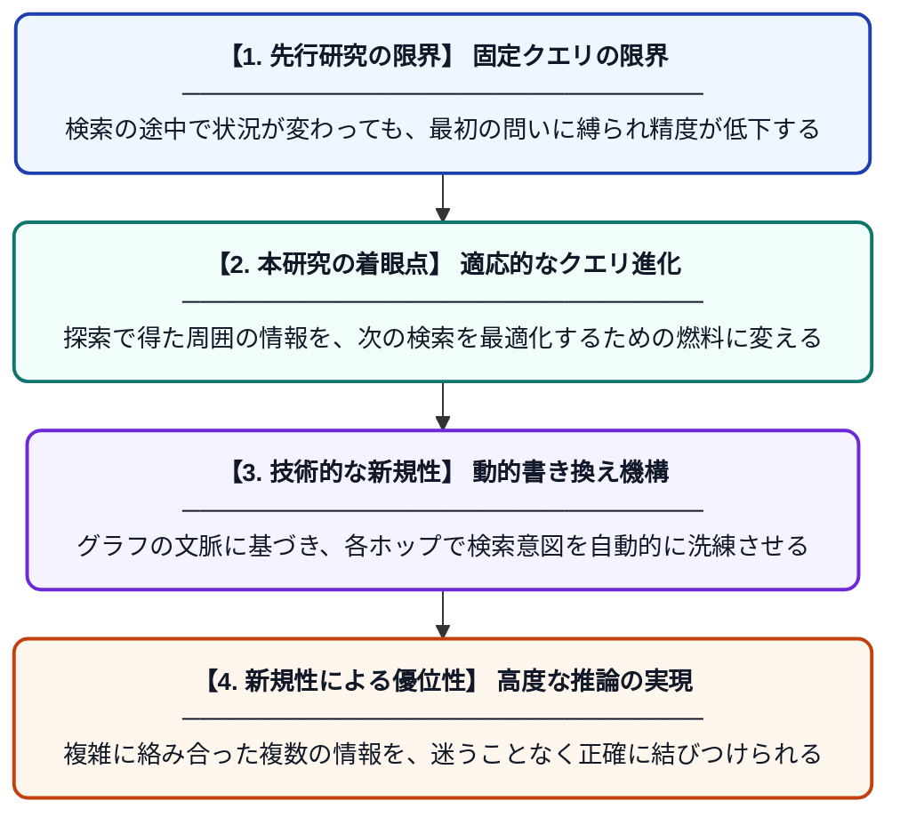

# QueryFlow：適応型クエリ進化によるマルチホップグラフ検索

**Original Title**: *QueryFlow: Multi-Hop Graph Retrieval with Adaptive Query Evolution*

> **💡 一言要約**: クエリが進化し、知識の迷宮を解き明かす検索手法

| 項目 | 内容 |
|---|---|
| **著者** | M Huang, C Bu, Y He, J Wang, X Wu |
| **掲載誌** | arXiv preprint arXiv:2611.04625 2026 |
| **アラートキーワード** | graph rag |
| **PDF** | [https://arxiv.org/pdf/2611.04625](https://arxiv.org/pdf/2611.04625) |
| **原文リンク** | [https://arxiv.org/pdf/2611.04625](https://arxiv.org/pdf/2611.04625) |
| **PDF版要約** | [README.pdf](./README.pdf) |

---

## 📊 新規性の図解（先行研究との違いと本研究のブレークスルー）

## 📝 要約

複雑な質問に対して、知識グラフ上を複数回探索しながら適切な情報を取得する新手法「QueryFlow」を提案しています。探索の進展に合わせてクエリを動的に更新（進化）させることで、文脈に応じた精度の高い情報抽出を可能にしました。

## ❓ どんな問題に取り組んだか

従来のグラフ検索では、検索クエリが固定されているか、単純な更新にとどまるため、複雑な関係性を辿る際に文脈を見失う課題がありました。また、構造化された知識グラフと非構造化テキストの間の橋渡しを効率的に行う仕組みも不足していました。

## ✨ 何が新しい？何がすごい？（新規性）

本研究の核心は「適応型クエリ進化（Adaptive Query Evolution）」にあります。先行研究のGFM-RAGが固定クエリを用いるのに対し、QueryFlowはグラフ探索の各ステップで得られた文脈を反映してクエリ自体を書き換えます。これにより、多段階の推論が必要な質問において、次に検索すべき情報の精度を飛躍的に高めることに成功しました。

## 🎓 大学1年生向けの解説

難しい問題を解くとき、調べていくうちに『次はこれを調べなきゃ』と目的が変わっていくことがありますよね。この研究は、AIが情報の地図（グラフ）を辿りながら、見つけたヒントに合わせて『次の探し方』を自分でアップデートしていく仕組みを作りました。これによって、バラバラに散らばった情報も芋づる式に見つけ出せるようになります。
