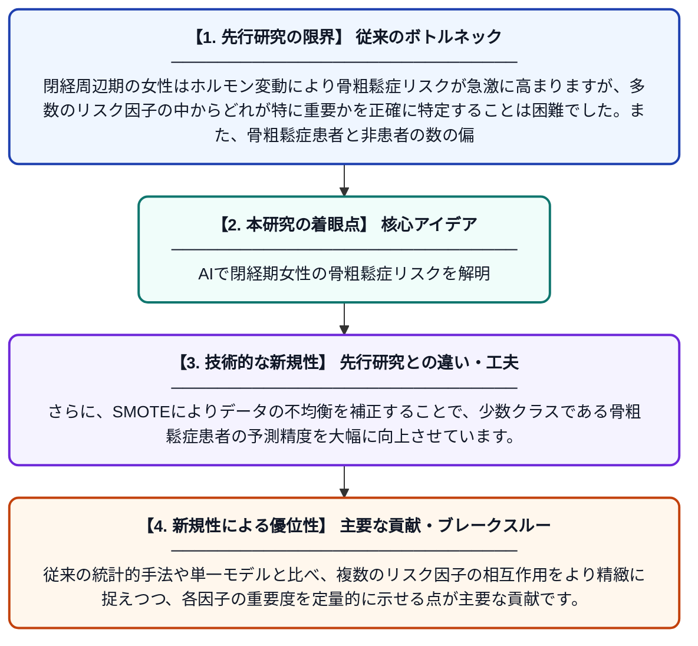

# TransformerとLSTMのハイブリッドモデルおよびSMOTEを用いた閉経周辺期女性における骨粗鬆症リスク因子の特定と重要度分析

**Original Title**: *Identification and importance analysis of osteoporosis risk factors in perimenopausal women based on the Transformer–LSTM hybrid model and SMOTE*

> **💡 一言要約**: AIで閉経期女性の骨粗鬆症リスクを解明

| 項目 | 内容 |
|---|---|
| **著者** | H Hu, W Wang, H Liang |
| **掲載誌** | Climacteric 2026 |
| **アラートキーワード** | SMOTE |
| **原文リンク** | [https://www.tandfonline.com/doi/full/10.1080/13697137.2026.2671750](https://www.tandfonline.com/doi/full/10.1080/13697137.2026.2671750) |
| **PDF版要約** | [README.pdf](./README.pdf) |

---

## 📊 新規性の図解（先行研究との違いと本研究のブレークスルー）

## 📝 要約

本研究は、閉経周辺期女性における骨粗鬆症の主要リスク因子を特定するため、TransformerとLSTMを組み合わせたハイブリッドモデルとSMOTE（少数クラス過剰サンプリング技術）を用いた分析フレームワークを提案しました。コホートデータを用いて各リスク因子の重要度を定量的に評価し、骨粗鬆症の早期予測・予防に向けた知見を提供しています。クラス不均衡問題にも対処することで、より精度の高いリスク予測を実現しています。

## ❓ どんな問題に取り組んだか

閉経周辺期の女性はホルモン変動により骨粗鬆症リスクが急激に高まりますが、多数のリスク因子の中からどれが特に重要かを正確に特定することは困難でした。また、骨粗鬆症患者と非患者の数の偏り（クラス不均衡）により、従来の機械学習モデルでは予測精度が低下しやすいという問題もありました。

## ✨ 何が新しい？何がすごい？（新規性）

本研究の新規性は、時系列パターンの長期依存性を捉えるLSTMと、特徴間の複雑な関係を学習するTransformerを組み合わせたハイブリッドモデルを骨粗鬆症リスク分析に初めて適用した点にあります。さらに、SMOTEによりデータの不均衡を補正することで、少数クラスである骨粗鬆症患者の予測精度を大幅に向上させています。従来の統計的手法や単一モデルと比べ、複数のリスク因子の相互作用をより精緻に捉えつつ、各因子の重要度を定量的に示せる点が主要な貢献です。

## 🎓 大学1年生向けの解説

骨粗鬆症とは骨がもろくなる病気で、特に閉経前後の女性に多く見られます。この研究では、どんな生活習慣や体の状態が骨粗鬆症になりやすいかをAIを使って調べました。AIにはTransformerとLSTMという2種類の賢いモデルを組み合わせて使い、さらにデータの偏りを補正する工夫（SMOTE）も取り入れました。これにより、どのリスク因子が最も重要かをより正確に見つけ出すことができ、将来の骨粗鬆症予防に役立てることが期待されます。
