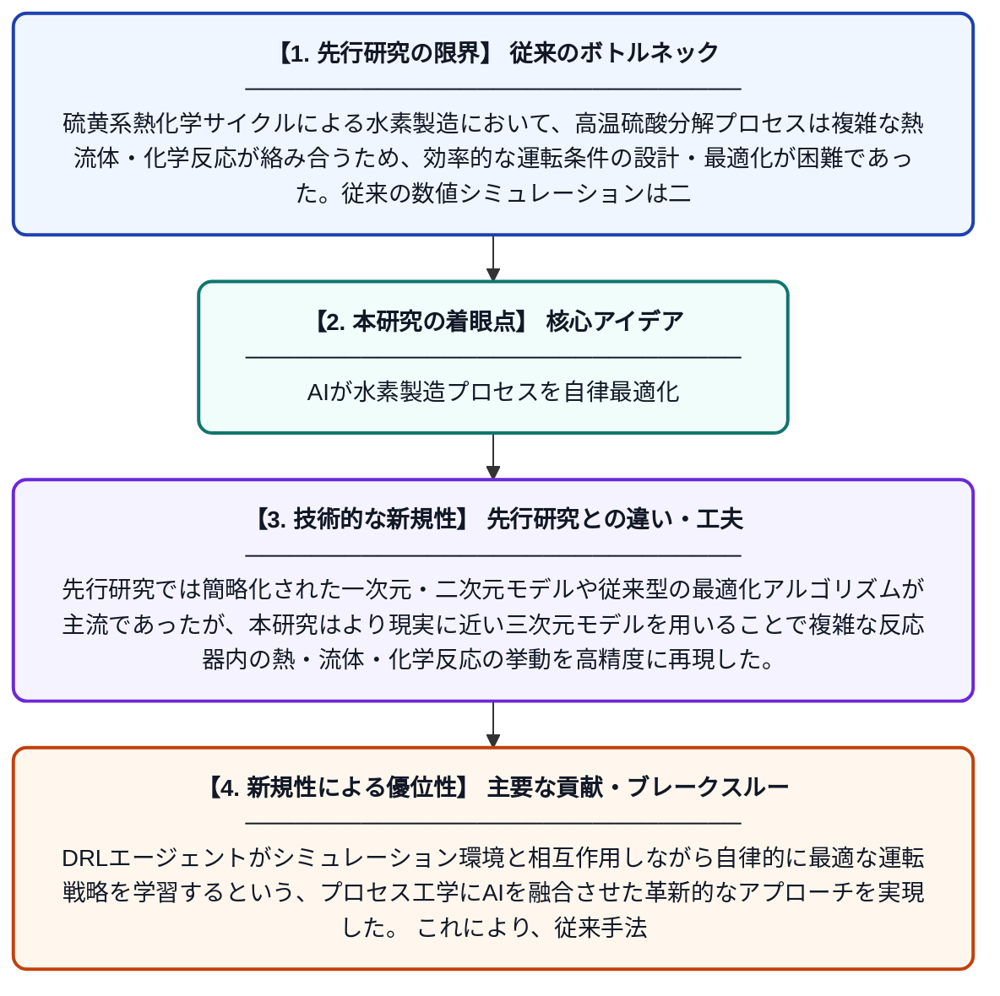

# 深層強化学習を用いた硫酸分解プロセスの三次元モデリングと最適化

**Original Title**: *Three-dimensional modeling and optimization of sulfuric acid decomposition with a deep reinforcement learning approach*

> **💡 一言要約**: AIが水素製造プロセスを自律最適化

| 項目 | 内容 |
|---|---|
| **著者** | J Chen, HY Jung, S Jung |
| **掲載誌** | Applied Thermal Engineering 2026 |
| **アラートキーワード** | reinforcement |
| **原文リンク** | [https://www.sciencedirect.com/science/article/pii/S1359431126028164](https://www.sciencedirect.com/science/article/pii/S1359431126028164) |
| **PDF版要約** | [README.pdf](./README.pdf) |

---

## 📊 新規性の図解（先行研究との違いと本研究のブレークスルー）

## 📝 要約

本論文は、大規模水素製造に有望なハイブリッド硫黄（HyS）サイクルにおける硫酸分解（SAD）プロセスを対象に、三次元シミュレーションモデルを構築し、深層強化学習（DRL）を用いてプロセスの最適化を行った研究である。高温での硫酸分解反応における熱流体挙動を精密にモデル化し、AIによる制御戦略の最適化を実現した。従来の試行錯誤的な最適化手法と比較して、より効率的かつ高精度な運転条件の探索が可能となった。

## ❓ どんな問題に取り組んだか

硫黄系熱化学サイクルによる水素製造において、高温硫酸分解プロセスは複雑な熱流体・化学反応が絡み合うため、効率的な運転条件の設計・最適化が困難であった。従来の数値シミュレーションは二次元モデルや簡略化した仮定に依存することが多く、実際のプロセス挙動を正確に再現できなかった。さらに、膨大なパラメータ空間の中から最適な運転条件を見つけ出すことは、従来の最適化手法では計算コストが非常に高いという課題があった。

## ✨ 何が新しい？何がすごい？（新規性）

本研究の最大の新規性は、硫酸分解プロセスに対して三次元CFD（数値流体力学）モデルと深層強化学習（DRL）を組み合わせた点にある。先行研究では簡略化された一次元・二次元モデルや従来型の最適化アルゴリズムが主流であったが、本研究はより現実に近い三次元モデルを用いることで複雑な反応器内の熱・流体・化学反応の挙動を高精度に再現した。DRLエージェントがシミュレーション環境と相互作用しながら自律的に最適な運転戦略を学習するという、プロセス工学にAIを融合させた革新的なアプローチを実現した。これにより、従来手法では困難であった多次元パラメータの同時最適化が効率的に達成された。

## 🎓 大学1年生向けの解説

水素は環境に優しいエネルギーとして注目されていますが、大量に作るにはまだ課題があります。この研究では、熱を使って硫酸から水素を作るプロセス（硫酸分解）をコンピューター上で3D再現し、どうすれば効率よく水素を作れるかをAI（深層強化学習）に自動で学ばせました。ゲームのAIが自分で上手くなるように、このAIも試行錯誤しながら最良の運転方法を見つけ出します。その結果、人間が手作業で探すよりもはるかに効率的に、最適な条件を発見することができました。将来的には、このような技術が水素エネルギーの普及を後押しする可能性があります。
