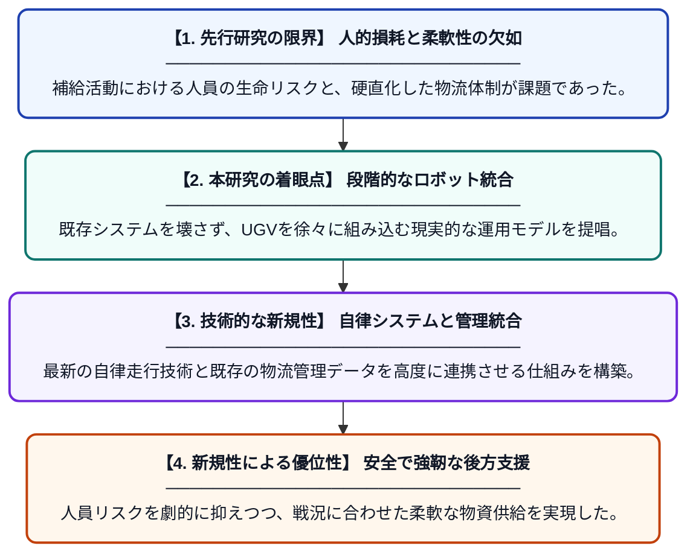

# 防空部隊の後方支援における無人地上車両（UGV）の役割

**Original Title**: *The role of unmanned ground vehicles in the logistics support of air defense units*

> **💡 一言要約**: UGVが変える、安全で柔軟な防空補給の未来

| 項目 | 内容 |
|---|---|
| **著者** | O Tokar, S Cherkashyn |
| **掲載誌** | 2026 |
| **アラートキーワード** | logistics |
| **原文リンク** | [https://ir.lib.vntu.edu.ua/items/d276d57c-72e7-4086-b659-babf8170a6de](https://ir.lib.vntu.edu.ua/items/d276d57c-72e7-4086-b659-babf8170a6de) |
| **PDF版要約** | [README.pdf](./README.pdf) |

---

## 📊 新規性の図解（先行研究との違いと本研究のブレークスルー）

## 📝 要約

防空部隊のロジスティクス支援における無人地上車両（UGV）の導入効果と、既存の管理システムへの統合方法を論じた研究です。自律走行ロボットを段階的に導入することで、人的リスクを低減しつつ、補給活動の柔軟性と効率を大幅に向上させる可能性を実証しています。

## ❓ どんな問題に取り組んだか

従来の軍事ロジスティクスでは、補給任務における人員の生命リスクが極めて高く、戦況の変化に応じた柔軟な物資輸送も困難でした。また、最新のロボット技術を既存の複雑な物流管理システムへ円滑に統合する具体的なプロセスが確立されていないことが課題でした。

## ✨ 何が新しい？何がすごい？（新規性）

本論文は、UGVを単独の機材としてではなく、防空部隊の物流エコシステム全体に段階的に統合する具体的な枠組みを提示した点が画期的です。既存の管理システムとのデータ連携や自律走行技術の適用可能性を精査し、技術・運用の両面から現実的な導入ロードマップを構築しました。これにより、人的損耗を最小限に抑えつつ、物流の即応性を高める新しい軍事ロジスティクスの形を提案しています。

## 🎓 大学1年生向けの解説

戦場で弾薬や食料を運ぶ「物流」は非常に大切ですが、敵に狙われやすく危険な仕事です。この研究では、兵士の代わりに「無人ロボット車（UGV）」を使って物資を運ぶ仕組みを提案しています。いきなりすべてを機械にするのではなく、今のやり方に少しずつロボットを混ぜていく現実的な方法を考えているのが特徴です。これが実現すれば、人の命を守りながら、より正確に物資を届けることができるようになります。
