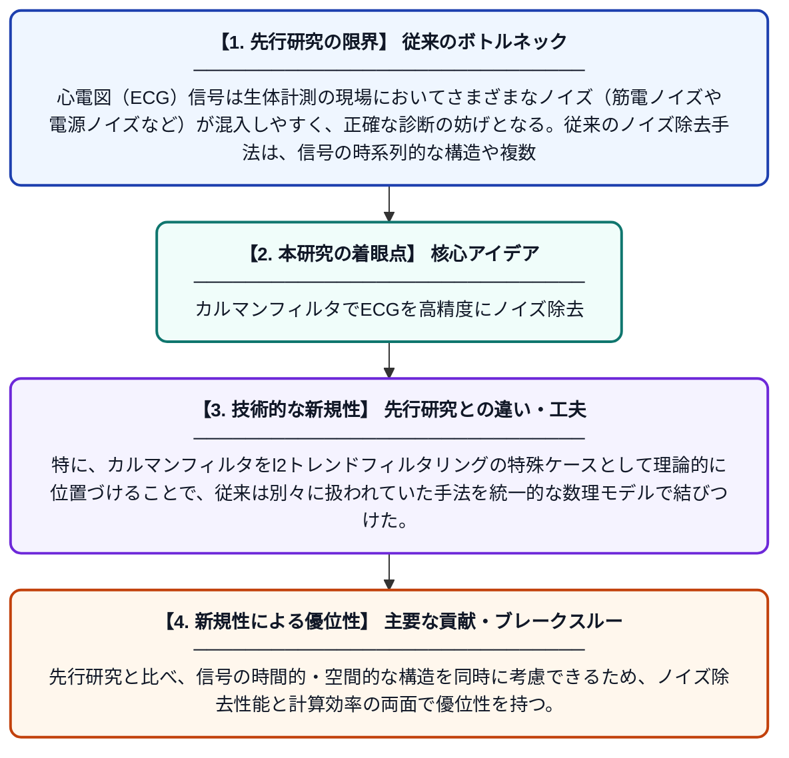

# カルマンフィルタに基づく変分法によるECGテンソルのノイズ除去

**Original Title**: *A Kalman filter-based variational method for ECG tensor denoising: P. Cui et al.*

> **💡 一言要約**: カルマンフィルタでECGを高精度にノイズ除去

| 項目 | 内容 |
|---|---|
| **著者** | P Cui, ZH Song, YM Huang, ZF Zhang |
| **掲載誌** | Advances in Computational Mathematics 2026 |
| **アラートキーワード** | kalman filter |
| **原文リンク** | [https://link.springer.com/article/10.1007/s10444-026-10337-0](https://link.springer.com/article/10.1007/s10444-026-10337-0) |
| **PDF版要約** | [README.pdf](./README.pdf) |

---

## 📊 新規性の図解（先行研究との違いと本研究のブレークスルー）

## 📝 要約

本論文は、心電図（ECG）信号のノイズを効果的に除去するため、カルマンフィルタと変分法を組み合わせた新しいテンソルベースの手法を提案している。心拍内（イントラHB）平滑化と心拍間（インターHB）処理の2段階アプローチを採用し、カルマンフィルタをl2トレンドフィルタリングの特殊ケースとして活用する。これにより、ECG信号に含まれるノイズを数学的に厳密かつ効率的に除去することを実現している。

## ❓ どんな問題に取り組んだか

心電図（ECG）信号は生体計測の現場においてさまざまなノイズ（筋電ノイズや電源ノイズなど）が混入しやすく、正確な診断の妨げとなる。従来のノイズ除去手法は、信号の時系列的な構造や複数チャンネル間の相関関係を十分に活用できていない場合が多く、高品質な信号復元が困難であった。

## ✨ 何が新しい？何がすごい？（新規性）

本研究は、ECG信号をテンソル（多次元配列）として表現し、心拍内・心拍間の2段階処理を変分法の枠組みで統一的に扱う点が新しい。特に、カルマンフィルタをl2トレンドフィルタリングの特殊ケースとして理論的に位置づけることで、従来は別々に扱われていた手法を統一的な数理モデルで結びつけた。先行研究と比べ、信号の時間的・空間的な構造を同時に考慮できるため、ノイズ除去性能と計算効率の両面で優位性を持つ。

## 🎓 大学1年生向けの解説

心電図（ECG）とは、心臓の電気的な動きを記録した波形のことで、病院での診断に欠かせないデータです。しかし、測定時に体の動きや電気機器の影響でノイズ（雑音）が混ざってしまいます。この研究では「カルマンフィルタ」と呼ばれる、GPSなどにも使われる賢いノイズ除去技術と、数学的な最適化の手法を組み合わせて、ECGをきれいにする新しい方法を開発しました。心拍ひとつひとつの中と、心拍をまたいだ変化の両方を丁寧に処理することで、より正確な波形を取り出せるようになっています。
