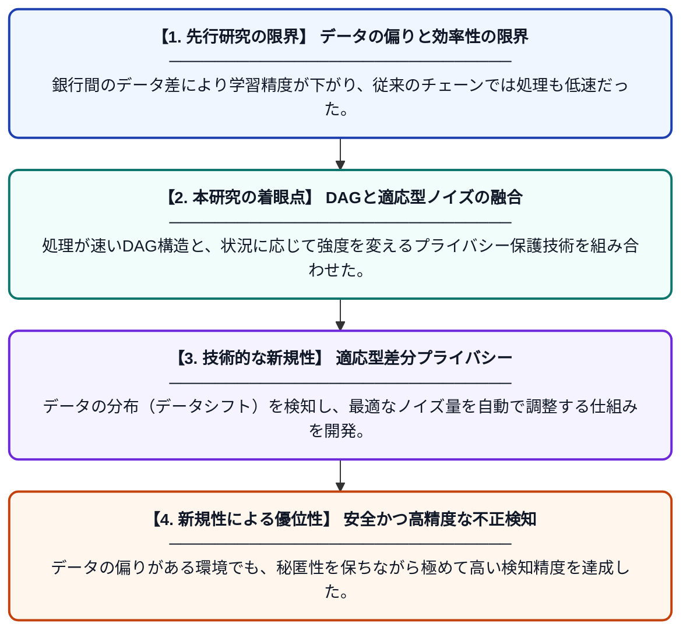

# DAGハイブリッドブロックチェーンに基づく金融不正検知のためのデータシフトを考慮したプライバシー保護連合学習

**Original Title**: *Data-Shift-Aware Privacy-Preserving Federated Learning for Financial Fraud Detection Based on DAG Hybrid Blockchain*

> **💡 一言要約**: ブロックチェーンとAIで、秘密を守り不正を暴く

| 項目 | 内容 |
|---|---|
| **著者** | X Gai, P Chen, Y Kong, Z Li |
| **掲載誌** | Blockchain and Web3 Technology Innovation and … 2026 |
| **アラートキーワード** | differential privacy |
| **原文リンク** | [https://link.springer.com/chapter/10.1007/978-981-92-7537-3_30](https://link.springer.com/chapter/10.1007/978-981-92-7537-3_30) |
| **PDF版要約** | [README.pdf](./README.pdf) |

---

## 📊 新規性の図解（先行研究との違いと本研究のブレークスルー）

## 📝 要約

金融機関間での機密データ共有が困難な課題に対し、DAG型のハイブリッドブロックチェーンと適応型差分プライバシーを組み合わせた連合学習手法を提案しています。データの不均一性（Non-IID）による精度低下を抑えつつ、高いセキュリティと効率的な学習を両立し、金融不正検知の精度を向上させました。

## ❓ どんな問題に取り組んだか

金融不正検知では、各機関が持つデータのプライバシー保護と、機関ごとにデータの分布が異なる「データシフト」問題の解決を両立させる必要があります。従来の連合学習では、データの偏りによってモデルの精度が著しく低下し、またブロックチェーンの処理能力がボトルネックになるという課題がありました。

## ✨ 何が新しい？何がすごい？（新規性）

DAG（有向非巡回グラフ）構造を持つハイブリッドブロックチェーンを導入することで、従来の中央集権的なサーバーへの依存を排除し、並列処理による高速な学習を実現しました。最大の特徴は「適応型差分プライバシー」メカニズムの提案であり、データの不均一性（Non-IID）の度合いに応じてノイズを動的に調整することで、プライバシー保護と学習精度のトレードオフを最適化しています。これにより、先行研究と比較してデータシフト環境下でも高い検知性能と頑健性を維持することに成功しました。

## 🎓 大学1年生向けの解説

銀行などが顧客の個人情報を秘密にしたまま協力して、「詐欺を見抜くAI」を作るための新しい技術です。通常、銀行ごとに顧客層が違うためAIの学習は難しいのですが、この研究では「データの偏り」を自動で判断して調整する賢い仕組みを取り入れました。また、情報のやり取りに「ブロックチェーン」という技術を使うことで、ハッカーによるデータの改ざんや盗み見を防いでいます。プライバシーを守りながら、みんなで協力して最新の詐欺を防げるようになる、画期的なシステムです。
