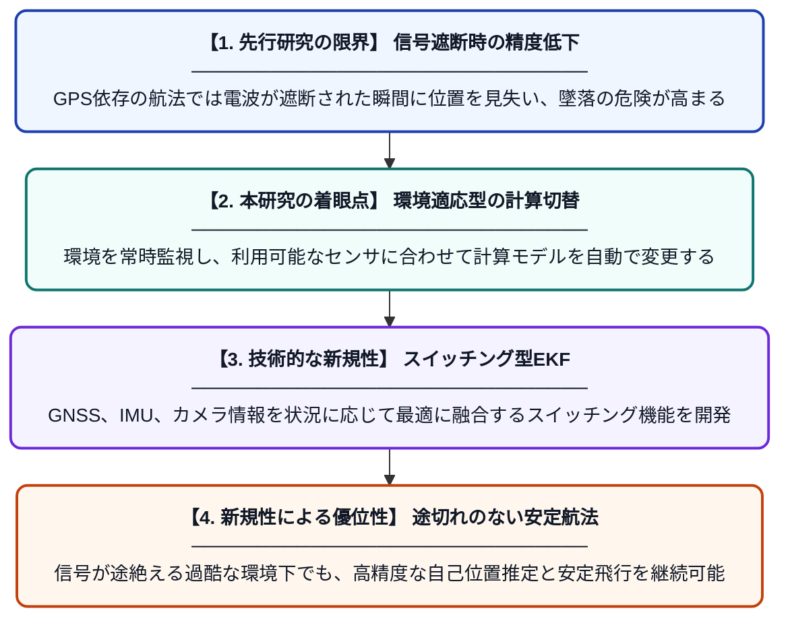

# GNSS環境およびGNSS障害環境における無人航空機の統合航法のためのスイッチング拡張カルマンフィルタ

**Original Title**: *Switching Extended Kalman Filter for Unmanned Aerial Vehicle Integrated Navigation in GNSS and GNSS-Denied Environment*

> **💡 一言要約**: GPSが途切れても迷わない、UAVの適応型ナビゲーション

| 項目 | 内容 |
|---|---|
| **著者** | A Fathurrahman, O Arifianto, YI Jenie, H Muhammad |
| **掲載誌** | Journal of Aeronautics … 2026 |
| **アラートキーワード** | kalman filter |
| **原文リンク** | [https://www.airitilibrary.com/Article/Detail/P20140627004-N202610220010-00025](https://www.airitilibrary.com/Article/Detail/P20140627004-N202610220010-00025) |
| **PDF版要約** | [README.pdf](./README.pdf) |

---

## 📊 新規性の図解（先行研究との違いと本研究のブレークスルー）

## 📝 要約

無人航空機（UAV）がGNSS信号の届く場所と届かない場所をシームレスに行き来するための、新しい「スイッチング拡張カルマンフィルタ（Switching EKF）」を提案しています。IMU、GNSS、オプティカルフローなどの多様なセンサを統合し、状況に応じて計算手法を切り替えることで、常に最適な自己位置推定を維持します。

## ❓ どんな問題に取り組んだか

従来のUAV航法はGNSS信号に強く依存しており、信号が遮断される屋内や森の中、都市部では位置推定精度が急激に悪化し、墜落や迷子のリスクがありました。また、センサの種類が増えると計算が複雑になり、動的な環境変化に即座に対応することが困難という課題もありました。

## ✨ 何が新しい？何がすごい？（新規性）

本研究の最大の特徴は、環境の状況（GNSSの有効性）を検知してフィルタの構造自体を動的に切り替える「スイッチング機構」を拡張カルマンフィルタに導入した点にあります。GNSSが利用不可になった瞬間にオプティカルフローや慣性センサを主軸とするモードへシームレスに移行することで、位置推測のドリフト（誤差の累積）を大幅に抑制しました。複数の異種センサを柔軟に組み合わせることで、単一のアルゴリズムでは不可能だった高いロバスト性を実現しています。

## 🎓 大学1年生向けの解説

ドローンが自分の場所を知るにはGPSを使いますが、トンネルやビルの影ではGPSの電波が届かなくなります。この研究では、GPSが使える時と使えない時で「情報の使い方」をパッと切り替える、賢い計算プログラムを作りました。カメラで地面の動きを見るセンサや加速を測るセンサを組み合わせることで、GPSが切れても道に迷わず、正確に飛び続けることができるようになります。
