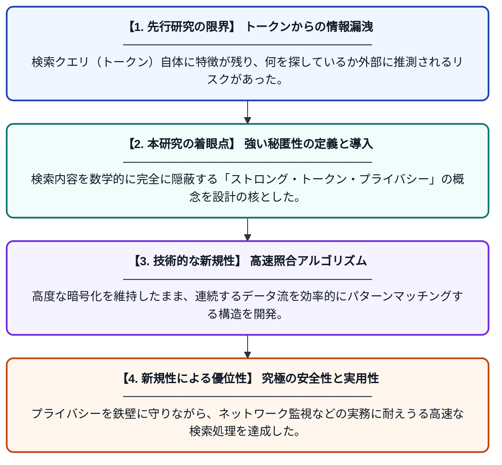

# 強いトークン・プライバシーを備えた暗号化ストリーミングデータの検索：応用と構成法

**Original Title**: *Encrypted Streaming Data Search with Strong Token Privacy, Applications and Constructions*

> **💡 一言要約**: 暗号化したまま高速検索！トークンの秘密も鉄壁に守る

| 項目 | 内容 |
|---|---|
| **著者** | H Qin, Q Li, E Foo, LY Zhang |
| **掲載誌** | … Transactions on Dependable and Secure Computing 2026 |
| **アラートキーワード** | Secure Computing |
| **原文リンク** | [https://www.computer.org/csdl/journal/tq/5555/01/11782824/2liF7ES3C3C](https://www.computer.org/csdl/journal/tq/5555/01/11782824/2liF7ES3C3C) |
| **PDF版要約** | [README.pdf](./README.pdf) |

---

## 📊 新規性の図解（先行研究との違いと本研究のブレークスルー）

## 📝 要約

ネットワーク監視やIoTで発生する膨大なストリーミングデータを、暗号化したまま安全かつ高速に検索する技術（SEPM）を提案しています。特に、検索クエリであるトークンから検索内容が推測されるリスクを数学的に防ぐ「強いトークン・プライバシー」を実現しているのが特徴です。

## ❓ どんな問題に取り組んだか

ストリーミングデータはリアルタイム性が重要ですが、プライバシー保護のために暗号化すると、中身を検索（パターンマッチング）するのが難しくなります。また、従来の検索可能暗号では検索クエリ自体から探している内容が漏洩する懸念があり、安全性と処理効率の両立が困難でした。

## ✨ 何が新しい？何がすごい？（新規性）

本研究は、従来のストリーミング検索手法では不十分だった「トークンの秘匿性」を大幅に強化した新しい構成法を提案しています。先行研究が検索パターンの一部を露出させていたのに対し、本手法は検索内容を完全に隠蔽しつつ、大規模なデータ流入に対しても遅延の少ない照合を実現しました。さらに、具体的なネットワーク侵入検知システムへの応用シナリオを提示し、実用的な性能を証明した点が画期的です。

## 🎓 大学1年生向けの解説

インターネットやセンサーから次々と送られてくるデータの中身を、暗号で隠したまま「特定のキーワード」が含まれているか調べる技術の話です。これまでは、検索に使う「合鍵」のようなデータから、何を探しているのかがバレてしまうという弱点がありました。この研究では、その合鍵を特殊な数学で加工することで、誰にも何を探しているか知られず、しかも大量のデータを一瞬で処理できるようにしました。
