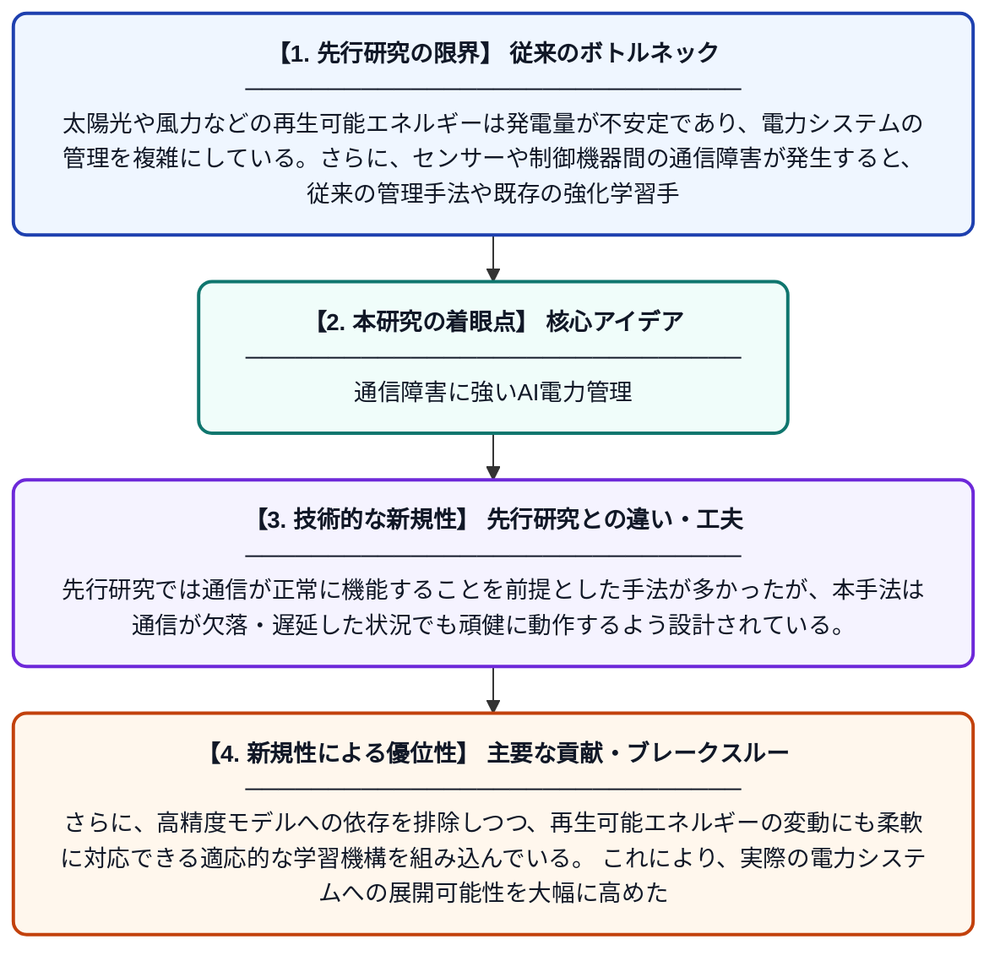

# 通信障害に対応した再生可能エネルギーベース電力管理のための信頼性の高い強化学習

**Original Title**: *Trustworthy Reinforcement Learning for Renewable Base Energy Management Against Communication Failures*

> **💡 一言要約**: 通信障害に強いAI電力管理

| 項目 | 内容 |
|---|---|
| **著者** | J Di, Q Cui, J Pan, Y Weng, D Yang, J Li, W Li |
| **掲載誌** | IEEE Transactions on Smart Grid 2026 |
| **アラートキーワード** | reinforcement |
| **原文リンク** | [https://ieeexplore.ieee.org/abstract/document/11623282/](https://ieeexplore.ieee.org/abstract/document/11623282/) |
| **PDF版要約** | [README.pdf](./README.pdf) |

---

## 📊 新規性の図解（先行研究との違いと本研究のブレークスルー）

## 📝 要約

再生可能エネルギーの導入による電力変動は、電力システムの管理に大きな課題をもたらしている。本論文では、通信障害が発生した状況でも安定的に機能する、強化学習ベースの信頼性の高いエネルギー管理手法を提案している。従来の高精度モデルに依存した手法では対応が困難だった不確実性や通信障害に対し、堅牢な制御を実現することを目指している。

## ❓ どんな問題に取り組んだか

太陽光や風力などの再生可能エネルギーは発電量が不安定であり、電力システムの管理を複雑にしている。さらに、センサーや制御機器間の通信障害が発生すると、従来の管理手法や既存の強化学習手法は正確な情報が得られず、安定した制御が困難になる。高精度な物理モデルへの依存も、現実の複雑な環境への適用を妨げている。

## ✨ 何が新しい？何がすごい？（新規性）

本研究は、通信障害という現実的なリスクを明示的に考慮した「信頼性の高い強化学習フレームワーク」を電力管理に初めて導入した点が新しい。先行研究では通信が正常に機能することを前提とした手法が多かったが、本手法は通信が欠落・遅延した状況でも頑健に動作するよう設計されている。さらに、高精度モデルへの依存を排除しつつ、再生可能エネルギーの変動にも柔軟に対応できる適応的な学習機構を組み込んでいる。これにより、実際の電力システムへの展開可能性を大幅に高めた点が主要な貢献である。

## 🎓 大学1年生向けの解説

太陽光発電や風力発電は天気によって発電量が変わるため、電気の量を上手に管理するのがとても難しいです。さらに、発電所や機器同士が情報をやり取りする通信が途切れてしまうと、従来のコンピューターによる管理システムは正しく動けなくなってしまいます。この研究では、AIの一種である『強化学習』を使って、通信が途切れても賢く電力を管理できる仕組みを作りました。ちょうど、地図アプリがGPSの電波が弱くても過去の情報をもとに案内を続けるようなイメージです。これにより、再生可能エネルギーをより安全・安定的に使える電力システムの実現に近づきます。
