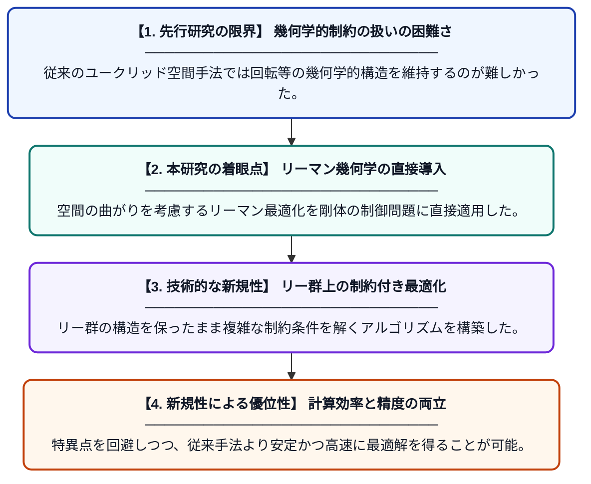

# リーマン最適化を用いた剛体リー群上の軌道最適化

**Original Title**: *Trajectory Optimization on Rigid-Body Lie Groups Using Riemannian Optimization*

> **💡 一言要約**: 幾何学的構造を直接扱い剛体の動きを最適化する

| 項目 | 内容 |
|---|---|
| **著者** | BS McCann, M Nazari |
| **掲載誌** | Journal of Guidance, Control, and Dynamics 2026 |
| **アラートキーワード** | optimization |
| **原文リンク** | [https://arc.aiaa.org/doi/abs/10.2514/1.G009597](https://arc.aiaa.org/doi/abs/10.2514/1.G009597) |
| **PDF版要約** | [README.pdf](./README.pdf) |

---

## 📊 新規性の図解（先行研究との違いと本研究のブレークスルー）

## 📝 要約

本研究は、剛体の運動を記述するリー群上での制約付き軌道最適化問題を、リーマン最適化アルゴリズムを用いて直接解く手法を提案しています。幾何学的な構造をアルゴリズム自体に組み込むことで、複雑な制約条件下でも効率的かつ高精度に最適制御を導き出すことが可能になりました。

## ❓ どんな問題に取り組んだか

宇宙機やロボットなどの剛体の動きを最適化する際、従来のユークリッド空間に基づく手法では回転などの幾何学的制約を扱うのが困難でした。特に、複雑な制約条件下で、数学的な整合性を保ちつつ計算効率と精度を両立させることが大きな課題となっていました。

## ✨ 何が新しい？何がすごい？（新規性）

本論文の新規性は、リー群上の幾何学的構造を最適化アルゴリズムの内部に直接組み込むリーマン最適化を軌道最適化に本格適用した点にあります。先行研究ではパラメータ化に伴う特異点や制約の処理に課題がありましたが、本手法は空間の曲率を直接考慮することでこれらを回避しています。また、実用的な剛体ダイナミクスに対する制約付き最適化の実装フレームワークを具体的に示した点も重要な貢献です。

## 🎓 大学1年生向けの解説

宇宙船やロボットの腕がどう動くべきかを計算することを「軌道最適化」と呼びます。剛体の回転などは普通の足し算や引き算が通用しない特殊な形（空間）をしていますが、この論文では「リーマン最適化」という数学を使って、その形を壊さずにスムーズに計算する方法を開発しました。これにより、難しい条件の中でも、最も効率の良い動きをコンピュータで素早く見つけることができるようになります。
