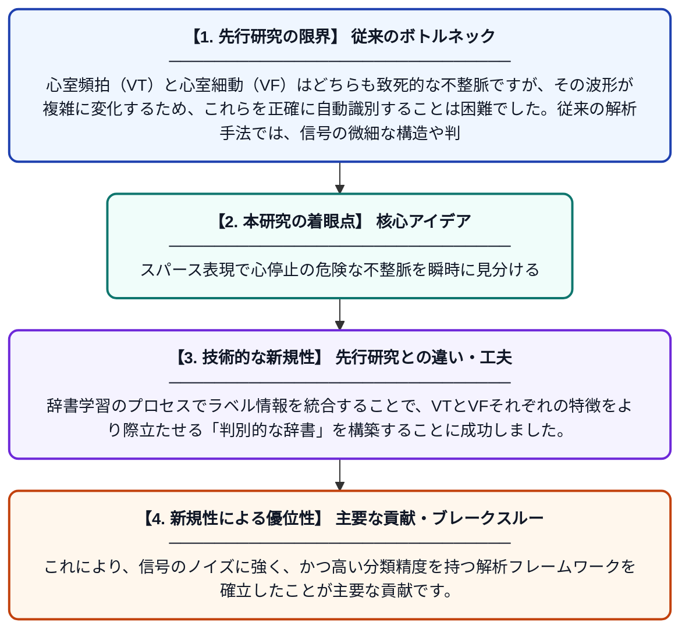

# 心室頻拍と心室細動の解析における判別型スパースコーディング

**Original Title**: *DISCRIMINATIVE SPARSE CODING IN THE ANALYSIS OF*

> **💡 一言要約**: スパース表現で心停止の危険な不整脈を瞬時に見分ける

| 項目 | 内容 |
|---|---|
| **著者** | I Kalaji |
| **アラートキーワード** | sparse coding |
| **原文リンク** | [https://torontomu.scholaris.ca/server/api/core/bitstreams/bfea6cf3-efba-4cf1-abf4-94e8fd5ca2b3/content](https://torontomu.scholaris.ca/server/api/core/bitstreams/bfea6cf3-efba-4cf1-abf4-94e8fd5ca2b3/content) |
| **PDF版要約** | [README.pdf](./README.pdf) |

---

## 📊 新規性の図解（先行研究との違いと本研究のブレークスルー）

## 📝 要約

本研究は、心室頻拍（VT）と心室細動（VF）の波形を正確に分類するために、ラベル一貫性を持つK-SVD（LC-KSVD）という判別型スパースコーディング手法を提案しています。学習データに付随するクラス情報を利用して辞書を構築することで、信号の再構成だけでなく、クラス間の識別能力を最大化する特徴抽出を実現しました。

## ❓ どんな問題に取り組んだか

心室頻拍（VT）と心室細動（VF）はどちらも致死的な不整脈ですが、その波形が複雑に変化するため、これらを正確に自動識別することは困難でした。従来の解析手法では、信号の微細な構造や判別に重要な特徴を十分に抽出できず、誤診のリスクが課題となっていました。

## ✨ 何が新しい？何がすごい？（新規性）

本論文の新規性は、単純に信号を再現するだけでなく、分類精度を高める制約を加えた「LC-KSVD」を心電図解析に導入した点にあります。辞書学習のプロセスでラベル情報を統合することで、VTとVFそれぞれの特徴をより際立たせる「判別的な辞書」を構築することに成功しました。これにより、信号のノイズに強く、かつ高い分類精度を持つ解析フレームワークを確立したことが主要な貢献です。

## 🎓 大学1年生向けの解説

心臓が正しく動かなくなる不整脈にはいくつかの種類があり、その中でも特に危険な2つのタイプを見分けるのは専門家でも難しい場合があります。この研究では「スパースコーディング」という数学的な手法を使い、複雑な心電図を「重要な部品」の組み合わせとして表現しました。さらに、AIが学習する際に「これはVT」「これはVF」という情報をあらかじめ教え込むことで、見分けやすい部品セットを自動で作れるようにしました。これにより、緊急時にどちらの不整脈が起きているかを素早く、正確に判断できるようになります。
