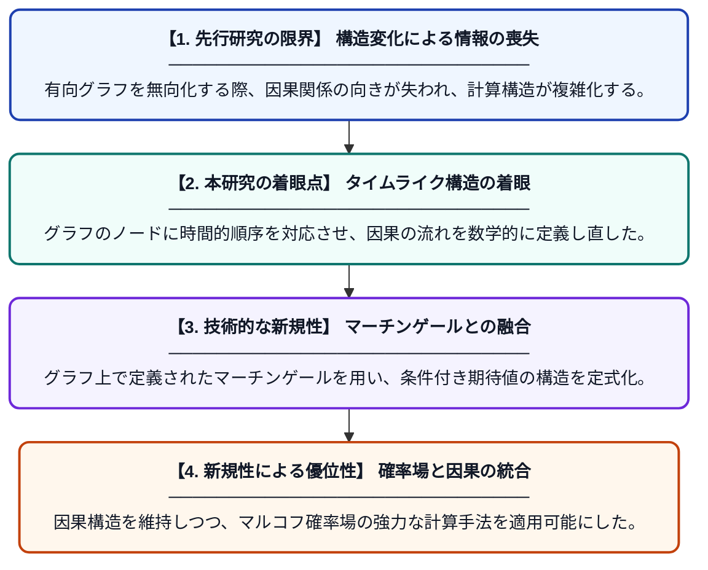

# タイムライク・グラフィカルモデル（時間的順序を持つグラフィカルモデル）

**Original Title**: *c? Copyright 2015 Tvrtko Tadic? Time-like graphical models Tvrtko Tadic? A dissertation*

> **💡 一言要約**: 時間順序と因果を確率場に統合する新理論

| 項目 | 内容 |
|---|---|
| **著者** | K Burdzy, ZQ Chen, S Pal |
| **アラートキーワード** | Markov random"  fields |
| **原文リンク** | [https://digital.lib.washington.edu/server/api/core/bitstreams/e2f6e617-ec9f-4760-9068-7ca6946a1e57/content](https://digital.lib.washington.edu/server/api/core/bitstreams/e2f6e617-ec9f-4760-9068-7ca6946a1e57/content) |
| **PDF版要約** | [README.pdf](./README.pdf) |

---

## 📊 新規性の図解（先行研究との違いと本研究のブレークスルー）

## 📝 要約

本論文は、ベイジアンネットワークをマルコフ確率場に変換する際の「道徳化（moralization）」の過程に着目し、時間的順序を考慮した新しいグラフィカルモデルの理論を構築しています。マルコフ確率場と、グラフ上でインデックス化されたマーチンゲールとの間の数学的接続を明らかにしています。

## ❓ どんな問題に取り組んだか

従来のグラフィカルモデルでは、有向グラフであるベイジアンネットワークを無向グラフのマルコフ確率場に変換する際、親ノード間に強制的にエッジを追加する「道徳化」が必要です。この過程で元の因果関係や時間的な順序構造が数学的に扱いにくくなるという課題がありました。

## ✨ 何が新しい？何がすごい？（新規性）

本研究は「タイムライク・グラフィカルモデル」という概念を導入し、グラフ構造に時間的な方向性を数学的に組み込んだ点が画期的です。特に、グラフ上のノードに紐付けられたマーチンゲール理論を用いることで、確率的な依存関係と因果の流れを統一的に記述する枠組みを提案しました。これにより、従来の道徳化の枠を超えて、より精密な条件付き確率の解析が可能になりました。

## 🎓 大学1年生向けの解説

私たちが「Aが起きたからBが起きる」と予測するとき、時間の流れ（因果関係）を矢印の図で表します。しかし、数学で計算を効率化するために矢印を消して「ただのつながり」に変換すると、時間の前後関係が混ざってしまう問題がありました。この研究は、数学の高度なテクニックを使い、時間の流れを正しく保ったまま複雑な確率を計算するための新しいルールを作ったものです。
