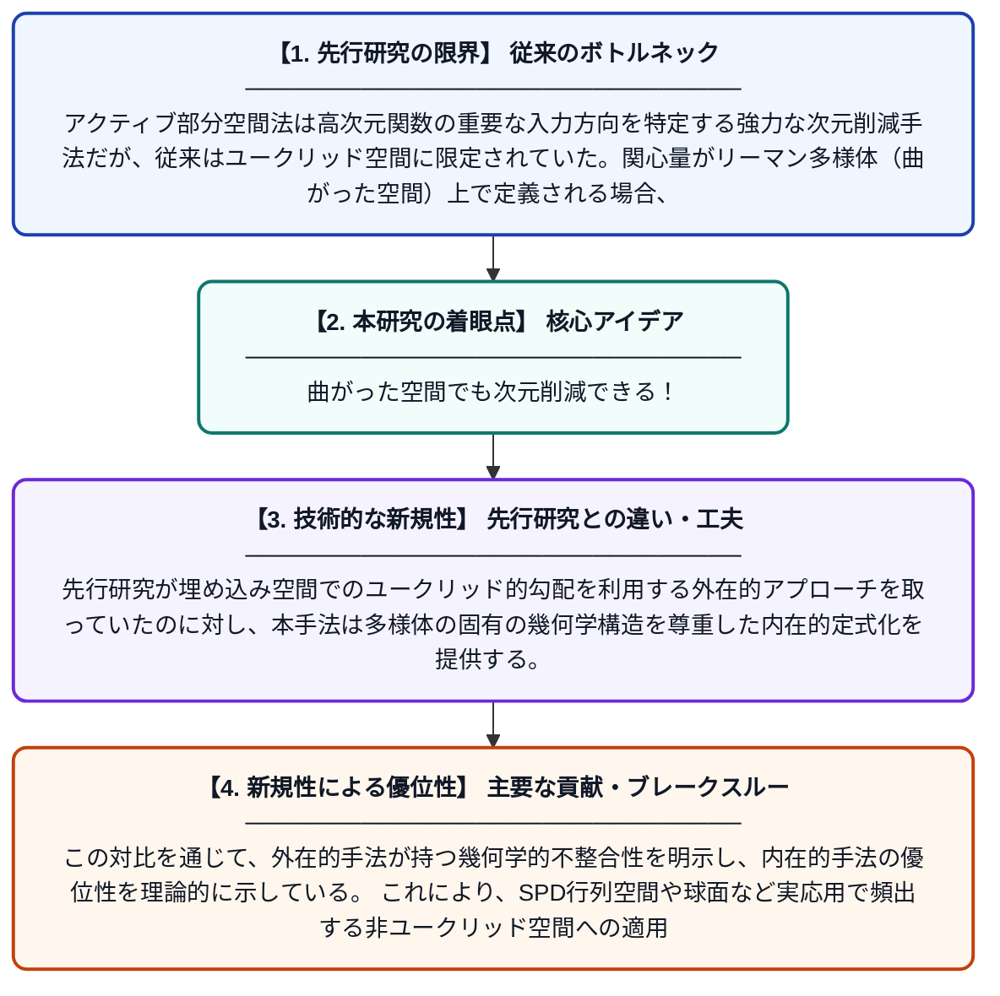

# アクティブ部分空間のリーマン幾何学的視点

**Original Title**: *A Riemannian View on Active Subspaces*

> **💡 一言要約**: 曲がった空間でも次元削減できる！

| 項目 | 内容 |
|---|---|
| **著者** | Z Grey |
| **掲載誌** | arXiv preprint arXiv:2607.25163 2026 |
| **アラートキーワード** | manifold learning |
| **PDF** | [https://arxiv.org/pdf/2607.25163](https://arxiv.org/pdf/2607.25163) |
| **原文リンク** | [https://arxiv.org/pdf/2607.25163](https://arxiv.org/pdf/2607.25163) |
| **PDF版要約** | [README.pdf](./README.pdf) |

---

## 📊 新規性の図解（先行研究との違いと本研究のブレークスルー）

## 📝 要約

本論文は、ユークリッド空間で定義されていたアクティブ部分空間の概念を、リーマン多様体上へ拡張する手法を提案する。平行移送との合成を用いることで、多様体上の関心量に対する内在的（intrinsic）な定式化を実現し、埋め込みに基づく外在的（extrinsic）な勾配アプローチと対比させている。これにより、曲がった空間上のデータ解析や次元削減において、より幾何学的に自然な枠組みが提供される。

## ❓ どんな問題に取り組んだか

アクティブ部分空間法は高次元関数の重要な入力方向を特定する強力な次元削減手法だが、従来はユークリッド空間に限定されていた。関心量がリーマン多様体（曲がった空間）上で定義される場合、既存の手法をそのまま適用すると幾何学的な整合性が失われる問題があった。

## ✨ 何が新しい？何がすごい？（新規性）

本研究は平行移送を用いた合成という概念を導入し、アクティブ部分空間をリーマン多様体上へ内在的に一般化した点が新しい。先行研究が埋め込み空間でのユークリッド的勾配を利用する外在的アプローチを取っていたのに対し、本手法は多様体の固有の幾何学構造を尊重した内在的定式化を提供する。この対比を通じて、外在的手法が持つ幾何学的不整合性を明示し、内在的手法の優位性を理論的に示している。これにより、SPD行列空間や球面など実応用で頻出する非ユークリッド空間への適用が可能となった。

## 🎓 大学1年生向けの解説

「アクティブ部分空間」とは、複雑な関数の中で特に重要な方向を見つけてデータをシンプルにする方法です。これまではまっすぐな（ユークリッド）空間でしか使えませんでしたが、この論文では地球の表面のような「曲がった空間」でも同じことができる方法を考えました。曲がった空間では、場所によって「まっすぐ進む」方向が変わるので、それを補正する「平行移送」というテクニックを使っています。このおかげで、もともとの空間の形を壊さずに大切な方向を正確に見つけられるようになりました。
