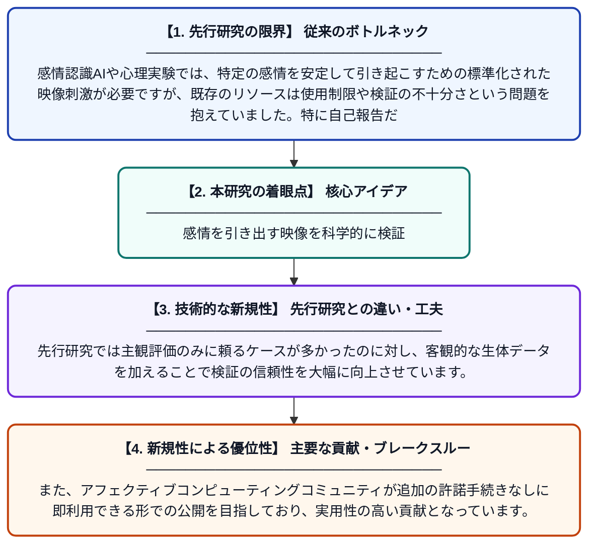

# 基本感情誘発のための映像刺激の検証：自己報告と生理信号を用いたマルチモーダルアプローチ

**Original Title**: *Validation of video stimuli for basic emotion elicitation: A multimodal approach using self-reports and physiological signals*

> **💡 一言要約**: 感情を引き出す映像を科学的に検証

| 項目 | 内容 |
|---|---|
| **著者** | V Machhi, A Shah |
| **アラートキーワード** | affective computing |
| **PDF** | [https://tarupublication.s3.ap-south-1.amazonaws.com/articles/jios-2226.pdf](https://tarupublication.s3.ap-south-1.amazonaws.com/articles/jios-2226.pdf) |
| **原文リンク** | [https://tarupublication.s3.ap-south-1.amazonaws.com/articles/jios-2226.pdf](https://tarupublication.s3.ap-south-1.amazonaws.com/articles/jios-2226.pdf) |
| **PDF版要約** | [README.pdf](./README.pdf) |

---

## 📊 新規性の図解（先行研究との違いと本研究のブレークスルー）

## 📝 要約

本研究は、基本的な感情（喜び・悲しみ・怒りなど）を引き起こすための映像刺激セットを、自己報告と生理信号の両面から検証したものです。アフェクティブコンピューティング（感情を扱うAI・コンピュータ技術）の研究者が手軽に利用できる、信頼性の高い感情誘発リソースの構築を目指しています。主観的な感情評価と客観的な身体反応データを組み合わせることで、映像刺激の妥当性を多角的に確認しています。

## ❓ どんな問題に取り組んだか

感情認識AIや心理実験では、特定の感情を安定して引き起こすための標準化された映像刺激が必要ですが、既存のリソースは使用制限や検証の不十分さという問題を抱えていました。特に自己報告だけでなく生理信号による客観的な検証が不足しており、研究者が共通して利用できる信頼性の高い刺激素材が不足していました。

## ✨ 何が新しい？何がすごい？（新規性）

本研究の新規性は、映像刺激の感情誘発効果を主観的な自己報告と生理信号（心拍・皮膚電気活動など）の両方を組み合わせたマルチモーダルな手法で検証した点にあります。先行研究では主観評価のみに頼るケースが多かったのに対し、客観的な生体データを加えることで検証の信頼性を大幅に向上させています。また、アフェクティブコンピューティングコミュニティが追加の許諾手続きなしに即利用できる形での公開を目指しており、実用性の高い貢献となっています。

## 🎓 大学1年生向けの解説

人間の感情（嬉しい・悲しい・怒りなど）をコンピュータに理解させる研究では、まず人に特定の感情を感じさせる映像が必要です。この研究では、そうした映像が本当に狙った感情を引き起こすかどうかを、アンケート（主観）と心拍や汗などの体の反応（客観）の両方で確かめました。主観だけでは信頼性が低いため、体の反応も同時に測ることでより科学的に証明しています。最終的には、世界中の研究者が自由に使える感情実験用の映像セットを提供することを目指しています。
