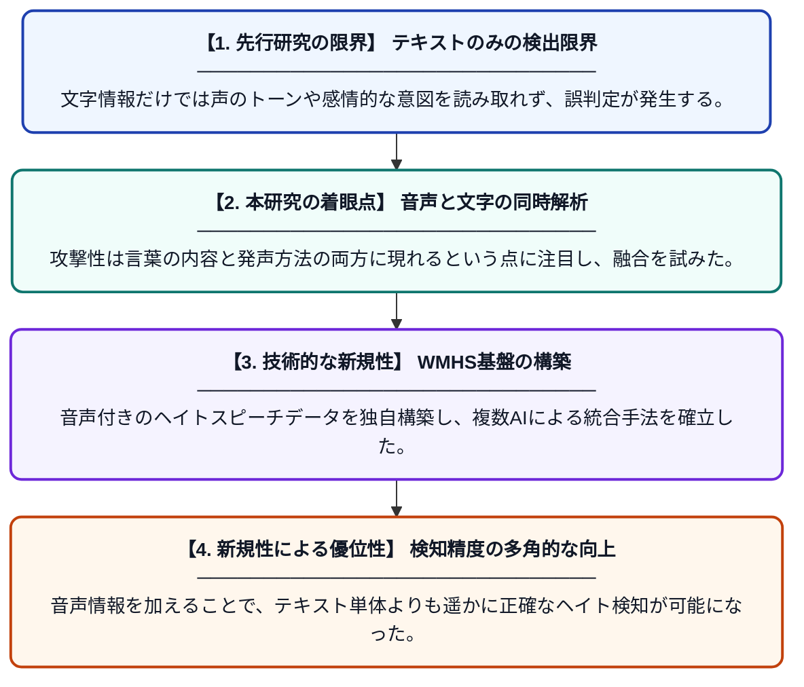

# ワルシャワ・マルチモーダル・ヘイトスピーチ・データベース（WMHS）：音声とテキストを用いた初期検証とベースライン自動検出

**Original Title**: *The Warsaw Multimodal Hate Speech Database (WMHS): Initial Validation and Baseline Automatic Detection Using Speech and Text*

> **💡 一言要約**: 声と文字の融合で、隠れた悪意をAIが正確に暴く。

| 項目 | 内容 |
|---|---|
| **著者** | D Puchała, RA Rammohan, D Küster, T Schultz… |
| **掲載誌** | … on Affective Computing 2026 |
| **アラートキーワード** | affective computing |
| **PDF** | [https://ieeexplore.ieee.org/iel8/5165369/5520654/11777745.pdf](https://ieeexplore.ieee.org/iel8/5165369/5520654/11777745.pdf) |
| **原文リンク** | [https://ieeexplore.ieee.org/iel8/5165369/5520654/11777745.pdf](https://ieeexplore.ieee.org/iel8/5165369/5520654/11777745.pdf) |
| **PDF版要約** | [README.pdf](./README.pdf) |

---

## 📊 新規性の図解（先行研究との違いと本研究のブレークスルー）

## 📝 要約

音声とテキストの両方の情報を含む新しいヘイトスピーチ・データセット「WMHS」を構築し、その有効性を検証した研究です。マルチモーダル（多角的）なアプローチにより、テキストだけでは判断が難しい、感情のトーンを含めたヘイトスピーチの自動検出を可能にしました。

## ❓ どんな問題に取り組んだか

従来のヘイトスピーチ検出は主に「書かれた文字（テキスト）」のみを対象としており、皮肉や怒り、軽蔑といった「声の調子（音声）」に含まれる重要な情報が無視されてきました。そのため、言葉の内容自体は攻撃的でなくても、トーンによってヘイトとなる表現を正確に見分けることが困難でした。

## ✨ 何が新しい？何がすごい？（新規性）

本研究の最大の貢献は、音声とテキストの両方を備えた「WMHSデータベース」を構築し、マルチモーダル学習の効果を実証した点にあります。単にデータを集めるだけでなく、音声の音響的特徴とテキストの言語的特徴を統合するベースラインモデルを提示し、複合的な情報が検出精度を向上させることを示しました。これにより、文脈や感情に依存するより高度な自動検閲システムの基盤を築いています。

## 🎓 大学1年生向けの解説

SNSなどで相手を傷つける言葉を見つけるAIは、これまで「文字」だけを読んで判断していました。しかし、同じ言葉でも笑いながら言うのと、怒鳴りながら言うのでは意味が全く違います。この研究では、文字だけでなく「声の感じ」もセットにしてAIに教えるための巨大なデータ集を作りました。これにより、AIはより人間に近い感覚で「これは本当にひどい攻撃だ」と判断できるようになります。
