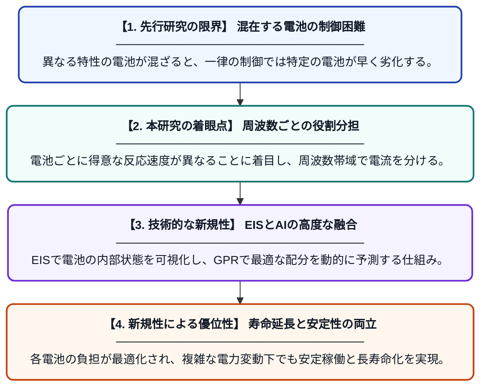

# 電気化学インピーダンス分光法とガウス過程回帰を用いた、自立型直流マイクログリッドにおける不均一蓄電池群の周波数帯域別電流配分

**Original Title**: *Electrochemical-Impedance-Spectroscopy-Informed Gaussian-Process-Regression-Enabled Spectral-Band Current Allocation for Heterogeneous Battery Banks in …*

> **💡 一言要約**: 電池の個性に合わせAIで電流を最適配分し、寿命と安定性を両立

| 項目 | 内容 |
|---|---|
| **著者** | RK Tagayi, M Davari, W Gao, F Blaabjerg, T Chai |
| **掲載誌** | IEEE Transactions on … 2026 |
| **アラートキーワード** | gaussian process |
| **原文リンク** | [https://ieeexplore.ieee.org/abstract/document/11770081/](https://ieeexplore.ieee.org/abstract/document/11770081/) |
| **PDF版要約** | [README.pdf](./README.pdf) |

---

## 📊 新規性の図解（先行研究との違いと本研究のブレークスルー）

## 📝 要約

太陽光発電を備えた自立型直流マイクログリッドにおいて、特性の異なる蓄電池群を最適に運用するための新しい電流配分フレームワークを提案しています。電気化学インピーダンス分光法（EIS）から得られる電池内部の情報をガウス過程回帰（GPR）で処理し、周波数帯域ごとに最適な電流を各電池に割り当てることで、システムの安定化と電池寿命の向上を実現しました。

## ❓ どんな問題に取り組んだか

直流マイクログリッド内には特性や劣化度が異なる様々な蓄電池が混在していますが、これらを一律に制御すると特定の電池に過度な負荷がかかる課題がありました。また、太陽光発電や負荷の急激な変動に対して、各電池の応答性能を最大限に活かしつつ、システム全体の効率を維持する制御手法が不足していました。

## ✨ 何が新しい？何がすごい？（新規性）

本研究の最大の特徴は、EISによる詳細な電池特性診断とGPRという高度な機械学習手法を組み合わせ、周波数帯域別（スペクトルバンド）に電流を配分する点にあります。従来の単純な充放電制御とは異なり、各電池のインピーダンス特性に基づき、得意な反応速度（周波数帯）の負荷を動的に割り当てることができます。これにより、不均一な電池構成であっても、個々の電池の負担を最小限に抑えながら、マイクログリッド全体の電圧安定性を飛躍的に高めることに成功しました。

## 🎓 大学1年生向けの解説

色々な種類の電池を一つの大きなチームとして使うとき、みんなに同じ仕事をさせると、すぐに疲れてしまう電池が出てきてしまいます。この研究では、AIを使って「どの電池が今どんな状態で、どんな速さの動きが得意か」を詳しく調べます。そして、速い動きが得意な電池には細かい変動を、ゆっくりした動きが得意な電池には大きな変動を担当させるように、仕事を賢く振り分けます。これによって、停電しても電気が安定して使え、電池たちも無理をせず長持ちできるようになります。
