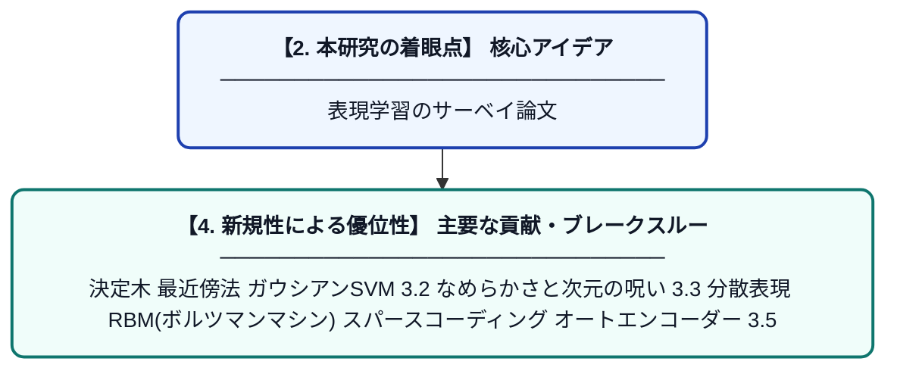

# Representation Learning: A Review and New Perspectives

> **💡 一言要約**: 表現学習のサーベイ論文

| 項目 | 内容 |
|---|---|
| **PDF版要約** | [README.pdf](./README.pdf) |

---

## 📊 新規性の図解（先行研究との違いと本研究のブレークスルー）

## 📝 要約

決定木

最近傍法

ガウシアンSVM

3.2 なめらかさと次元の呪い

3.3 分散表現

RBM(ボルツマンマシン)

スパースコーディング

オートエンコーダー

3.5 Disentangling Factors of Variation

？

3.6 表現学習の良い基準とは？

分類タスクの場合だと、誤分類を減らしたい。

credit assignment problem(貢献度分配問題)

4 BUILDING DEEP REPRESENTATIONS

層ごとに事前学習した結果によってできた特徴量は、通常の機械学習のinputにされたり、あるいはニューラルネットの初期として利用できるよ。

PCAの3つの側面

確率的PCA

オートエンコーダー

多様体学習

ICAは紙面の都合で触れないけど、特徴抽出の手法として重要。

6.1 Directed Graphical Models

sparsecoding

sigmoid belief networks

spike-and-slab sparse coding model → よくわからない

S3CモデルがCifar10とCifar100において、性能が上回った

実際NIP’S 2011で優勝している

マルコフ確率場

普通の主成分分析

分散が最大になるような低次元部分空間を求めそこに射影する。

次元圧縮

確率的主成分分析

この辺がわかりやすいかも↓

観測変数 = 重み * 潜在変数 + 誤差

のような確率モデルを仮定

潜在変数の方が次元が低いので、潜在変数の次元に次元圧縮している

ベイズ主成分分析

カーネル主成分分析

GRBM(Gaussian RBM)

mPoT

ssRBM

mcRBM

オートエンコーダー

確率モデルでは最尤関数の最大化

オートエンコーダーは別の基準

In the case of a linear auto-encoder (linear encoder and decoder) with squared reconstruction error, minimizing Eq. 19 learns the same subspace15 as PCA. This is also true when using a sigmoid nonlinearity in the encoder (Bourlard and Kamp, 1988),

Similarly, Le et al. (2011b) recently showed that adding a regularization term of the form

t
j s3(Wjx(t)) to a linear auto-encoder with tied weights, where s3 is a nonlinear convex function, yields an efficient algorithm for learning linear ICA.

Denoising Auto-Encoders (DAE)

Contractive Auto-Encoders (CAE),

→損失関数にヤコビアンのフロベニウスノルムを入れている。
