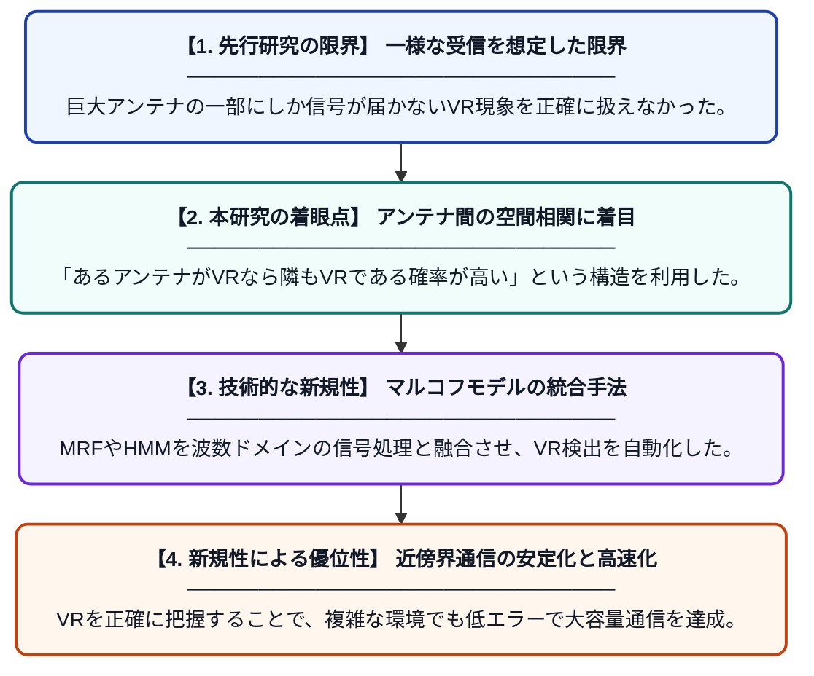

# 超大規模アンテナアレイにおける可視領域検出を強化した近傍界チャネル推定

**Original Title**: *Visibility Region Detection Enhanced Near-Field Channel Estimation for Extremely Large-Scale Antenna Arrays*

> **💡 一言要約**: VR検出で超大規模アンテナの通信精度を劇的に向上

| 項目 | 内容 |
|---|---|
| **著者** | C Wang, H Wang, H Tong, X Wang, L Liu, Y Xu |
| **掲載誌** | IEEE Wireless Communications … 2026 |
| **アラートキーワード** | MRFs Markov |
| **原文リンク** | [https://ieeexplore.ieee.org/abstract/document/11794942/](https://ieeexplore.ieee.org/abstract/document/11794942/) |
| **PDF版要約** | [README.pdf](./README.pdf) |

---

## 📊 新規性の図解（先行研究との違いと本研究のブレークスルー）

## 📝 要約

超大規模アンテナアレイ（XL-MIMO）において、特定のアンテナ群のみが有効に動作する「可視領域（VR）」を正確に特定する新しいチャネル推定手法を提案しています。マルコフ確率場や隠れマルコフモデルなどの構造的事前情報を活用することで、近傍界特有の複雑な電波伝搬特性を効率的に捉えています。

## ❓ どんな問題に取り組んだか

アンテナが巨大化するXL-MIMOでは、物理的な広さゆえに一部のアンテナにしか信号が届かない「可視領域（VR）」が生じます。従来の推定法ではこのVRの存在や空間的な相関を十分に考慮できず、近傍界における通信品質が低下するという課題がありました。

## ✨ 何が新しい？何がすごい？（新規性）

本論文の核心は、VRのモデル化にマルコフ確率場（MRF）や隠れマルコフモデル（HMM）といった構造的統計モデルを導入した点にあります。波数ドメインにおける信念伝播法を用いたOMPアルゴリズムと、マルコフ連鎖メッセージパッシング検出器を組み合わせることで、ノイズ下でも高精度なVR検出とチャネル推定を同時に実現しました。単なる信号処理を超えて、アンテナ間の位置関係という構造的特徴を最大限に活用した点が画期的です。

## 🎓 大学1年生向けの解説

次世代の超高速通信では、壁一面のような巨大なアンテナを使いますが、大きすぎるために「電波が届いているアンテナ」と「届いていないアンテナ」にムラができてしまいます。この研究は、どのアンテナがちゃんと電波を捕まえているかを数学的なモデルを使って賢く見分ける技術を開発しました。これによって、無駄な計算を省きつつ、より確実に大容量のデータを送ることが可能になります。巨大なアンテナをフル活用するための、いわば「視力」を向上させる技術です。
