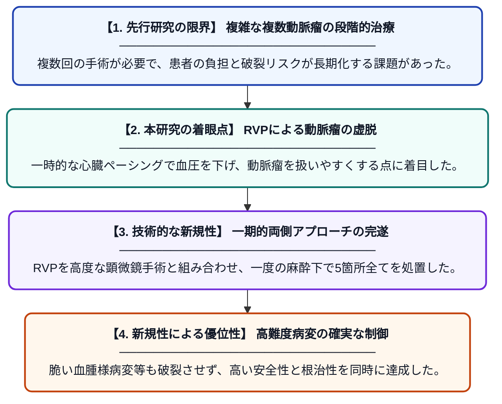

# 急速心室ペーシングを併用した5つの複雑な未破裂前前方循環動脈瘤に対する一期的両側顕微鏡手術：症例報告

**Original Title**: *Single-Stage Bilateral Microsurgical Treatment of Five Complex Unruptured Anterior Circulation Aneurysms Assisted by Rapid Ventricular Pacing: Case Report and …*

> **💡 一言要約**: 超難関の5つの脳動脈瘤を一度の手術で完治

| 項目 | 内容 |
|---|---|
| **著者** | FJ López-González, EG Mendoza Verdin… |
| **掲載誌** | International Medical Case … 2026 |
| **アラートキーワード** | ICA |
| **PDF** | [https://www.tandfonline.com/doi/pdf/10.2147/IMCRJ.S644665](https://www.tandfonline.com/doi/pdf/10.2147/IMCRJ.S644665) |
| **原文リンク** | [https://www.tandfonline.com/doi/pdf/10.2147/IMCRJ.S644665](https://www.tandfonline.com/doi/pdf/10.2147/IMCRJ.S644665) |
| **PDF版要約** | [README.pdf](./README.pdf) |

---

## 📊 新規性の図解（先行研究との違いと本研究のブレークスルー）

## 📝 要約

5つの複雑な未破裂前前方循環動脈瘤を持つ患者に対し、急速心室ペーシング（RVP）を併用した一期的な両側顕微鏡手術による治療に成功した症例報告です。高難度のBarami IIIa型内頚動脈瘤や血腫様病変に対し、RVPによる一時的な血流低減を用いることで、安全かつ精密なクリッピングを実現しました。

## ❓ どんな問題に取り組んだか

複数の複雑な未破裂脳動脈瘤を同時に治療する場合、手術時間の延長や術中の出血制御、重要血管の保護が極めて困難になります。特に、血腫様病変（BBL）のような脆い血管は、従来の血流遮断法だけでは破裂のリスクが高く、安全な処置が課題でした。

## ✨ 何が新しい？何がすごい？（新規性）

左右両側の計5つの複雑な動脈瘤に対し、一度の開頭手術で完結させた点が画期的です。心臓に一時的な電気刺激を与える急速心室ペーシング（RVP）を駆使し、動脈瘤の緊張を瞬時に緩和させることで、従来のクリッピング技術では困難だったBarami IIIa型やBBLへの安全なアプローチを可能にしました。

## 🎓 大学1年生向けの解説

脳の血管にできた5つのコブ（動脈瘤）を、一度の手術で全て治してしまったという驚きの報告です。普通なら数回に分けて行うような大変な手術ですが、心臓を一時的に速く動かして血圧を下げる特殊な技術を使いました。これによって、血管のコブをフニャフニャにして扱いやすくし、破れるリスクを最小限に抑えながら留め金で固定することに成功したのです。
