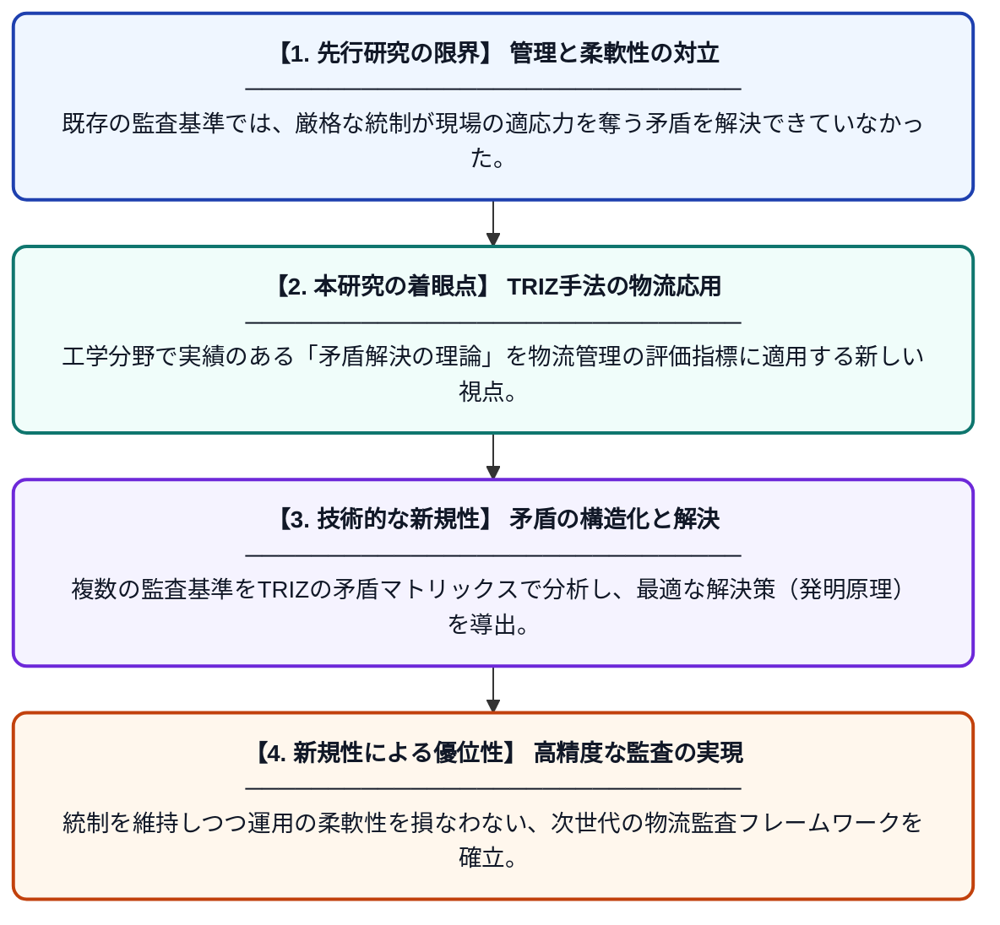

# 物流監査ベンチマークの比較分析：矛盾解決のためのTRIZ手法によるアプローチ

**Original Title**: *Comparative Analysis of Logistics Audit Benchmarks: A TRIZ Method Approach to Resolve Contradictions*

> **💡 一言要約**: TRIZで解く、物流監査の「管理」と「柔軟性」の矛盾

| 項目 | 内容 |
|---|---|
| **著者** | Y Bouaziz, MA Keskes, B Maazoun, D Dhouib |
| **掲載誌** | International TRIZ and Artificial … 2026 |
| **アラートキーワード** | logistics |
| **原文リンク** | [https://link.springer.com/chapter/10.1007/978-3-032-43200-1_8](https://link.springer.com/chapter/10.1007/978-3-032-43200-1_8) |
| **PDF版要約** | [README.pdf](./README.pdf) |

---

## 📊 新規性の図解（先行研究との違いと本研究のブレークスルー）

## 📝 要約

複雑化するサプライチェーンにおいて、物流監査における「管理の厳格さ」と「運用の柔軟性」という相反する要求を両立させる手法を提案しています。発明的な問題解決理論であるTRIZを用いることで、既存の監査基準が抱える固有の矛盾を特定し、それらを解消するための新しいフレームワークを構築しました。

## ❓ どんな問題に取り組んだか

サプライチェーンの複雑化に伴い、物流監査には厳しい統制が求められますが、過度な管理は現場の柔軟な対応を損なうというトレードオフが生じます。これまでの監査基準では、この管理と柔軟性の間の矛盾を体系的に解決し、最適なバランスを導き出す具体的な手法が不足していました。

## ✨ 何が新しい？何がすごい？（新規性）

本研究の最大の特徴は、主に工学や製品開発で使われるTRIZ（発明的問題解決理論）を、物流監査という経営管理分野のベンチマーク比較に応用した点にあります。先行研究が単なる基準の比較に留まっていたのに対し、本研究は基準間の「技術的矛盾」を抽出し、発明原理を適用することで矛盾を解消する動的なアプローチを提示しました。これにより、理論的な枠組みだけでなく、実務における監査プロセスの最適化に直接寄与する貢献をしています。

## 🎓 大学1年生向けの解説

物流の現場では「ルールをしっかり守ること」と「状況に合わせて柔軟に動くこと」のどちらも大切ですが、この2つを同時に叶えるのはとても難しいことです。この論文では、新しいアイデアを生み出すための「TRIZ」という特別な道具を使って、この難しいパズルのような問題を解く方法を考えています。色々な監査のルールを比べることで、厳しさと自由さをうまく両立させるためのヒントを見つけ出しています。
