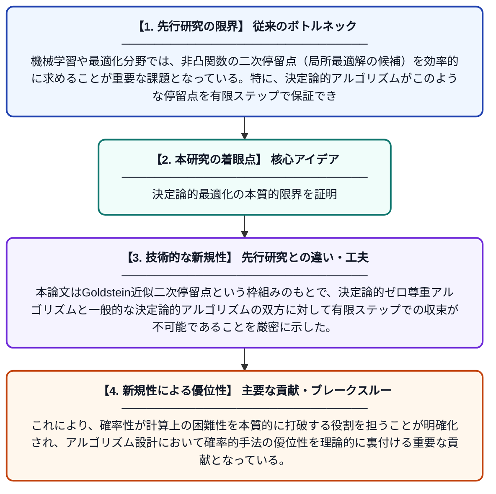

# リプシッツ連続勾配を持つ関数の決定論的二次最適化の困難性について

**Original Title**: *On the hardness of deterministic second-order optimization of functions with Lipschitz gradients*

> **💡 一言要約**: 決定論的最適化の本質的限界を証明

| 項目 | 内容 |
|---|---|
| **著者** | J Guan, AMC So |
| **掲載誌** | arXiv preprint arXiv:2607.24120 2026 |
| **アラートキーワード** | optimization |
| **PDF** | [https://arxiv.org/pdf/2607.24120](https://arxiv.org/pdf/2607.24120) |
| **原文リンク** | [https://arxiv.org/pdf/2607.24120](https://arxiv.org/pdf/2607.24120) |
| **PDF版要約** | [README.pdf](./README.pdf) |

---

## 📊 新規性の図解（先行研究との違いと本研究のブレークスルー）

## 📝 要約

本論文は、リプシッツ連続勾配を持つ関数に対して、Goldstein近似二次停留点を有限回の反復で求めることが、決定論的ゼロ尊重アルゴリズムおよび一般的な決定論的アルゴリズムのいずれによっても不可能であることを示す。これは非凸最適化における決定論的アルゴリズムの本質的な限界を理論的に確立するものである。確率的手法と決定論的手法の間に根本的な計算複雑性の差異が存在することを示唆している。

## ❓ どんな問題に取り組んだか

機械学習や最適化分野では、非凸関数の二次停留点（局所最適解の候補）を効率的に求めることが重要な課題となっている。特に、決定論的アルゴリズムがこのような停留点を有限ステップで保証できるかどうかは未解決の問題であった。本論文はこの問いに対する厳密な理論的回答を与えることを目指している。

## ✨ 何が新しい？何がすごい？（新規性）

先行研究では確率的アルゴリズムによる二次停留点の発見可能性が議論されてきたが、決定論的アルゴリズムに対する下界（不可能性）の理論的証明は欠けていた。本論文はGoldstein近似二次停留点という枠組みのもとで、決定論的ゼロ尊重アルゴリズムと一般的な決定論的アルゴリズムの双方に対して有限ステップでの収束が不可能であることを厳密に示した。これにより、確率性が計算上の困難性を本質的に打破する役割を担うことが明確化され、アルゴリズム設計において確率的手法の優位性を理論的に裏付ける重要な貢献となっている。

## 🎓 大学1年生向けの解説

例えばAIの学習では、「損失関数」と呼ばれる複雑な山や谷のある地形で「良い谷（停留点）」を見つける作業が必要です。この研究は、毎回同じ手順を踏む「決定論的」な方法では、どんなに賢いアルゴリズムを使っても、その良い谷を有限回の計算で必ず見つけることができないことを数学的に証明しました。つまり「サイコロを振るようなランダム性」を取り入れた手法でないと、原理的に解けない問題があることを示しています。これはアルゴリズムの限界を理論的に明らかにする、数学的に非常に重要な発見です。
