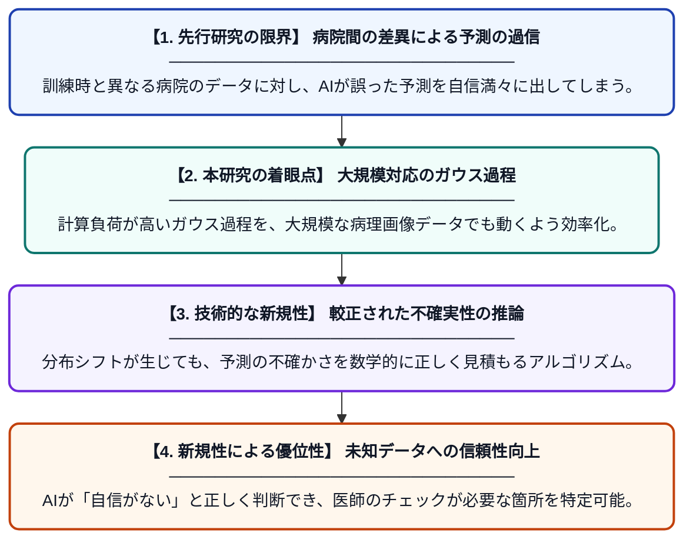

# がん病理画像診断のためのスケーラブルなベイズ的ガウス過程分類：分布シフト下での信頼性の高い不確実性推定

**Original Title**: *Scalable Bayesian Gaussian Process Classification for Cancer Histopathology: Calibrated Uncertainty Under Distribution Shift*

> **💡 一言要約**: 病院間の差異に強く、診断の「迷い」を正しく判定

| 項目 | 内容 |
|---|---|
| **著者** | Y Zheng, WT Chan, S Dsouza, Z Hong |
| **掲載誌** | arXiv preprint arXiv:2611.07127 2026 |
| **アラートキーワード** | gaussian process |
| **原文リンク** | [https://arxiv.org/abs/2611.07127](https://arxiv.org/abs/2611.07127) |
| **PDF版要約** | [README.pdf](./README.pdf) |

---

## 📊 新規性の図解（先行研究との違いと本研究のブレークスルー）

## 📝 要約

病院間のデータの性質の差（分布シフト）によってAIが過信した予測を出す問題を解決するため、大規模データに適用可能なベイズ的ガウス過程分類手法を提案しています。この手法は、未知のデータに対しても不確実性を正しく評価でき、がん診断におけるAIの判断の信頼性を大幅に向上させます。

## ❓ どんな問題に取り組んだか

医療AIは訓練データと異なる病院のデータを扱う際、誤った予測を自信満々に出してしまう「過信」の問題があります。従来のニューラルネットワークや近似的なガウス過程手法では、この分布シフトに対する不確実性の推定が不十分で、医療現場での安全性が課題でした。

## ✨ 何が新しい？何がすごい？（新規性）

本研究は、計算負荷の高いベイズ的ガウス過程（GP）を、大規模な病理画像データセットに適用できるようスケーラブルに拡張しました。先行研究の変分推論に基づく手法とは異なり、分布シフト下でも予測の不確実性を適切に較正（キャリブレーション）できる数学的枠組みを導入しています。これにより、モデルが「自分の知らないデータ」に対して正しく「自信がない」と出力できる点が最大の貢献です。

## 🎓 大学1年生向けの解説

病院で撮影される細胞の写真は、カメラの種類や染色の加減によって病院ごとに少しずつ特徴が異なります。AIは、ある病院のデータで勉強しても、別の病院の写真を見ると、間違っているのに「絶対これだ！」と勘違いすることがあります。この研究は、AIに「これは自分が勉強したことがないタイプのデータだ」と気づかせる魔法のような計算方法を開発しました。これによって、AIが迷ったときには素直に「わかりません」と言えるようになり、お医者さんが最終確認をするための安全装置になります。
