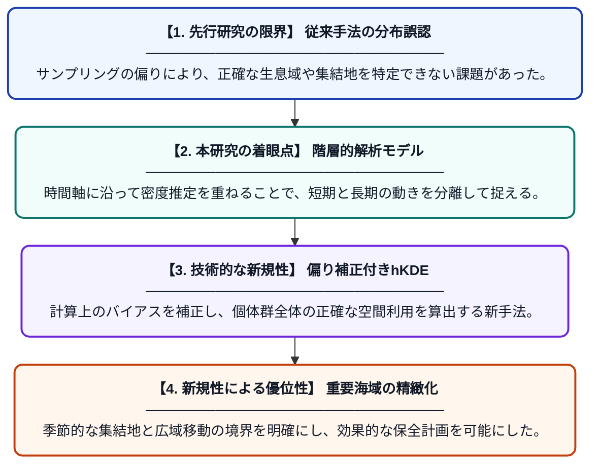

# 海洋島は季節的な集結地：コビレゴンドウにおける限定的な滞在と広域的な移動

**Original Title**: *Oceanic islands as seasonal aggregation sites: restricted residency and wide-ranging movements in short-finned pilot whales*

> **💡 一言要約**: コビレゴンドウの「島の集い」と広大な旅路を解明

| 項目 | 内容 |
|---|---|
| **著者** | MF Morron, M Weyn, R Ferreira, M Rosso, AM Correia… |
| **掲載誌** | 2026 |
| **アラートキーワード** | kernel density estimation |
| **PDF** | [https://link.springer.com/content/pdf/10.1186/s40462-026-00702-5_reference.pdf](https://link.springer.com/content/pdf/10.1186/s40462-026-00702-5_reference.pdf) |
| **原文リンク** | [https://link.springer.com/content/pdf/10.1186/s40462-026-00702-5_reference.pdf](https://link.springer.com/content/pdf/10.1186/s40462-026-00702-5_reference.pdf) |
| **PDF版要約** | [README.pdf](./README.pdf) |

---

## 📊 新規性の図解（先行研究との違いと本研究のブレークスルー）

## 📝 要約

本研究は、コビレゴンドウが海洋島を季節的な集結拠点として利用している実態を、高度な統計手法を用いて明らかにしました。彼らは特定の島周辺に短期間滞在する一方で、それ以外の時期には極めて広範囲な海域を移動していることが判明しました。

## ❓ どんな問題に取り組んだか

海洋島における鯨類の行動解析では、データの偏りによって正確な生息範囲を推定することが困難でした。特に、特定の場所に留まる性質と広域を移動する性質が混在する場合、従来の解析手法では分布の重要度を正しく評価できないという課題がありました。

## ✨ 何が新しい？何がすごい？（新規性）

偏り補正を組み込んだ「階層的カーネル密度推定（hKDE）」を導入し、時間的なサンプリングのムラに左右されない精緻な分布解析を実現しました。これにより、コビレゴンドウが特定の季節に島へ集結する「限定的滞在」と、外洋への「広域移動」という二面性を持つ行動パターンを定量的に証明することに成功しました。個体群レベルでの空間利用を最新の統計モデルで定義し、従来の定点観測では見落とされていた広域的な連結性を可視化した点が最大の貢献です。

## 🎓 大学1年生向けの解説

コビレゴンドウというクジラの仲間が、広い海でどのように過ごしているかを調査した研究です。彼らはいつも同じ場所にいるわけではなく、ある季節には特定の島の周りに集まり、それ以外の時期には驚くほど遠くまで旅をしていることが分かりました。最新の数学的な計算方法を使ってデータの偏りを修正したことで、彼らにとって本当に大切な場所がどこなのかを、これまで以上に正確に地図に描き出すことができました。
