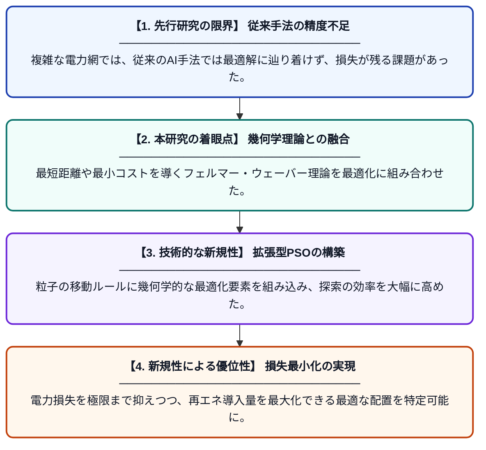

# 再生可能エネルギー導入拡大のための拡張型フェルマー・ウェーバー配置粒子群最適化法

**Original Title**: *Enhanced Fermat-Weber Location Particle Swarm Optimization for Renewable Energy Penetration*

> **💡 一言要約**: 最適配置で再エネ効率を最大化する進化型AI手法

| 項目 | 内容 |
|---|---|
| **著者** | W Haider, QP Ha |
| **掲載誌** | Results in Engineering 2026 |
| **アラートキーワード** | optimization |
| **原文リンク** | [https://www.sciencedirect.com/science/article/pii/S2590123026052503](https://www.sciencedirect.com/science/article/pii/S2590123026052503) |
| **PDF版要約** | [README.pdf](./README.pdf) |

---

## 📊 新規性の図解（先行研究との違いと本研究のブレークスルー）

## 📝 要約

電力網への再生可能エネルギー導入における送電損失の最小化と運用効率の最大化を目指した研究です。幾何学的な最適化手法であるフェルマー・ウェーバー問題の概念を粒子群最適化（PSO）に統合した、新たなアルゴリズム「EFWL-PSO」を提案しています。

## ❓ どんな問題に取り組んだか

再生可能エネルギーを電力系統に導入する際、不適切な設置場所は送電損失の増大や電圧不安定を招きます。複雑な制約がある電力網において、いかに計算負荷を抑えつつ、損失を最小化し効率を最大化する配置場所を特定するかが大きな課題でした。

## ✨ 何が新しい？何がすごい？（新規性）

最短距離コストを求める「フェルマー・ウェーバー問題」の幾何学的理論を、メタヒューリスティクス手法である「粒子群最適化（PSO）」に融合させた点が最大の特徴です。従来のPSOが陥りやすかった局所解への停滞を回避し、空間的な配置効率と物理的な電力損失の双方を同時に最適化する枠組みを構築しました。これにより、従来手法よりも高精度かつ堅牢に、大規模なグリッド環境下での最適解を導き出せるようになりました。

## 🎓 大学1年生向けの解説

太陽光発電や風力発電を「どこに設置すれば電気が無駄にならないか」を計算する新しいAIを作ったという研究です。たくさんのロボットが協力して宝探しをするような計算手法に、数学的な「一番効率の良い場所」を見つけるヒントを組み合わせました。これによって、これまでよりも素早く正確に、地球に優しいエネルギーを効率よく使うための場所が見つけられるようになります。複雑な電気のネットワークを賢く管理するための、強力な助っ人ツールです。
