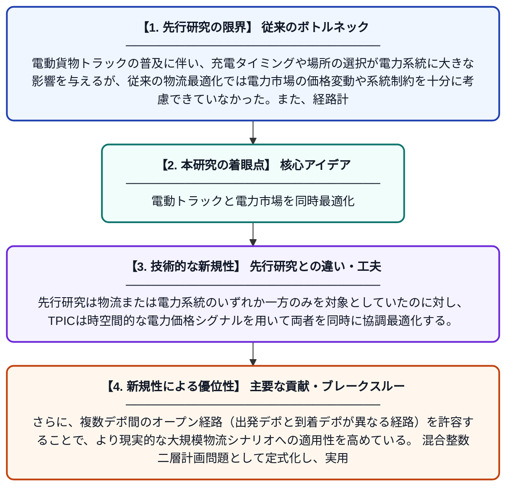

# TPIC：電動貨物トラックの経路・積載・充放電を統合調整する時空間価格駆動型フレームワーク

**Original Title**: *TPIC: A temporal–spatial price-driven integrated coordination framework for routing, loading, and (dis)charging of electric freight trucks*

> **💡 一言要約**: 電動トラックと電力市場を同時最適化

| 項目 | 内容 |
|---|---|
| **著者** | X Liu, Y Ye, X Zhang, G Strbac |
| **掲載誌** | Applied Energy 2026 |
| **アラートキーワード** | VRP |
| **原文リンク** | [https://www.sciencedirect.com/science/article/pii/S0306261926011736](https://www.sciencedirect.com/science/article/pii/S0306261926011736) |
| **PDF版要約** | [README.pdf](./README.pdf) |

---

## 📊 新規性の図解（先行研究との違いと本研究のブレークスルー）

## 📝 要約

本論文は、電動貨物トラックの配送経路計画・積載量決定・充放電スケジューリングを、電力市場の価格シグナルと連動させて統合的に最適化するフレームワーク「TPIC」を提案する。数理的には、複数デポ間のオープン経路を持つ車両経路問題と、配電市場の均衡制約を組み合わせた混合整数二層計画問題として定式化される。これにより、物流コストと充電コストを同時に最小化しながら、電力系統への影響も考慮した意思決定が可能となる。

## ❓ どんな問題に取り組んだか

電動貨物トラックの普及に伴い、充電タイミングや場所の選択が電力系統に大きな影響を与えるが、従来の物流最適化では電力市場の価格変動や系統制約を十分に考慮できていなかった。また、経路計画・積載量・充放電スケジュールをそれぞれ独立に最適化するアプローチでは、全体最適解を得ることが困難であった。

## ✨ 何が新しい？何がすごい？（新規性）

本研究の最大の新規性は、物流分野の車両経路問題（VRP）と電力分野の配電市場均衡制約を二層最適化の枠組みで統合した点にある。先行研究は物流または電力系統のいずれか一方のみを対象としていたのに対し、TPICは時空間的な電力価格シグナルを用いて両者を同時に協調最適化する。さらに、複数デポ間のオープン経路（出発デポと到着デポが異なる経路）を許容することで、より現実的な大規模物流シナリオへの適用性を高めている。混合整数二層計画問題として定式化し、実用的な解法を提示した点も重要な貢献である。

## 🎓 大学1年生向けの解説

宅配便の電動トラックは荷物を届けながら途中で充電する必要がありますが、いつどこで充電するかによって電気料金が大きく変わります。この研究は、どのルートを走るか・荷物をどう積むか・いつ充電するかをまとめて賢く決める方法を考えました。特に面白いのは、電気の値段がリアルタイムで変わる「電力市場」の情報も一緒に使って計算している点です。これにより、物流会社はコストを抑えつつ、電力会社にとっても都合の良いタイミングで充電できるようになります。まるでトラックの運行計画と電力会社の運営計画を同時にパズルのように解く研究です。
