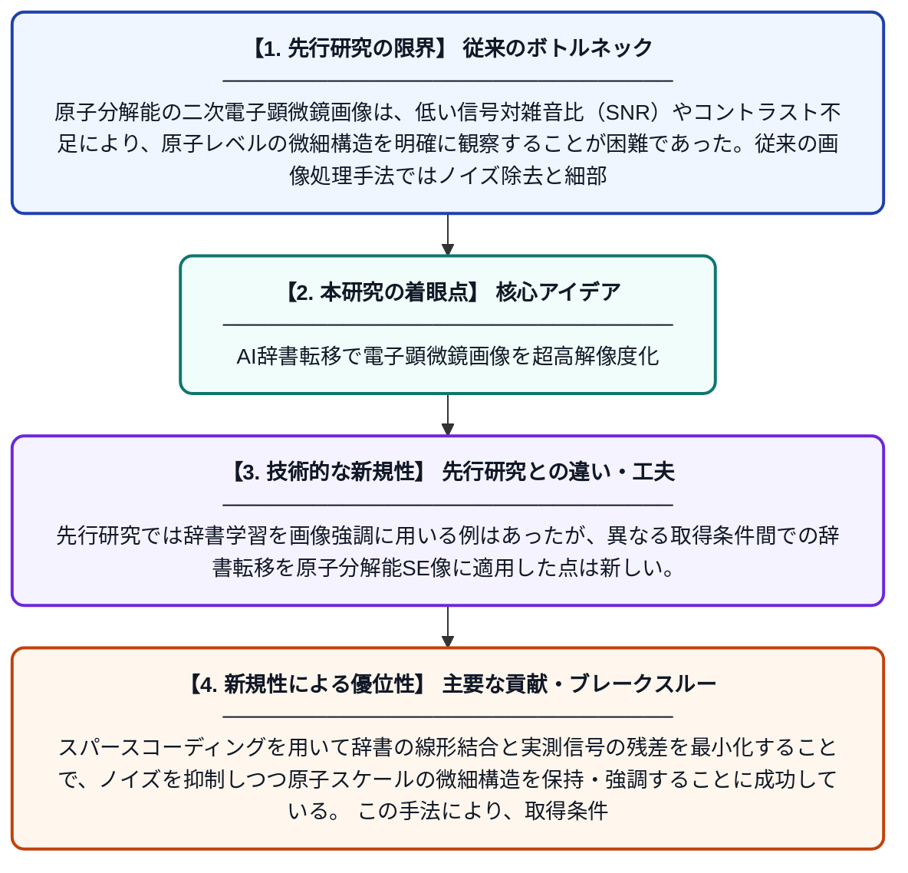

# 原子分解能二次電子像の分解能とコントラストを向上させる辞書学習と転移手法

**Original Title**: *Dictionary Learning and Transfer Methods to Enhance Resolution and Contrast in Atomic Resolution Secondary Electron Images*

> **💡 一言要約**: AI辞書転移で電子顕微鏡画像を超高解像度化

| 項目 | 内容 |
|---|---|
| **著者** | AW Robinson, D Nicholls, J Fernando, J Otte, R Wepf |
| **掲載誌** | Microscopy and Microanalysis 2026 |
| **アラートキーワード** | sparse coding |
| **原文リンク** | [https://academic.oup.com/mam/article/32/Supplement_1/ozag053.619/8743213](https://academic.oup.com/mam/article/32/Supplement_1/ozag053.619/8743213) |
| **PDF版要約** | [README.pdf](./README.pdf) |

---

## 📊 新規性の図解（先行研究との違いと本研究のブレークスルー）

## 📝 要約

本論文は、原子分解能の二次電子（SE）画像において、分解能とコントラストを向上させるために辞書学習とスパースコーディングを応用した手法を提案している。特に「辞書転移」という概念を導入し、高SNR（信号対雑音比）の辞書を低品質なSE信号の強調に活用することを可能にした。スパースコーディングによって辞書の線形結合と観測画像との残差を最小化することで、画像品質を大幅に改善する。

## ❓ どんな問題に取り組んだか

原子分解能の二次電子顕微鏡画像は、低い信号対雑音比（SNR）やコントラスト不足により、原子レベルの微細構造を明確に観察することが困難であった。従来の画像処理手法ではノイズ除去と細部保持のトレードオフが課題となっており、より高度な信号強調技術が求められていた。

## ✨ 何が新しい？何がすごい？（新規性）

本研究の最大の新規性は「辞書転移」手法の導入であり、高SNR条件で学習した辞書を低品質なSE画像の強調処理に転用できる点が革新的である。先行研究では辞書学習を画像強調に用いる例はあったが、異なる取得条件間での辞書転移を原子分解能SE像に適用した点は新しい。スパースコーディングを用いて辞書の線形結合と実測信号の残差を最小化することで、ノイズを抑制しつつ原子スケールの微細構造を保持・強調することに成功している。この手法により、取得条件が限られた実験環境でも高品質な画像解析が可能となる。

## 🎓 大学1年生向けの解説

電子顕微鏡は原子レベルの超微細な構造を観察できる装置ですが、撮影した画像にはノイズ（乱れ）が多く、細部がぼやけてしまうことがあります。この研究では、「辞書学習」というAI技術を使い、画像の典型的なパターンを辞書のように覚えさせることで、ノイズを除去しながら鮮明な画像を復元する方法を開発しました。さらに、品質の良い条件で作った辞書を、品質の悪い画像にも「転用（転移）」できる仕組みを考案しました。これにより、撮影条件が悪くても、原子一つ一つをはっきり見えるような高品質な画像が得られるようになります。
