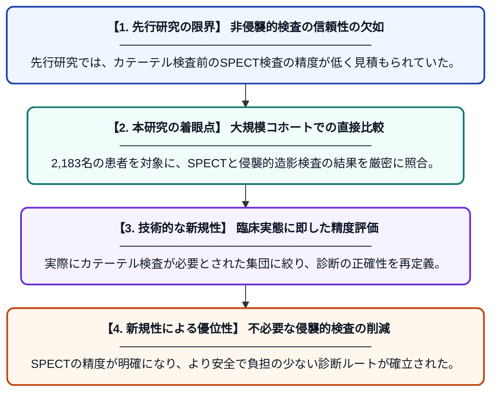

# 閉塞性冠動脈疾患に対する負荷SPECT心筋血流イメージングの侵襲的冠動脈造影と比較した診断精度

**Original Title**: *Diagnostic Accuracy of Stress SPECT Myocardial Perfusion Im-aging Compared with Invasive Coronary Angiography for Obstructive Coronary Artery Disease*

> **💡 一言要約**: 心臓カテーテル検査前のSPECT検査の診断精度を解明

| 項目 | 内容 |
|---|---|
| **著者** | S Ullah, H Ullah, A Fatima |
| **掲載誌** | Heartline Balochistan 2026 |
| **アラートキーワード** | ICA |
| **PDF** | [https://journal.smbzanicq.gob.pk/index.php/smbzanicq/article/download/19/14](https://journal.smbzanicq.gob.pk/index.php/smbzanicq/article/download/19/14) |
| **原文リンク** | [https://journal.smbzanicq.gob.pk/index.php/smbzanicq/article/download/19/14](https://journal.smbzanicq.gob.pk/index.php/smbzanicq/article/download/19/14) |
| **PDF版要約** | [README.pdf](./README.pdf) |

---

## 📊 新規性の図解（先行研究との違いと本研究のブレークスルー）

## 📝 要約

心臓の血流を評価する非侵襲的な検査である負荷SPECT心筋血流イメージング（MPI）の診断精度を、黄金律とされる侵襲的冠動脈造影（ICA）と比較評価した研究です。2,183名の患者を対象とした解析により、カテーテル検査が検討される患者群におけるSPECT検査の信頼性と実用性を検証しています。

## ❓ どんな問題に取り組んだか

冠動脈疾患の診断において、カテーテルを用いる侵襲的検査（ICA）は患者への負担が大きいですが、非侵襲的なSPECT検査の精度については報告によりばらつきがありました。特に、すでにカテーテル検査が必要と判断された患者層におけるSPECTの正確な診断能力が十分に明らかになっていないという課題がありました。

## ✨ 何が新しい？何がすごい？（新規性）

本研究は、2,183名という大規模な患者コホートを対象に、負荷SPECT MPIとICAの直接的な比較を行った点に大きな価値があります。先行研究ではカテーテル検査に回された患者群において非侵襲的検査の精度が低く出る傾向がありましたが、本研究はその実態を詳細に再評価しました。これにより、どのような患者にSPECTが最も有効であるかを示す強力な臨床的エビデンスを提示しています。

## 🎓 大学1年生向けの解説

心臓の血管が詰まる病気を診断する際、細い管を心臓まで通す「カテーテル検査」は確実ですが、体に傷をつけるため負担がかかります。そこで、薬や運動で心臓に負荷をかけ、放射線を使って外から血流を撮影する「SPECT検査」がどれくらい正確に病気を見抜けるかを調べました。2,000人以上のデータを使って、この外からの検査がカテーテル検査の代わりとしてどの程度信頼できるかを明らかにしています。
