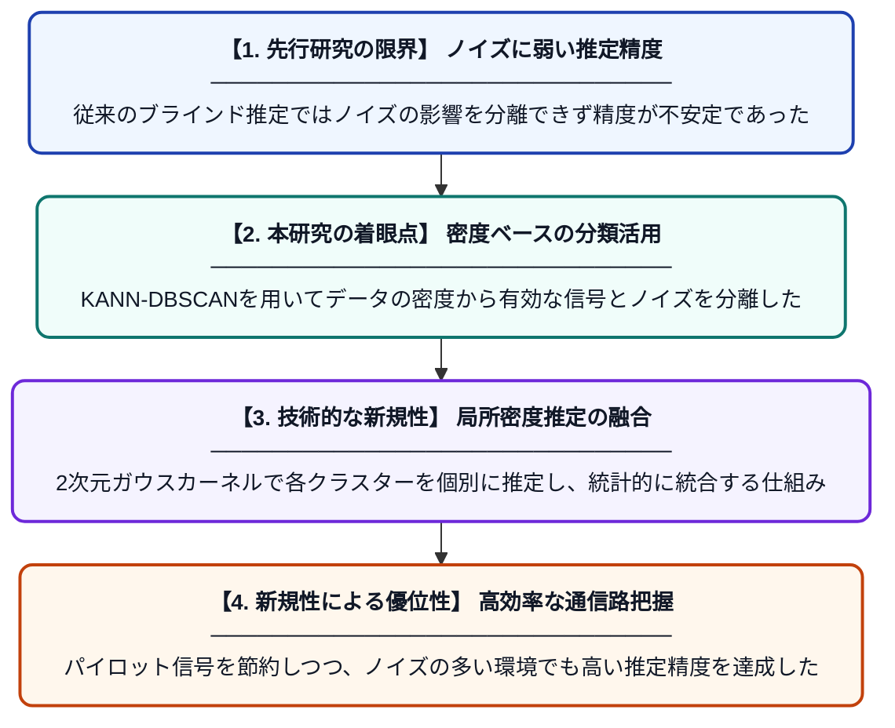

# NB-IoTにおけるブラインドチャネル推定のためのKANN-DBSCANアルゴリズム

**Original Title**: *KANN-DBSCAN algorithm for blind channel estimation in NB-IoT*

> **💡 一言要約**: クラスタリングと密度推定で通信の質を賢く見抜く

| 項目 | 内容 |
|---|---|
| **著者** | X Qin, X Zhang |
| **掲載誌** | Discover Internet of Things 2026 |
| **アラートキーワード** | kernel density estimation |
| **原文リンク** | [https://link.springer.com/article/10.1007/s43926-026-00542-0](https://link.springer.com/article/10.1007/s43926-026-00542-0) |
| **PDF版要約** | [README.pdf](./README.pdf) |

---

## 📊 新規性の図解（先行研究との違いと本研究のブレークスルー）

## 📝 要約

NB-IoT通信において、既知のパイロット信号を使用せずに通信路の状態を推定する新しい手法を提案しています。クラスタリング技術とカーネル密度推定を組み合わせることで、ノイズの影響を効果的に排除し、高精度な通信品質の把握を可能にしました。

## ❓ どんな問題に取り組んだか

NB-IoT（モノのインターネット向け通信）では、限られた通信資源を有効活用するために、既知の信号に頼らない「ブラインド推定」が求められています。しかし、従来のブラインド推定法は周囲のノイズに弱く、データのばらつきが大きい環境では精度が著しく低下するという課題がありました。

## ✨ 何が新しい？何がすごい？（新規性）

本研究は、KANN-DBSCANというクラスタリング手法を導入し、データからノイズを分離した上で、各クラスターに対して独立にカーネル密度推定を行う点が独創的です。2次元ガウスカーネルを用いてクラスターごとの局所的な推定を行い、それらをサンプル割合に応じて統合する新手法を開発しました。これにより、複雑な干渉がある環境下でも、先行研究を上回る安定した推定性能を実現しています。

## 🎓 大学1年生向けの解説

スマホやセンサーがネットにつながる際、電波が通りやすいかどうかを常にチェックする必要があります。この研究では、あらかじめ決められた合図を使わずに、届いたデータの「集まり具合」をAIのような方法で分析して、電波の状態を当てる魔法のような技術を作りました。データの「塊」ごとに詳しく調べることで、ノイズという邪魔なデータに惑わされず、正確に状態を知ることができます。
