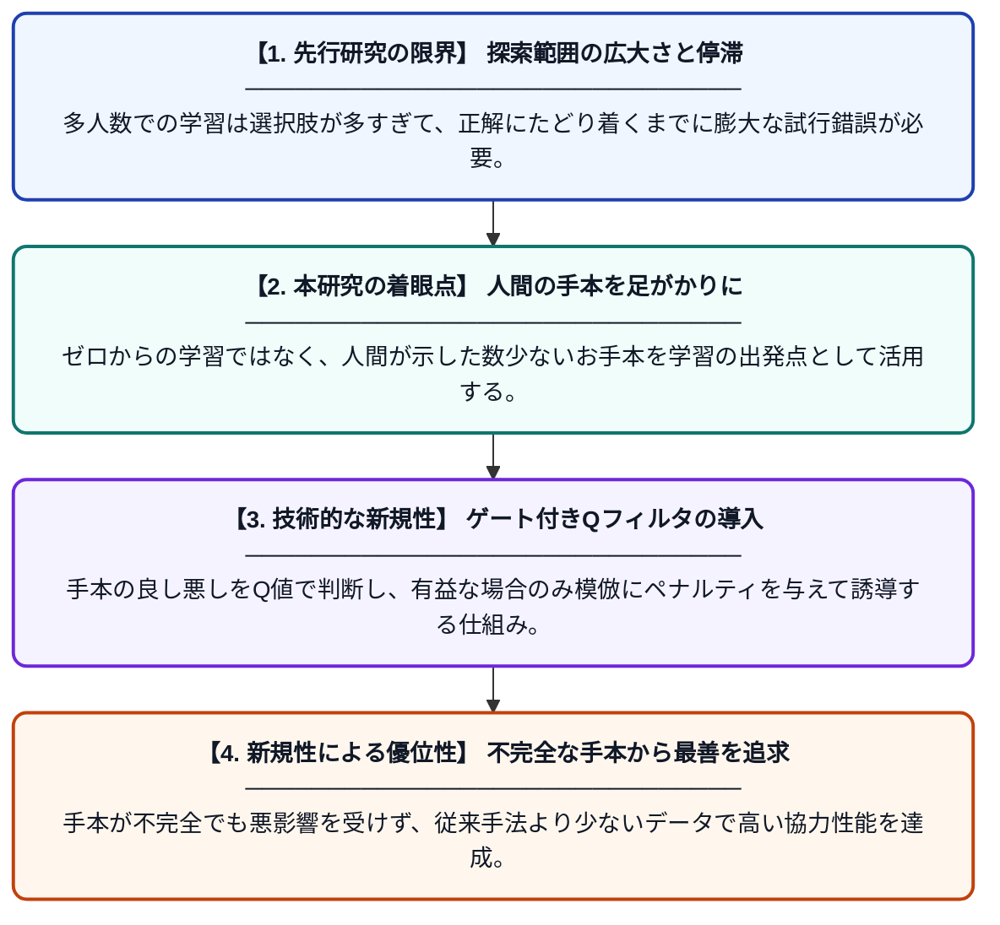

# 模倣によるブートストラップを用いたマルチエージェント強化学習

**Original Title**: *Imitation Bootstrapped Multi-Agent Reinforcement Learning*

> **💡 一言要約**: 人の手本を賢く選別し、多人数AIの学習を劇的に高速化

| 項目 | 内容 |
|---|---|
| **著者** | TH Zhang, C Mattson, DS Brown |
| **掲載誌** | arXiv preprint arXiv:2611.18543 2026 |
| **アラートキーワード** | multi agent |
| **PDF** | [https://arxiv.org/pdf/2611.18543](https://arxiv.org/pdf/2611.18543) |
| **原文リンク** | [https://arxiv.org/pdf/2611.18543](https://arxiv.org/pdf/2611.18543) |
| **PDF版要約** | [README.pdf](./README.pdf) |

---

## 📊 新規性の図解（先行研究との違いと本研究のブレークスルー）

## 📝 要約

少量の人間によるデモンストレーションを活用して、マルチエージェント強化学習の学習を加速させる手法「IBMARL」を提案しました。ゲート付き模倣ペナルティとQフィルタリングを組み合わせることで、質の低いデータに惑わされず、効率的に協調動作を学習することが可能です。

## ❓ どんな問題に取り組んだか

従来のマルチエージェント強化学習は、報酬が稀薄な環境では探索が非常に困難であり、学習に膨大な時間を要するという課題がありました。また、既存の模倣学習を組み合わせる手法では、人間の不完全なデモンストレーションが学習の足を引っ張ってしまうという問題も存在しました。

## ✨ 何が新しい？何がすごい？（新規性）

本研究は、先行研究のIBRLをマルチエージェントへと拡張し、状態ごとに模倣ポリシーを評価する「ゲート付き模倣ペナルティ」を導入しました。これにより、人間の手本が有効な場面のみを選択的に学習へ反映させ、不適切な行動の模倣を防ぐことが可能になりました。また、1人の人間のデモンストレーションだけで複数のエージェントを効率的に訓練できることを実証した点に大きな価値があります。

## 🎓 大学1年生向けの解説

複数のロボットを同時に賢く動かすには、ゼロから練習させると非常に時間がかかります。そこで、この研究では「人間の手本」をヒントとして与えることで、学習をスムーズに進める方法を開発しました。ポイントは、人間の動きが正しいかどうかをAIが自分で判断し、良い部分だけを吸収する仕組みです。これによって、完璧ではない手本からでも、AIたちは自分たちで協力する方法を素早く学べるようになります。
