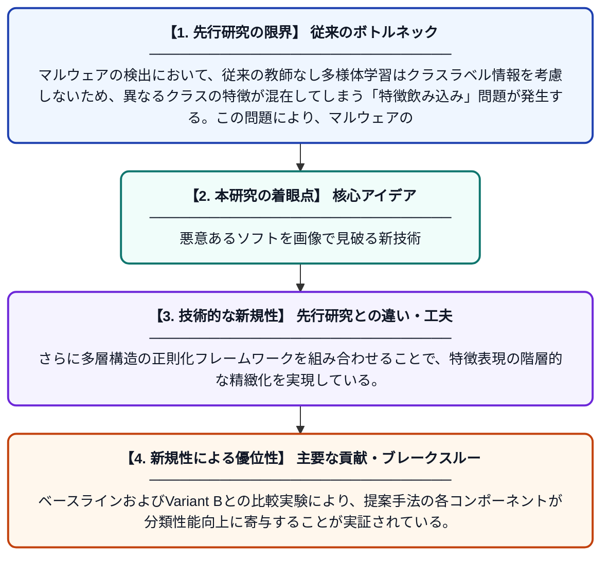

# マルウェア画像分類のための多層教師あり多様体正則化

**Original Title**: *Multi-layer Supervised Manifold Regularization for Malware Image Classification*

> **💡 一言要約**: 悪意あるソフトを画像で見破る新技術

| 項目 | 内容 |
|---|---|
| **著者** | L Wang, J Li, Y Song, Y Ren |
| **掲載誌** | 2026 6th International Conference on Artificial Intelligence … 2026 |
| **アラートキーワード** | manifold learning |
| **原文リンク** | [https://ieeexplore.ieee.org/abstract/document/11621501/](https://ieeexplore.ieee.org/abstract/document/11621501/) |
| **PDF版要約** | [README.pdf](./README.pdf) |

---

## 📊 新規性の図解（先行研究との違いと本研究のブレークスルー）

## 📝 要約

本論文は、マルウェアをバイナリ画像として可視化し、画像分類技術を用いて識別する手法を提案している。従来の教師なし多様体学習が持つ「特徴飲み込み（feature swallowing）」という欠陥を、教師あり局所線形埋め込み（LLE）グラフ構築アルゴリズムで解決する。さらに多層構造の正則化フレームワークを導入することで、マルウェア分類の精度向上を実現した。

## ❓ どんな問題に取り組んだか

マルウェアの検出において、従来の教師なし多様体学習はクラスラベル情報を考慮しないため、異なるクラスの特徴が混在してしまう「特徴飲み込み」問題が発生する。この問題により、マルウェアの種類を正確に分類することが困難になっていた。特に多様化・高度化するマルウェアに対して、既存手法では十分な識別性能が得られないという課題があった。

## ✨ 何が新しい？何がすごい？（新規性）

本研究の核心は、クラスラベル情報を活用した教師ありLLEグラフ構築アルゴリズムを提案し、従来の教師なし手法が抱える「特徴飲み込み」欠陥を根本的に解消した点にある。さらに多層構造の正則化フレームワークを組み合わせることで、特徴表現の階層的な精緻化を実現している。ベースラインおよびVariant Bとの比較実験により、提案手法の各コンポーネントが分類性能向上に寄与することが実証されている。

## 🎓 大学1年生向けの解説

コンピュータウイルスなどの悪意あるプログラム（マルウェア）を、そのデータをカラー画像に変換して「見た目」で種類を分類する研究です。従来の方法では、似ていない種類の特徴が混ざり合ってしまう問題がありました。この研究では、あらかじめ「どの種類か」という答えを教えながら特徴を整理する新しい仕組みを作り、その問題を解決しました。複数の層に分けて特徴を段階的に磨き上げることで、より正確にマルウェアを見分けられるようになりました。
